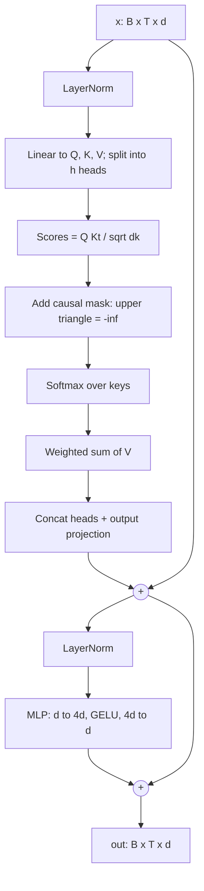

# 01.3 · Attention & the Transformer Block

> **Modality:** text (architecture used by all modalities) · **Prereqs:** [01.2](02-embeddings.md), [00.6](../00-foundations/06-ml-fundamentals.md) · **Used in project:** ✅

## 1. First principles

To predict the next token, each position needs information from earlier positions. Before 2017, RNNs passed a single hidden state step by step. That was sequential (slow) and lossy over long ranges. **Self-attention** lets every position read directly from every allowed position in one parallel matmul.

For input `X ∈ ℝ^{T×d}`:
```
Q = X W_q,  K = X W_k,  V = X W_v
Attention(Q,K,V) = softmax( Q Kᵀ / √d_k  +  M ) V
```
- `Q Kᵀ`: how relevant each key is to each query (`T×T` scores).
- `√d_k` scaling keeps dot products from growing with dimension and saturating the softmax.
- `M` is the **causal mask**: `−∞` above the diagonal, so token `t` can't see `t+1…`. This is what makes a decoder a *language model*.
- **Multi-head:** split `d` into `h` heads of `d/h`. Each head learns a different relation (syntax, coreference, copying), then the heads are concatenated and projected.

A **Transformer block** = attention (mixes information *across* positions) + MLP (transforms *each* position), each wrapped in normalization and a residual connection.

## 2. Diagram



## 3. Deep dive

### Parameter count (no biases, tied head)
Per block: attention `4d²` (Q, K, V, O) + MLP `8d²` (d→4d→d) = **12d²**. Total ≈ `12·L·d² + V·d + block_size·d`.

Check against our 3B rung: `L=16, d=3952` → 12 × 16 × 3952² ≈ **2.999B**, matching the model card's 2,999,532,432.

### Compute & memory
- Attention scores are `T×T` per head, so memory and compute are **O(T²)**. That's why context length is expensive. FlashAttention avoids materializing the matrix (IO-aware tiling) but compute is still O(T²).
- Training FLOPs ≈ **6 · params · tokens** (2 forward + 4 backward).

### Design choices (ours vs modern LLMs)
| Component | Ours (GPT-2 style) | Llama-3 style |
|---|---|---|
| Norm | LayerNorm, pre-norm | RMSNorm, pre-norm |
| Position | Learned absolute | RoPE |
| MLP | GELU, 4× | SwiGLU (gate/up/down), ~2.7× |
| Attention | Full MHA | Grouped-query attention (GQA), fewer K/V heads → smaller KV cache |
| Biases | None | None |

**Pre-norm** (LN before the sublayer) gives a clean residual "highway" and is much more stable for deep stacks than post-norm.

## 4. In our project

- **One `Block` class reused from 984 params to 3B** ([`tiny_llm.py#L24-L37`](https://github.com/SEVT-Logistics-Private-Limited/tiny-llm-jetson/blob/9a7b564c8d764d1eff92218261f2fd2cef99099e/tiny_llm.py#L24-L37)):
  ```python
  mask = torch.triu(torch.ones(T, T, device=x.device), diagonal=1).bool()  # causal
  a = self.ln1(x)
  x = x + self.attn(a, a, a, attn_mask=mask, need_weights=False)[0]
  return x + self.mlp(self.ln2(x))
  ```
  - Pre-norm, bias-free `nn.MultiheadAttention`, 4× GELU MLP.
  - `need_weights=False` lets PyTorch use the fused SDPA kernel.
- **Scaling is config-only:** only `(block_size, n_embd, n_head, n_layer)` changes between rungs. That's the point of the experiment.
  | Rung | d | L | h | Params |
  |---|---|---|---|---|
  | 1 | 8 | 1 | 2 | 984 |
  | 2 | 200 | 2 | 8 | 990K |
  | 5 | 1520 | 36 | 16 | ~998M |
  | 7 | 3952 | 16 | 16 | 3.0B |
  | 8 | 4000 | 16 | 32 | 3.07B |
- **Llama projections as LoRA / ternary targets:** the 3B pipeline targets Llama's `q,k,v,o` (attention) and `gate,up,down` (SwiGLU MLP) projections. That's 7 Linear layers per block × 28 blocks = 196 `BitLinear` swaps ([`finetune_telugu_3b.py#L29`](https://github.com/SEVT-Logistics-Private-Limited/tiny-llm-jetson/blob/9a7b564c8d764d1eff92218261f2fd2cef99099e/compression/finetune_telugu_3b.py#L29)).

## 5. Common pitfalls

- **Mask convention flip:** in `nn.MultiheadAttention`, a *bool* mask `True` means **block**. In some other APIs `True` means **keep**. Getting it wrong leaks future tokens: training loss collapses to ~0, and generation is garbage.
- **Rebuilding the mask every forward** (our code) costs O(T²) allocation per block. Register it once as a buffer, or use `is_causal=True` with `F.scaled_dot_product_attention`.
- **Shallow-and-wide vs deep:** rung 7 (L=16, d=3952) is very wide and shallow. At a fixed budget, deeper models usually generalize better. Width was chosen here to hit param targets.
- **Head dim not dividing `d`:** `n_embd % n_head != 0` crashes. Head dims under ~32 hurt quality (rung 1: d=8, h=2 → head dim 4).
- **Forgetting the √d_k scale** in hand-written attention gives a saturated softmax and vanishing gradients.

## 6. References
- Vaswani et al., *Attention Is All You Need*, arXiv:1706.03762.
- Dao et al., *FlashAttention*, arXiv:2205.14135. Xiong et al., *On Layer Normalization in the Transformer Architecture*, arXiv:2002.04745.
