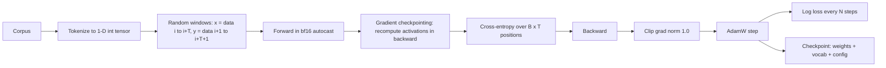

# 01.4 · LLM Training & Scaling

> **Modality:** text · **Prereqs:** [01.3](03-attention-transformer.md), [00.6](../00-foundations/06-ml-fundamentals.md) · **Used in project:** ✅ (core of `tiny-llm-jetson`)

## 1. First principles

An LLM is trained with **self-supervised next-token prediction**. From any text, build inputs `x = t[0:T]` and targets `y = t[1:T+1]` (shifted by one), and minimize cross-entropy at every position in parallel. No labels are needed, because the text supervises itself.

The life cycle has three stages:

| Stage | Data | Objective | Our project |
|---|---|---|---|
| **Pre-training** | Trillions of raw tokens | Next-token CE | Scratch rungs 1–9 (toy and Telugu corpora) |
| **Supervised fine-tuning (SFT)** | Curated prompt→response pairs | CE on response tokens only | LoRA on 8,439 Telugu Q&A ([01.6](06-fine-tuning-lora.md)) |
| **Preference tuning (RLHF/DPO)** | Ranked responses | Prefer chosen over rejected | Not yet used |

### Scaling laws
Loss falls as a power law in **parameters N**, **data D** and **compute C ≈ 6ND**. Chinchilla's result: for a fixed compute budget, the optimum is about **20 tokens per parameter**. A 3B model "wants" ~60B tokens. Scaling N without scaling D just buys memorization.

## 2. Diagram



## 3. Deep dive

### Memory per parameter in training (mixed precision, Adam)
| Item | Bytes/param |
|---|---|
| fp32 master weights | 4 |
| fp32 gradients | 4 |
| Adam m + v | 8 |
| **Total (excluding activations)** | **16** |

For 3B params that's ~48 GB before activations, which is why 3B is near the ceiling of one 80 GB A100.

### The three memory levers we used
1. **bf16 autocast:** matmuls run in bf16 on tensor cores. bf16 has fp32's exponent range, so no loss scaling is needed (a `GradScaler` is harmless but unnecessary with bf16).
2. **Gradient checkpointing:** don't store per-block activations; recompute them during backward. That trades ~30% more compute for activation memory that drops from O(L) blocks to roughly O(1).
3. **Smaller batch:** the blunt lever. It increases gradient noise, which usually needs a lower lr.

### What changes with scale (lessons from our ladder)
- lr must **decrease** as width grows: 3e-3 (1M) → 3e-4 (400M) → 5e-5 (3B) → 3e-5 (3.07B).
- Initial loss grows with width under default init (137 → 2222), a sign of init scale, not a bug in the data.
- Hardware failures move from "doesn't fit" to "allocator fragmentation" (see Jetson notes in [06.1](../06-systems/01-gpu-memory-hardware.md)).

## 4. In our project

**The scaling ladder** (`tiny_llm.py` → `tiny_llm_5b.py`): one architecture, nine rungs, from Jetson Orin Nano to A100-80GB.

| Rung | Params | Hardware | Key technique introduced | Result |
|---|---|---|---|---|
| 1 | 984 | Jetson Orin | End-to-end pipeline | Loss 0.175, partial garbling |
| 2 | 990K | Jetson Orin | 1000× scale | Loss 0.016, **flawless memorization** |
| 3 | 151M | Jetson (+T4) | Batch cut to 8 | Loss oscillated 1–2. lr too high. Allocator crash fixed via `drop_caches`. |
| 4 | 399M | Colab | **bf16 AMP + grad checkpointing + clipping** | ([`tiny_llm_400m.py#L56-L94`](https://github.com/SEVT-Logistics-Private-Limited/tiny-llm-jetson/blob/9a7b564c8d764d1eff92218261f2fd2cef99099e/tiny_llm_400m.py#L56-L94)) |
| 5 | ~998M | A100-80GB | First billion-param run | |
| 6 | 2B | A100-80GB | 3.8 GB checkpoint | |
| 7 | 3.0B | A100-80GB | **bf16 checkpoint cast** for a 6 GB file | Loss 0.1098 |
| 8 | 3.07B | A100-80GB | Hardware max (batch 4) | Best loss 0.0977 |
| 9 | 25M | A100-80GB | **First real language: Telugu samanantar, 50k sentences** | Loss 1.42, produces real Telugu |

Key code (rung 4+):
```python
x = checkpoint(blk, x, use_reentrant=False) if (self.use_ckpt and self.training) else blk(x)
...
with torch.cuda.amp.autocast(dtype=dtype):
    _, loss = model(x, y)
scaler.scale(loss).backward(); scaler.unscale_(opt)
torch.nn.utils.clip_grad_norm_(model.parameters(), 1.0)
```

**Honest takeaway (recorded in the repo):** rungs 1–8 measure *engineering capacity* (can we fit and train N params?), not language ability, because the corpus is a single repeated sentence. Rung 9 is where actual language modeling starts. The roadmap goal, replacing the hosted LLM (Sarvam-105b originally, Gemini today) with our own model, requires the data side to scale next.

Telugu rung: [`tiny_llm_telugu.py`](https://github.com/SEVT-Logistics-Private-Limited/tiny-llm-jetson/blob/9a7b564c8d764d1eff92218261f2fd2cef99099e/tiny_llm_telugu.py). Model cards: [`model-card-*.md`](https://github.com/SEVT-Logistics-Private-Limited/tiny-llm-jetson/tree/main).

## 5. Common pitfalls

- **Scaling N on fixed tiny D:** a 3B model on 8 KB of text is ~10⁻⁹ tokens/param vs Chinchilla's 20. Expect memorization, not capability.
- **No eval split / no fixed eval loss:** the ladder reports single-batch train loss, which can't detect overfitting.
- **Constant lr, no warmup:** large models diverge early. Use warmup + cosine (the LoRA/QAT scripts do this; the scratch rungs don't).
- **`torch.cuda.amp` is deprecated** in favor of `torch.amp.autocast("cuda", ...)`.
- **Checkpoints too big for git:** GitHub LFS caps files at 2–5 GB, so 3B+ checkpoints went to Hugging Face. Many `.pt` files in the repo are LFS pointers.
- **Random-window sampling:** `torch.randint` windows over a tiny corpus repeat heavily. That's fine for toys, but use epoch-based shuffled chunks for real data.

## 6. References
- Radford et al., *GPT-2: Language Models are Unsupervised Multitask Learners* (2019).
- Kaplan et al., *Scaling Laws for Neural Language Models*, arXiv:2001.08361. Hoffmann et al., *Chinchilla*, arXiv:2203.15556.
- Chen et al., *Training Deep Nets with Sublinear Memory Cost*, arXiv:1604.06174.
