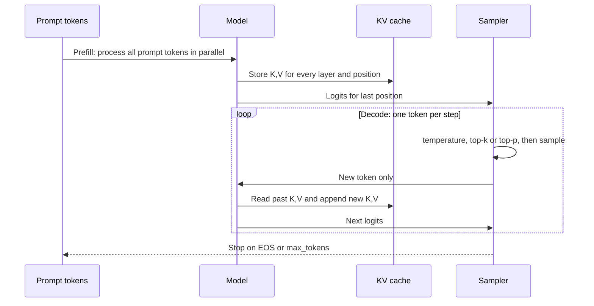

# 01.5 · Decoding & Inference

> **Modality:** text · **Prereqs:** [01.4](04-llm-training-scaling.md) · **Used in project:** ✅

## 1. First principles

A trained LM outputs a probability distribution over the next token. **Generation is a loop:** predict a distribution → pick a token → append it → repeat until EOS or `max_tokens`. The model is the same at training and inference. The *decoding strategy* is a separate choice that strongly shapes the output.

| Strategy | Rule | Behavior |
|---|---|---|
| **Greedy** | `argmax` | Deterministic, can loop or repeat |
| **Sampling** | Draw from `softmax(z / τ)` | Diverse. τ < 1 sharpens, τ > 1 flattens. |
| **Top-k** | Sample from the k most likely | Cuts the long tail |
| **Top-p (nucleus)** | Sample from the smallest set with cumulative p ≥ P | Adaptive tail cut |
| **Beam search** | Keep the B best partial sequences | Good for translation and ASR, bland for chat |

## 2. Diagram



## 3. Deep dive

- **Prefill vs decode:**
  - Prefill is compute-bound (big parallel matmuls). It determines **time-to-first-token (TTFT)**.
  - Decode is **memory-bandwidth-bound**: each step reads all weights to produce one token. It determines **tokens/sec**.
  - Rough ceiling: tokens/s ≈ memory bandwidth / model bytes. The Jetson Orin Nano Super has ~102 GB/s, so a 1.1 GB ternary 3B tops out near ~90 tok/s in theory (less in practice). A 6 GB bf16 3B tops out near ~17 tok/s.
- **KV cache:** without it, step `t` recomputes attention for all `t` tokens (O(T²) total work). With it, each step computes only the new token's Q/K/V. Cache size = `2 · L · T · n_kv_heads · d_head · bytes`. GQA shrinks it.
- **`max_tokens` is a latency knob:** decode time is linear in output length. For voice, every extra sentence is extra seconds before TTS can finish.
- **Stop reasons:** `STOP` (natural EOS), `MAX_TOKENS` (truncated), `SAFETY`. Production code must handle each one.

## 4. In our project

- **Scratch models: naive sampling without a KV cache** ([`tiny_llm.py#L56-L62`](https://github.com/SEVT-Logistics-Private-Limited/tiny-llm-jetson/blob/9a7b564c8d764d1eff92218261f2fd2cef99099e/tiny_llm.py#L56-L62)):
  ```python
  logits, _ = self(idx[:, -block_size:])          # full recompute each step, context cropped
  probs = F.softmax(logits[:, -1, :], dim=-1)     # τ = 1, no top-k/p
  idx = torch.cat([idx, torch.multinomial(probs, 1)], dim=1)
  ```
- **Greedy for evaluation:** both 3B scripts use `do_sample=False` so base-vs-fine-tuned comparisons are deterministic ([`finetune_telugu_3b.py#L194-L199`](https://github.com/SEVT-Logistics-Private-Limited/tiny-llm-jetson/blob/9a7b564c8d764d1eff92218261f2fd2cef99099e/compression/finetune_telugu_3b.py#L194-L199)).
- **Production: a hosted LLM with output caps:**
  - v4.2 cut `max_tokens` to 300 to reduce latency. The current v10 uses `max_output_tokens=500`.
  - `_extract_text_from_response` recovers partial text when `finish_reason == MAX_TOKENS`, because `response.text` raises in google-genai ≥ 2.x ([`api.py#L50-L68`](https://github.com/SEVT-Logistics-Private-Limited/tiny-llm-jetson/blob/9a7b564c8d764d1eff92218261f2fd2cef99099e/voice-assistant/api.py#L50-L68)).
- **Skipping inference entirely:** `INSTANT_RESPONSES` answers time, date and greetings from a lookup table in under 100 ms, never calling the LLM ([`api.py#L141-L157`](https://github.com/SEVT-Logistics-Private-Limited/tiny-llm-jetson/blob/9a7b564c8d764d1eff92218261f2fd2cef99099e/voice-assistant/api.py#L141-L157)). The cheapest token is the one you never generate.

## 5. Common pitfalls

- **No KV cache** in custom generate loops: O(T²) slowdown. Fine at T=128, unusable at 4k.
- **Treating `MAX_TOKENS` as failure:** it discards a usable partial answer. Better: lower `max_tokens` *and* instruct brevity in the prompt so answers finish naturally.
- **Greedy decoding in chat:** degenerate repetition loops. Use τ≈0.7 + top-p 0.9 for conversational output and greedy for evals.
- **Measuring only total latency:** for streaming UX, TTFT matters more than tokens/sec.
- **Decoding mid-UTF-8:** streaming byte-level tokens can split a Telugu character across chunks. Buffer until valid UTF-8.

## 6. References
- Holtzman et al., *The Curious Case of Neural Text Degeneration* (nucleus sampling), arXiv:1904.09751.
- Pope et al., *Efficiently Scaling Transformer Inference*, arXiv:2211.05102.
