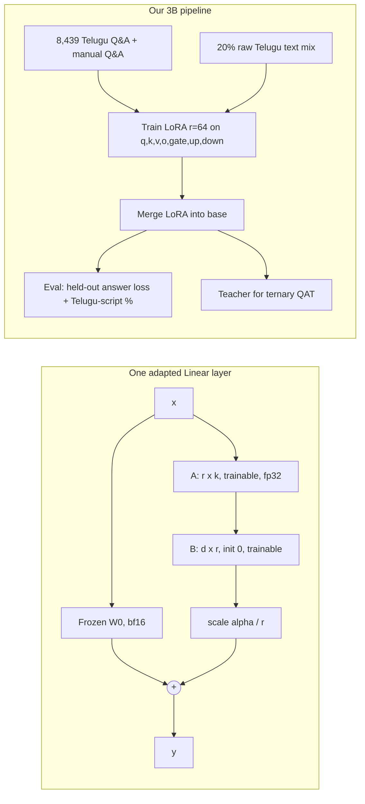

# 01.6 · Fine-tuning: SFT & LoRA

> **Modality:** text · **Prereqs:** [01.4](04-llm-training-scaling.md), [01.1](01-tokenization.md) · **Used in project:** ✅

## 1. First principles

Pre-training gives a model knowledge and language. **Fine-tuning** adapts its *behavior* (format, tone, language, domain) using a small curated dataset.

**Supervised fine-tuning (SFT):** train on `(prompt, response)` conversations with next-token CE, but **compute loss only on the response tokens**. The model should learn to *produce* answers, not to predict user questions or the system prompt.

**Full fine-tuning** updates all weights: 16 bytes/param of state, and a high risk of **catastrophic forgetting**.

**LoRA (Low-Rank Adaptation):** freeze the base weight `W₀ ∈ ℝ^{d×k}` and learn a low-rank update:
```
W = W₀ + (α / r) · B A,    A ∈ ℝ^{r×k},  B ∈ ℝ^{d×r},  r ≪ min(d, k)
```
- `B` is initialized to 0, so training starts exactly at the base model.
- Trainable params per layer: `r(d + k)` instead of `dk`. That's ~1–3% of the model at r=64.
- After training, **merge** `W₀ + (α/r)BA` into a plain dense weight, so there's zero inference overhead.
- Hypothesis: the weight *change* needed for adaptation has low intrinsic rank.

**QLoRA:** the base is stored in 4-bit NF4 and LoRA trains on top. A 3B model fine-tunes in under 10 GB.

## 2. Diagram



## 3. Deep dive

- **Answer-only loss masking:** set labels to `-100` (PyTorch's `ignore_index`) for system and user tokens. Without it, the model spends capacity memorizing prompts, and small datasets get dominated by the repetitive system prompt.
- **Rank & alpha:**
  - r=8–16 is enough for style or format.
  - r=64+ suits new language or domain behavior.
  - `α = 2r` is a common default (ours: r=64, α=128).
- **Target modules:** attention-only LoRA is cheaper. Adding MLP projections (gate/up/down) helps knowledge-heavy adaptation.
- **Learning rate:** LoRA tolerates ~10× higher lr than full FT (2e-4 typical) because the update is low-rank and starts at zero.
- **Data mixing to fight forgetting:** blend general-domain text into SFT batches.
- **SFT vs RAG:** SFT changes *how* the model answers (language, style, format). RAG changes *what facts* it can access at query time. Facts that change (manuals, prices) belong in RAG, not weights. See [01.9](09-rag.md).

## 4. In our project

`compression/finetune_telugu_3b.py` is Step 1 of the 3B pipeline. It teaches Llama-3.2-3B-Instruct to answer in Yodha's Telugu style.

| Design decision | Implementation | Link |
|---|---|---|
| Flexible data ingestion | `.jsonl`/`.csv`; `question/answer`, `instruction/output`, `prompt/response` or `messages` | [`#L35-L52`](https://github.com/SEVT-Logistics-Private-Limited/tiny-llm-jetson/blob/9a7b564c8d764d1eff92218261f2fd2cef99099e/compression/finetune_telugu_3b.py#L35-L52) |
| Same system prompt as production | `SYSTEM_PROMPT` mirrors `build_system()` minus live time | [`#L22-L28`](https://github.com/SEVT-Logistics-Private-Limited/tiny-llm-jetson/blob/9a7b564c8d764d1eff92218261f2fd2cef99099e/compression/finetune_telugu_3b.py#L22-L28) |
| Answer-only labels, multi-turn safe | Per assistant turn, prompt tokens → `-100`. Asserts the chat template is prefix-stable. | [`#L55-L70`](https://github.com/SEVT-Logistics-Private-Limited/tiny-llm-jetson/blob/9a7b564c8d764d1eff92218261f2fd2cef99099e/compression/finetune_telugu_3b.py#L55-L70) |
| Loss only on kept tokens, fp32 upcast | `F.cross_entropy(logits[keep].float(), tgt[keep])` | [`#L105-L111`](https://github.com/SEVT-Logistics-Private-Limited/tiny-llm-jetson/blob/9a7b564c8d764d1eff92218261f2fd2cef99099e/compression/finetune_telugu_3b.py#L105-L111) |
| LoRA r=64, α=128, all 7 projections; LoRA weights in fp32, base in bf16 | `add_lora` | [`#L114-L121`](https://github.com/SEVT-Logistics-Private-Limited/tiny-llm-jetson/blob/9a7b564c8d764d1eff92218261f2fd2cef99099e/compression/finetune_telugu_3b.py#L114-L121) |
| Raw Telugu mixing (20% of batch slots from samanantar) | `batches(..., text_mix)` | [`#L90-L102`](https://github.com/SEVT-Logistics-Private-Limited/tiny-llm-jetson/blob/9a7b564c8d764d1eff92218261f2fd2cef99099e/compression/finetune_telugu_3b.py#L90-L102) |
| Colab-disconnect-proof training | Atomic `train_state.pt` (tmp + `os.replace`) every 200 steps / 30 min, auto-resume | [`#L128-L173`](https://github.com/SEVT-Logistics-Private-Limited/tiny-llm-jetson/blob/9a7b564c8d764d1eff92218261f2fd2cef99099e/compression/finetune_telugu_3b.py#L128-L173) |
| Merge for deployment / teacher | `PeftModel.from_pretrained(...).merge_and_unload()` | `main()` merge stage |

Effective batch is 8 × 2 accumulation = 16. 8,439 pairs × 3 epochs ≈ 2,000 steps ≈ 1–3 h on an A100.

Separately, the README reports a conversational Telugu fine-tune: maya-research/IndicVault, 93,028 samples, 3 epochs, loss 2.17 → 0.76, published as `RishikUttejSasanala/tiny-llm-telugu-conv` on Hugging Face. The training script for that run isn't in the repo.

## 5. Common pitfalls

- **Training on prompt tokens:** the model parrots questions. Verify by decoding the tokens where `labels != -100`; they should be answers only.
- **Truncation eating the answer:** if `max_len` cuts the whole response, the example has zero trainable tokens. The script filters these: `any(l != IGNORE ...)`.
- **Chat template mismatch** between training and serving (e.g., serving via a different API that formats turns differently).
- **Overfitting tiny data:** 3 epochs on 8k pairs is reasonable. 10+ epochs memorizes. Watch held-out answer loss.
- **Forgetting to merge** (or merging into the wrong base revision): the adapter is tied to the exact base weights.
- **Expecting LoRA to inject facts reliably:** it teaches style well and facts poorly, and it hallucinates confidently on near-miss questions. Use RAG for facts.

## 6. References
- Hu et al., *LoRA*, arXiv:2106.09685. Dettmers et al., *QLoRA*, arXiv:2305.14314.
- Ouyang et al., *InstructGPT*, arXiv:2203.02155.
