# 01.7 · Quantization, Distillation & Compression

> **Modality:** text (applies to all models) · **Prereqs:** [00.1](../00-foundations/01-data-as-numbers.md), [01.5](05-decoding-inference.md) · **Used in project:** ✅

## 1. First principles

Decode speed is bounded by **bytes moved per token**, and deployability by **bytes stored**. Compression shrinks the bytes per weight while preserving the function the model computes.

**Quantization** maps floats to a small integer set plus a scale:
```
q = clamp(round(w / s), qmin, qmax)      ŵ = q · s
```
- **Granularity of `s`:** per-tensor → per-channel/row → **per-group** (e.g., 128 weights). Finer groups give less error but more scale overhead.
- **Symmetric vs asymmetric** (an added zero-point).

| Method | When | Bits | Quality | Cost |
|---|---|---|---|---|
| **PTQ** (post-training quantization) | After training, no gradients | 8 / 4 | 8-bit ≈ lossless, 4-bit ~97–99% | Minutes |
| **QAT** (quantization-aware training) | Train with quantization in the forward pass | 4 / 2 / **1.58** | Recovers most quality | Hours–days |
| **Distillation** | A student learns to match a teacher's output distribution | n/a | Transfers "dark knowledge" | Training run |

**Ternary (1.58-bit):** weights ∈ {−1, 0, +1} × s, and log₂3 ≈ 1.58 bits of information. Matmuls become additions and subtractions. BitNet b1.58 showed this works if trained with quantization from the start, or with QAT plus distillation.

**Straight-through estimator (STE):** `round()` has zero gradient almost everywhere. STE uses the quantized weight in the forward pass but passes the gradient to the full-precision "latent" weight as if quantization were the identity:
`w_q = w + (q(w) − w).detach()`

## 2. Diagram

```mermaid
flowchart TB
    subgraph PathA["Path A: PTQ 4-bit, about 15 min"]
        HF["HF bf16 3B, 6.4 GB"] --> GG["convert_hf_to_gguf bf16"] --> QZ["llama-quantize Q4_K_M"] --> OUT1["GGUF about 2.0 GB"]
    end
    subgraph PathB["Path B: Ternary QAT + distillation, hours to days"]
        TEA["Teacher: Telugu-tuned 3B bf16, frozen"] --> KL["KL to teacher logits"]
        STU["Student: copy with 196 Linear to BitLinear"] --> RAMP["Ramp strength 0 to 1 over 500 steps"]
        RAMP --> FWD["Forward with w_q = w + s*(q-w).detach"]
        FWD --> KL
        FWD --> CE["CE on real Telugu text"]
        KL --> LOSS["Loss = 0.5 KL + 0.5 CE"]
        CE --> LOSS
        LOSS --> UPD["AdamW8bit on latent fp32 weights"]
        UPD --> EXP["Export: 2-bit codes 4 per byte + fp16 scale per 128 + int8 embeddings"]
        EXP --> OUT2["about 1.1 GB"]
    end
```



## 3. Deep dive

- **Why per-group 128:** one outlier weight inflates the scale for its whole group. Small groups contain the blast radius. The overhead is 16 bits / 128 weights = 0.125 bits/weight.
- **Why ramp to ternary:** snapping a pretrained model straight to ternary destroys it, and the loss spikes beyond recovery. Interpolating `w → q(w)` over N steps lets the latent weights migrate.
- **Distillation loss:** `KL(teacher ‖ student)` over the full vocabulary carries far more signal per token than one-hot CE. Temperature `T` softens both distributions; multiply by `T²` to keep gradient scale.
- **Why keep embeddings at 8-bit:** embedding rows are looked up, not summed over many inputs. Per-row errors aren't averaged out, so they're fragile at low bits.
- **Size math (Llama-3.2-3B, from the repo):** ternary layer weights 0.70 GB + scales 0.04 GB + int8 embeddings 0.39 GB ≈ **1.1 GB**, vs 6.4 GB bf16. That's 5.8× smaller.
- **Format/runtime coupling:** a compressed file is only useful if a runtime has kernels for it. Custom packing needs a converter (llama.cpp's `TQ1_0`/`TQ2_0` use a different layout).

## 4. In our project

`compression/ternary_qat_3b.py`, "PrismML-style" (inspired by PrismML Bonsai):

| Piece | Code | Link |
|---|---|---|
| `BitLinear` with group-128 absmean ternarization + STE + `strength` buffer | `ternarize`, `forward` | [`#L25-L48`](https://github.com/SEVT-Logistics-Private-Limited/tiny-llm-jetson/blob/9a7b564c8d764d1eff92218261f2fd2cef99099e/compression/ternary_qat_3b.py#L25-L48) |
| Swap every `nn.Linear` except `lm_head`, sharing weights | `to_bitlinear` | [`#L51-L66`](https://github.com/SEVT-Logistics-Private-Limited/tiny-llm-jetson/blob/9a7b564c8d764d1eff92218261f2fd2cef99099e/compression/ternary_qat_3b.py#L51-L66) |
| KL + CE distillation loss (α=0.5) | `distill_loss` | [`#L109-L117`](https://github.com/SEVT-Logistics-Private-Limited/tiny-llm-jetson/blob/9a7b564c8d764d1eff92218261f2fd2cef99099e/compression/ternary_qat_3b.py#L109-L117) |
| 8-bit Adam (saves ~18 GB), warmup + cosine, 500-step ramp, atomic resume | `make_optimizer`, `run_qat` | [`#L120-L178`](https://github.com/SEVT-Logistics-Private-Limited/tiny-llm-jetson/blob/9a7b564c8d764d1eff92218261f2fd2cef99099e/compression/ternary_qat_3b.py#L120-L178) |
| Pack {-1,0,1} → {0,1,2}, 4 codes per byte | `pack_codes` / `unpack_codes` | [`#L181-L189`](https://github.com/SEVT-Logistics-Private-Limited/tiny-llm-jetson/blob/9a7b564c8d764d1eff92218261f2fd2cef99099e/compression/ternary_qat_3b.py#L181-L189) |
| Export with int8 per-row embeddings + size report | `export_packed` | [`#L192-L212`](https://github.com/SEVT-Logistics-Private-Limited/tiny-llm-jetson/blob/9a7b564c8d764d1eff92218261f2fd2cef99099e/compression/ternary_qat_3b.py#L192-L212) |
| Reload packed file → HF model → perplexity vs teacher | `load_compressed`, `perplexity` | [`#L226-L248`](https://github.com/SEVT-Logistics-Private-Limited/tiny-llm-jetson/blob/9a7b564c8d764d1eff92218261f2fd2cef99099e/compression/ternary_qat_3b.py#L226-L248) |

**Why not compress our own 3B?** In the repo's own words: `tiny_llm_3b.pt` memorized one sentence, and "compression keeps what a model already knows, it cannot add knowledge". So the pipeline compresses a *real* pretrained 3B after Telugu LoRA.

**Memory budget on A100-80GB:** student fp32 13 GB + grads 13 GB + 8-bit Adam 6.5 GB + teacher bf16 6.5 GB + activations 10–15 GB ≈ 50–55 GB.

**Path A** (llama.cpp Q4_K_M GGUF) is documented in [`compression/README.md`](https://github.com/SEVT-Logistics-Private-Limited/tiny-llm-jetson/blob/9a7b564c8d764d1eff92218261f2fd2cef99099e/compression/README.md) as the fast baseline.

**Tests:** CPU tests with tiny random models cover layer swap, training, resume, pack/unpack round-trip and reload ([`test_ternary_qat.py`](https://github.com/SEVT-Logistics-Private-Limited/tiny-llm-jetson/blob/9a7b564c8d764d1eff92218261f2fd2cef99099e/compression/test_ternary_qat.py)).

## 5. Common pitfalls

- **Comparing compressed models only by size:** always report perplexity on a held-out set *and* side-by-side task outputs. The script's `eval` stage does both.
- **QAT data too small:** ~50M tokens (3,000 steps) is far below what BitNet-style models train on. Expect a noticeable quality loss, and budget 10k–30k steps.
- **Teacher ceiling:** the student can't exceed the teacher. Fine-tune first (Step 1), then compress.
- **Shape constraints:** `in_features % 128 != 0` fails the assert. Check every target layer.
- **No runtime for the custom format:** `ternary_model.pt` currently runs only via PyTorch dequantization, which **doesn't realize the speedup**. Edge latency gains need a ternary kernel (llama.cpp converter, or bitnet.cpp).
- **Quantizing `lm_head` / embeddings aggressively:** a disproportionate quality drop.

## 6. References
- Ma et al., *The Era of 1-bit LLMs: BitNet b1.58*, arXiv:2402.17764.
- Hinton et al., *Distilling the Knowledge in a Neural Network*, arXiv:1503.02531.
- Bengio et al., *Estimating or Propagating Gradients Through Stochastic Neurons* (STE), arXiv:1308.3432.
- Frantar et al., *GPTQ*, arXiv:2210.17323.
