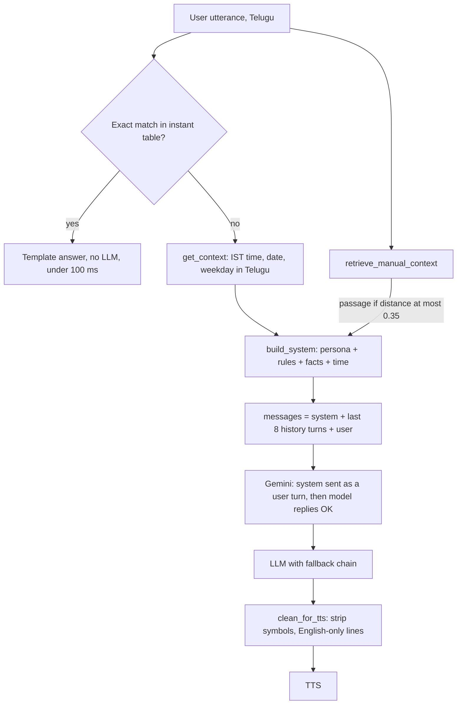

# 01.8 · Prompt Engineering & Context Injection

> **Modality:** text · **Prereqs:** [01.5](05-decoding-inference.md) · **Used in project:** ✅

## 1. First principles

An instruction-tuned LLM computes `P(response | context)`. **Everything the model knows about this request is in its context window.** It has no memory of earlier requests, no clock and no access to your database. Prompt engineering is the discipline of constructing that context deliberately.

A production prompt is assembled from layers:

| Layer | Content | Changes |
|---|---|---|
| **System / persona** | Identity, language, tone, output constraints | Per deployment |
| **Dynamic context** | Current time, user profile, retrieved documents (RAG) | Per request |
| **Conversation history** | Prior turns (windowed) | Per turn |
| **User message** | The actual question | Per turn |

Prompting is the cheapest lever, then RAG, then fine-tuning. Use the cheapest one that works.

## 2. Diagram

## 3. Deep dive

- **Be explicit about output modality.** A voice assistant must forbid markdown, lists and symbols, because TTS reads `*` and `#` aloud. Prompting reduces violations. Only **post-processing guarantees** them.
- **Ground the model in facts it can't know:** current time and date, entity facts, retrieved passages. Without them it hallucinates plausibly.
- **Honesty instructions** ("say you don't know; don't imagine") measurably reduce fabrication, especially combined with RAG.
- **History windowing:** context cost grows every turn. Keep the last N turns, summarize older ones, or retrieve relevant past turns.
- **Prompt and training alignment:** if you fine-tune, train with the *same* system prompt you serve with. Our pipeline does exactly this.
- **Provider quirks:** system-role support differs across models and APIs. Design an adapter layer, not provider-specific prompts throughout the codebase.

## 4. In our project

- **Yodha persona prompt** in Telugu ([`api.py#L193-L211`](https://github.com/SEVT-Logistics-Private-Limited/tiny-llm-jetson/blob/9a7b564c8d764d1eff92218261f2fd2cef99099e/voice-assistant/api.py#L193-L211)):
  - Friendly assistant named Yodha.
  - Match answer length to the question.
  - Mainly Telugu, English technical terms allowed.
  - No `*, #, _, /`.
  - Say "అది నాకు live గా తెలియదు మిత్రమా" for real-time data like scores or weather.
  - Don't imagine unknown facts.
- **Real-time context injection:** `get_context()` puts the IST time, Telugu date and weekday into every system prompt ([`api.py#L129-L139`](https://github.com/SEVT-Logistics-Private-Limited/tiny-llm-jetson/blob/9a7b564c8d764d1eff92218261f2fd2cef99099e/voice-assistant/api.py#L129-L139)). Static facts (capitals of India/Telangana/AP) are hard-coded.
- **RAG passage injection:** when retrieval succeeds, the manual passage and its source are appended with "answer based on the above information".
- **Prompt evolution (v8 → v10):**
  | v8 (`telugu_voice_api.py`) | v10 (`voice-assistant/api.py`) |
  |---|---|
  | "Only Telugu, never English words" | "Mainly Telugu, technical English OK" (code-switching is natural speech) |
  | "Answer in 1–2 sentences" | "Short question → short answer; explain when needed" |
  | `system_instruction` config | System prompt sent as a **user turn + model "సరే."** because some Gemini models silently returned nothing with `system_instruction` |
  | Substring instant-match (`kw in t`) | **Exact** instant-match (avoids hijacking "what time does the service center open?") |
- **History window:** the last 8 messages ([`api.py#L463`](https://github.com/SEVT-Logistics-Private-Limited/tiny-llm-jetson/blob/9a7b564c8d764d1eff92218261f2fd2cef99099e/voice-assistant/api.py#L463)).
- **Defense in depth:** `clean_for_tts` enforces what the prompt asks for ([`api.py#L178-L191`](https://github.com/SEVT-Logistics-Private-Limited/tiny-llm-jetson/blob/9a7b564c8d764d1eff92218261f2fd2cef99099e/voice-assistant/api.py#L178-L191)).
- **`/debug` endpoint** A/B-tests three prompting modes per model (plain, `system_instruction`, system-as-turn). That's a pragmatic way to detect provider behavior changes in production ([`api.py#L303-L425`](https://github.com/SEVT-Logistics-Private-Limited/tiny-llm-jetson/blob/9a7b564c8d764d1eff92218261f2fd2cef99099e/voice-assistant/api.py#L303-L425)).

## 5. Common pitfalls

- **Prompt-only output guarantees:** models drift. Always validate and sanitize output (as `clean_for_tts` does).
- **Substring intent matching:** "ఈరోజు" (today) in any sentence triggered the date reply in v8. Fixed with exact match. Better still: a lightweight intent classifier.
- **History sent from the client:** the client controls `history`, so a user can inject fake "assistant" turns (prompt injection). Validate length and roles, or store history server-side.
- **RAG text as instructions:** retrieved passages can contain instruction-like text. Delimit them clearly and tell the model they are reference data.
- **Hard-coded facts rot** (capitals change rarely, prices and policies often). Keep mutable facts in RAG or config.
- **Unbounded prompts:** history plus a 1,200-char passage plus the system prompt in Telugu (high token fertility) adds up fast. Monitor token counts per request.

## 6. References
- Brown et al., *Language Models are Few-Shot Learners* (GPT-3), arXiv:2005.14165.
- Greshake et al., *Indirect Prompt Injection*, arXiv:2302.12173.
