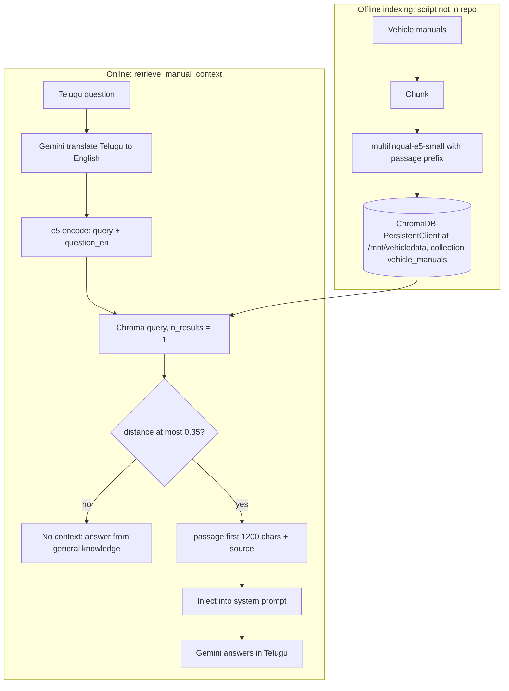

# 01.9 · Retrieval-Augmented Generation (RAG)

> **Modality:** text · **Prereqs:** [01.2 Embeddings](02-embeddings.md), [01.8 Prompting](08-prompt-engineering.md) · **Used in project:** ✅

## 1. First principles

LLM weights are a **lossy, frozen snapshot** of training data. They don't contain your private documents, they go stale, and they can't cite sources. **RAG** separates *knowledge* from *reasoning*:

1. **Index (offline):** split documents into chunks → embed each chunk → store the vectors and text in a vector database.
2. **Retrieve (online):** embed the query → nearest-neighbor search → top-k chunks.
3. **Generate:** put the chunks in the prompt → the LLM answers *grounded* in them.

Why it works: semantic embeddings put a question and the passage that answers it close together in vector space, even with no shared keywords.

| | Fine-tuning | RAG |
|---|---|---|
| Changes | Behavior / style | Accessible facts |
| Update cost | Retrain | Re-index a document |
| Citations | No | Yes (chunk source) |
| Hallucination on facts | High | Lower (if retrieval is good) |

## 2. Diagram

## 3. Deep dive

### Retrieval quality is the ceiling
If the right chunk isn't retrieved, the LLM can't use it. Generation quality can't exceed retrieval quality.

| Knob | Trade-off |
|---|---|
| **Chunk size** | Small = precise but loses context. Large = context but diluted embeddings. 200–500 tokens with overlap is typical. |
| **top-k** | k=1 is cheap but brittle. k=3–5 plus reranking is more robust but costs more tokens. |
| **Distance threshold** | Filters irrelevant context (prevents "grounding" in the wrong manual). Too strict and you never retrieve. |
| **Embedding model** | Multilingual vs English. Domain match matters more than size. |
| **Hybrid search** | Dense + BM25 keyword search catches part numbers and exact terms that embeddings blur. |
| **Reranker** | A cross-encoder rescores the top-20 down to top-3. A big precision gain. |

### Cross-lingual retrieval strategies
1. **Translate the query to the corpus language** (ours): reuses an English index, but adds an LLM call (latency + cost) and translation errors.
2. **Multilingual embeddings directly:** e5-multilingual maps Telugu and English into a shared space, so you could skip translation. Measure recall both ways.
3. **Translate the corpus:** index Telugu versions too. Best recall, highest cost.

### Vector DB internals
ANN indexes (HNSW in Chroma) trade exactness for O(log N) search. The distance metric (`l2`, `cosine`, `ip`) is fixed at collection creation, and thresholds are only meaningful relative to it.

## 4. In our project

The **Yodha voice assistant answers vehicle-service questions grounded in vehicle manuals** (README: "RAG answers grounded in vehicle manuals").

| Step | Implementation | Link |
|---|---|---|
| Non-blocking KB load | A daemon thread loads e5 + Chroma at startup. The API serves immediately, and RAG activates when ready. A failure logs "RAG disabled" instead of crashing. | [`api.py#L21-L47`](https://github.com/SEVT-Logistics-Private-Limited/tiny-llm-jetson/blob/9a7b564c8d764d1eff92218261f2fd2cef99099e/voice-assistant/api.py#L21-L47) |
| Offline-safe model | `TRANSFORMERS_OFFLINE=1` + model pre-baked in the Docker image | [`Dockerfile#L11-L14`](https://github.com/SEVT-Logistics-Private-Limited/tiny-llm-jetson/blob/9a7b564c8d764d1eff92218261f2fd2cef99099e/voice-assistant/Dockerfile#L11-L14) |
| Query translation | `gemini_translate(question_te, "Telugu", "English")` | [`api.py#L102-L108`](https://github.com/SEVT-Logistics-Private-Limited/tiny-llm-jetson/blob/9a7b564c8d764d1eff92218261f2fd2cef99099e/voice-assistant/api.py#L102-L108) |
| Retrieval + threshold | `"query: "` prefix, `n_results=1`, reject if `distance > 0.35`, truncate to 1,200 chars, return `source` | [`api.py#L111-L127`](https://github.com/SEVT-Logistics-Private-Limited/tiny-llm-jetson/blob/9a7b564c8d764d1eff92218261f2fd2cef99099e/voice-assistant/api.py#L111-L127) |
| Prompt injection of the passage | Appended to the Yodha system prompt with its source name | [`api.py#L206-L211`](https://github.com/SEVT-Logistics-Private-Limited/tiny-llm-jetson/blob/9a7b564c8d764d1eff92218261f2fd2cef99099e/voice-assistant/api.py#L206-L211) |
| Used on every LLM path | `/converse`, `/converse_stream`, `/converse_text_stream`, `/voice` (skipped for instant replies) | `api.py` endpoints |
| Observability | `GET /` and `/debug` report `kb: loaded / disabled` | [`api.py#L290-L294`](https://github.com/SEVT-Logistics-Private-Limited/tiny-llm-jetson/blob/9a7b564c8d764d1eff92218261f2fd2cef99099e/voice-assistant/api.py#L290-L294) |

**Synergy with fine-tuning:** `compression/README.md` plans to add "Q&A written from the vehicle manuals" to the LoRA dataset. RAG supplies the facts, and SFT supplies the Telugu answering style.

### Gaps worth fixing (review notes)
- **RAG is off in production right now:** the live Container App reports `"kb": "disabled"` at `GET /` (checked 2026-11-11), because `/mnt/vehicledata` isn't mounted. Every answer is currently ungrounded.
- The **ingestion pipeline isn't versioned** in the repo, so chunking, prefixes and the distance metric can't be reproduced or audited.
- `retrieve_manual_context` swallows **all exceptions** silently (`except Exception: return None`), so retrieval outages are invisible. Log them.
- The **translation call runs even when the KB answer will be rejected.** Consider embedding the Telugu query directly with multilingual e5 and comparing recall.
- `/mnt/vehicledata` is a mounted volume. The CI deploy doesn't show how it's provisioned, so a fresh environment silently runs without RAG.

## 5. Common pitfalls

- **Threshold without a known metric:** 0.35 means different things in L2 vs cosine space. Document the collection's `hnsw:space` and calibrate on labeled (query, should-match) pairs.
- **k=1 brittleness:** one near-miss chunk ends up grounding a wrong answer. Use k=3 plus a reranker, or require margin over the second-best match.
- **Blind truncation** (`doc[:1200]`) can cut mid-sentence or mid-table. Chunk to size at ingestion instead.
- **No retrieval evaluation:** track recall@k and MRR on a gold set. Without metrics, RAG regressions go unnoticed.
- **Stale index:** manuals update, embeddings don't. Version the index alongside its source docs.
- **Grounded but wrong language:** an English passage + Telugu answer requires the model to translate correctly. Validate domain terms (part names) explicitly.

## 6. References
- Lewis et al., *Retrieval-Augmented Generation for Knowledge-Intensive NLP Tasks*, arXiv:2005.11401.
- Wang et al., *Multilingual E5 Text Embeddings*, arXiv:2402.05672. Malkov & Yashunin, *HNSW*, arXiv:1603.09320.
- Liu et al., *Lost in the Middle*, arXiv:2307.03172.
