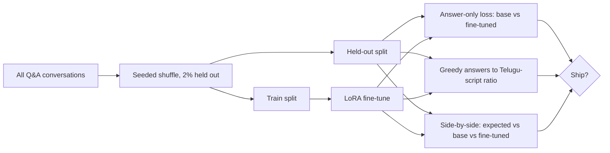

# 01.10 · Evaluation

> **Modality:** text (principles apply to all) · **Prereqs:** [00.6](../00-foundations/06-ml-fundamentals.md), [01.4](04-llm-training-scaling.md) · **Used in project:** ✅

## 1. First principles

You can't improve what you don't measure, and training loss **isn't** the thing you care about. Evaluation answers: *does the system do the job, on data it hasn't seen, under production conditions?*

Evaluation levels, cheapest first:

| Level | Metric examples | Measures |
|---|---|---|
| **Intrinsic (model)** | Held-out loss, perplexity, bits-per-char | How well the model predicts text |
| **Task (offline)** | Exact match, F1, BLEU/chrF, WER (ASR), recall@k (RAG), LLM-as-judge | Whether the model solves the task |
| **Constraint checks** | Language/script ratio, format validity, length | Hard product requirements |
| **System (online)** | Latency p50/p95, error rate, fallback rate, user re-asks | Whether the product works for users |

**The golden rule:** eval data must never leak into training. Same split, same prompt format, deterministic decoding.

## 2. Diagram

## 3. Deep dive

- **Perplexity** = `exp(mean CE)`. Only comparable with the **same tokenizer and the same eval set**.
- **Bits per character** = CE / ln 2 per char. Lets you compare char-level and subword models.
- **LLM-as-judge:** a strong model grades outputs against a rubric. It scales, but it's biased (toward verbosity, its own style, position). Calibrate it against human labels.
- **Constraint metrics are cheap and high-value.** For a Telugu voice product: Telugu-script ratio, symbol-free output, length in seconds of speech.
- **Regression suites:** a fixed set of golden prompts run on every model, prompt or provider change. That's what catches "the provider updated the model and now it ignores system prompts".
- **Online metrics need instrumentation:** log per-stage latency (STT/RAG/LLM/TTS), which model in the fallback chain answered, and retrieval hit rate.

## 4. In our project

- **Fine-tune eval stage** ([`finetune_telugu_3b.py#L176-L213`](https://github.com/SEVT-Logistics-Private-Limited/tiny-llm-jetson/blob/9a7b564c8d764d1eff92218261f2fd2cef99099e/compression/finetune_telugu_3b.py#L176-L213)):
  - A seeded 2% held-out split (`split_qa`).
  - **Answer-only held-out loss** for the base and fine-tuned models.
  - **Telugu-script %** of greedy answers (`telugu_ratio`).
  - Side-by-side expected / base / fine-tuned answers for N samples.
- **Compression eval:** Telugu **perplexity** of the teacher vs the reloaded *packed* ternary model, plus side-by-side answers ([`ternary_qat_3b.py#L239-L257`](https://github.com/SEVT-Logistics-Private-Limited/tiny-llm-jetson/blob/9a7b564c8d764d1eff92218261f2fd2cef99099e/compression/ternary_qat_3b.py#L239-L257)). It evaluates the *exported artifact*, not the in-memory training model, which is a good practice.
- **Checkpoint verification scripts:** `test_tiny_llm*.py` reload each scratch checkpoint in a separate process and generate from unseen seeds. This verifies the artifact is self-contained.
- **Production smoke tests:** `/debug` probes every LLM model × prompting mode, the TTS backends and KB status ([`api.py#L303-L425`](https://github.com/SEVT-Logistics-Private-Limited/tiny-llm-jetson/blob/9a7b564c8d764d1eff92218261f2fd2cef99099e/voice-assistant/api.py#L303-L425)).
- **Gaps:**
  - The scratch ladder reports train-batch loss only.
  - No RAG retrieval eval set.
  - No ASR word error rate (WER) tracking.
  - No latency metrics beyond the README's "1.2 s LLM response time".

## 5. Common pitfalls

- **Evaluating on training data** (the scratch ladder's samples come from the training sentence). The result is always "perfect".
- **Sampling during eval:** non-deterministic, so you can't compare runs. Use greedy or fix the seed and average.
- **Single-metric shipping:** lower loss but 40% English answers is a regression for a Telugu product. Track constraint metrics alongside.
- **Tiny eval sets:** 2% of 8,439 ≈ 168 examples. Fine for loss, noisy for rare failure types. Add targeted test sets (numbers, part names, code-switching).
- **No eval for the hosted LLM path:** provider model swaps (the `gemini-*` fallback chain) change behavior silently. Run golden prompts on every deploy.

## 6. References
- Zheng et al., *Judging LLM-as-a-Judge with MT-Bench*, arXiv:2306.05685.
- Popović, *chrF*, WMT 2015 (character-level metric, well-suited to Indic languages).
