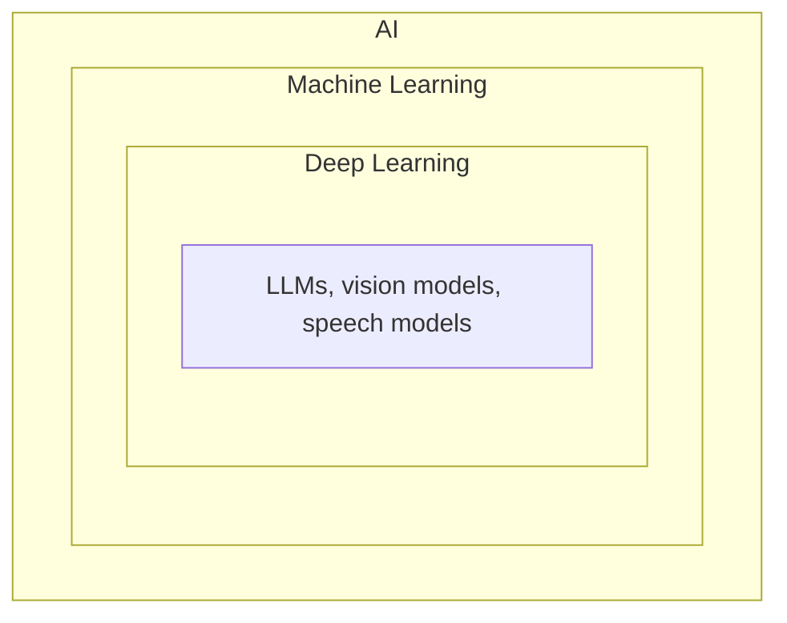
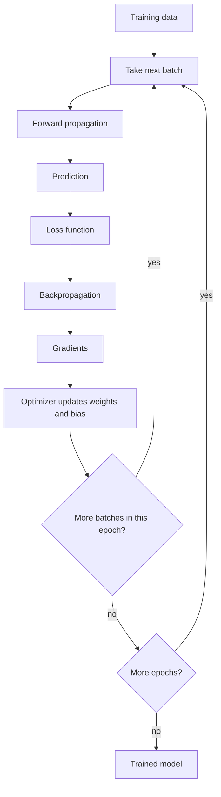
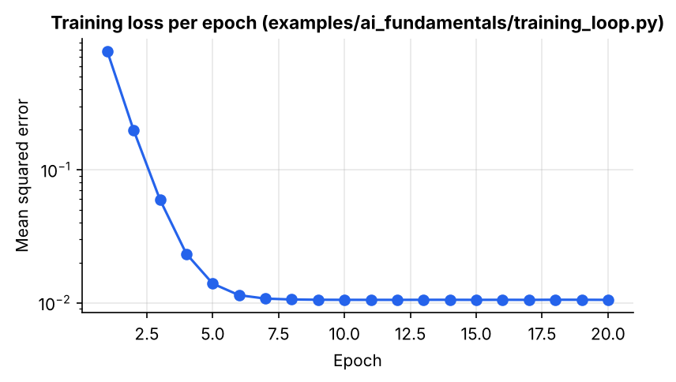

# AI Fundamentals

> How AI, Machine Learning and Deep Learning relate to each other, and how a neural network actually learns from data.

| | |
|---|---|
| **Chapter** | 2 of 5 |
| **Prerequisites** | [Computing Foundations](../01-computing-foundations/README.md) |
| **Example code** | [`examples/ai_fundamentals/training_loop.py`](../../examples/ai_fundamentals/training_loop.py) |
| **Used in project** | Yes. The same training loop trains every tiny-llm-jetson model. |

---

## Introduction

"AI", "ML" and "Deep Learning" are often used interchangeably, but they are nested ideas. This chapter defines each one, introduces NLP (the branch that deals with language), and walks through the **training loop**: the process every neural network, from a 3-parameter toy to GPT, uses to learn.

## What is it?

| Term | Definition | Examples |
|---|---|---|
| **AI** (Artificial Intelligence) | The broad field of building systems that can perform tasks that normally require some form of human intelligence | ChatGPT, self-driving cars, Siri |
| **ML** (Machine Learning) | A subset of AI where systems **learn patterns from data** rather than relying entirely on explicitly programmed rules | Fraud detection, stock price prediction, house price prediction |
| **Deep Learning** | A subset of ML that uses **multi-layer neural networks** to learn complex patterns | Self-driving cars, image generation, voice recognition |
| **NLP** (Natural Language Processing) | A branch of AI that helps computers **understand, process and work with human language** | Google Translate, voice assistants |

**Deep learning example:** give a model thousands of face images. It learns features such as eyes, nose and facial shape on its own, and can then recognise a new face it has never seen.

**NLP example:** when you tell a computer "Book a ticket to Hyderabad", NLP helps it understand what you are asking, what action you want, and what information it needs.

## Why is it needed?

Some problems are too complex to solve with hand-written rules. Nobody can write an `if` statement for every way a face can look, or every way a sentence can be phrased. Machine learning lets the computer **learn the rules from examples** instead.

## How does it work?

### Training vocabulary

| Term | Definition | Example |
|---|---|---|
| **Epoch** | One complete pass through the entire training dataset | 1000 samples seen once = 1 epoch; seen 5 times = 5 epochs |
| **Batch** | A subset of the training data processed together in one training step | 1000 samples split into groups of 100 |
| **Batch size** | The number of training examples processed before the optimizer updates the model | 100 |
| **Step** | One forward pass, backward pass and weight update on one batch | 1000 samples ÷ 100 batch size = **10 steps per epoch** |

Worked example: dataset = 1000 samples, batch size = 100

| Batch | Samples |
|---|---|
| Batch 1 | 1 – 100 |
| Batch 2 | 101 – 200 |
| … | … |
| Batch 10 | 901 – 1000 |

So **1 epoch = 10 batches = 10 steps**.

### Small vs large batches

| Small batch | Large batch |
|---|---|
| Less memory | More memory |
| Can be slower per epoch | Can be more computationally efficient on suitable hardware (GPU) |
| Noisier updates (can help generalisation) | Smoother updates |

### The training loop

1. **Forward propagation:** the batch flows through the network and produces a **prediction**.
2. **Loss function:** measures how wrong the prediction is. The result is the **loss**.
3. **Backpropagation:** applies the chain rule to compute the **gradient** of the loss with respect to every weight and bias.
4. **Optimizer:** nudges every weight and bias in the direction that lowers the loss (`w = w - learning_rate × gradient`).
5. Move on to the **next batch**. After every batch has been used, the **epoch** ends and the next one begins.

## Architecture





## Practical implementation

In practice you don't write gradients by hand. Frameworks like **PyTorch** compute them automatically (`loss.backward()`), and optimizers such as **AdamW** perform the update (`optimizer.step()`). The structure of the loop stays exactly the same.

```python
for epoch in range(epochs):
    for xb, yb in dataloader:          # one batch
        pred = model(xb)               # forward propagation
        loss = loss_fn(pred, yb)       # loss
        optimizer.zero_grad()
        loss.backward()                # backpropagation -> gradients
        optimizer.step()               # update weights
```

## Code example

[`examples/ai_fundamentals/training_loop.py`](../../examples/ai_fundamentals/training_loop.py) implements every step from scratch with NumPy. The model learns the line `y = 3x + 2` from 1000 noisy samples:

```python
pred = w * xb + b                 # 1. forward propagation
loss = np.mean((pred - yb) ** 2)  # 2. loss (mean squared error)
grad_w = 2 * np.mean((pred - yb) * xb)  # 3. gradients
grad_b = 2 * np.mean(pred - yb)
w -= lr * grad_w                  # 4. optimizer update
b -= lr * grad_b
```

```bash
python examples/ai_fundamentals/training_loop.py
```

```text
dataset: 1000 samples, batch size 100 -> 10 steps per epoch

epoch  1 | loss 0.7762 | w=1.505 b=1.843
epoch  2 | loss 0.1981 | w=2.238 b=2.013
epoch  5 | loss 0.0139 | w=2.896 b=2.002
epoch 10 | loss 0.0105 | w=2.996 b=2.000
epoch 20 | loss 0.0105 | w=2.999 b=1.998

learned: y = 3.00x + 2.00   (true: y = 3x + 2)
```



The loss drops quickly, then flattens at about 0.01, which is the noise built into the data. It cannot go lower without memorising that noise.

## Real-world use cases

| Use case | Type |
|---|---|
| Fraud detection, price prediction | Machine learning |
| Face recognition, self-driving perception | Deep learning |
| Translation, chatbots, voice assistants | NLP (deep learning) |

**In my project:** every model in [tiny-llm-jetson](https://github.com/SEVT-Logistics-Private-Limited/tiny-llm-jetson) is trained with this loop in PyTorch, from a 984-parameter model to a 3-billion-parameter one ([`tiny_llm.py`](https://github.com/SEVT-Logistics-Private-Limited/tiny-llm-jetson/blob/main/tiny_llm.py)).

## Common mistakes and best practices

| Mistake | Better approach |
|---|---|
| Measuring only training loss | Keep a held-out validation set. Low training loss can just mean memorisation. |
| Learning rate too high | Loss jumps around or explodes. Lower it, or use warm-up. |
| Not shuffling data between epochs | Shuffle every epoch so batches differ. |
| Batch too large for the GPU | Use a smaller batch with gradient accumulation. |

## Key takeaways

- AI ⊃ Machine Learning ⊃ Deep Learning. NLP is the branch of AI focused on language.
- An epoch is one full pass over the data, and a batch is one chunk of it. Steps per epoch = dataset size ÷ batch size.
- Training loop: forward pass → loss → backpropagation → optimizer update → repeat.

---

**Previous:** [← Computing Foundations](../01-computing-foundations/README.md) · [Home](../../README.md) · **Next:** [Language Models →](../03-language-models/README.md)
