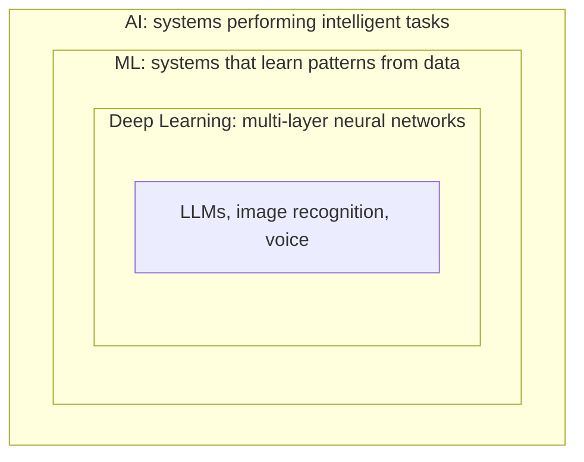
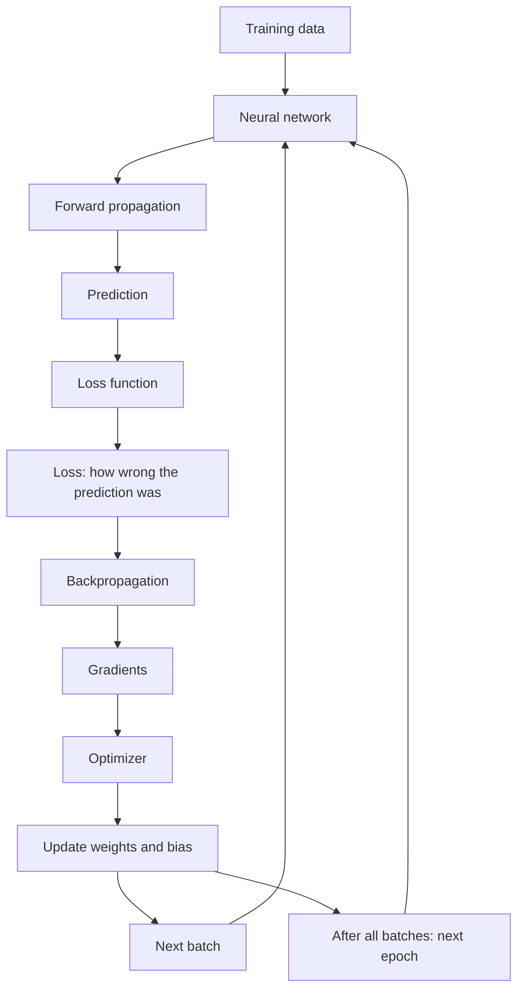

# 2. AI, ML and Deep Learning

[← Back to contents](../README.md)

---

## AI (Artificial Intelligence)

AI is the broad field of **building systems that can perform tasks that normally require some form of human intelligence.**

Examples: ChatGPT, self-driving cars, Siri.

## AI → ML → Deep Learning

These are not three separate things. Each one sits inside the one before it.

| | Definition | Examples |
|---|---|---|
| **AI** | The broadest concept: systems performing intelligent tasks | ChatGPT, self-driving cars, Siri |
| **ML** (Machine Learning) | A subset of AI where systems **learn patterns from data** instead of relying entirely on explicitly programmed rules | Fraud detection, stock price prediction, house price prediction |
| **Deep Learning** | A subset of ML that uses **multi-layer neural networks** to learn complex patterns | Self-driving cars, image generation, voice recognition |

**Deep learning example:** give a model thousands of images of faces. It learns features like eyes, nose and facial shape by itself. Then it can recognise a new image it has never seen.

---

## NLP (Natural Language Processing)

NLP is a **branch of AI that helps computers understand, process and work with human language.** It deals with text.

When you say "book a ticket to Hyderabad", NLP helps the computer understand:
- what you are asking
- what action you want
- what information it needs

**In simple words:** NLP helps computers understand and work with human language.

Examples: Google Translate, voice assistants.

---

## How a model learns: the training loop

### Epoch

An **epoch** is one complete pass through the entire training dataset.

> Training samples = 1000
> - The model sees all 1000 samples once → **1 epoch**
> - The model sees all 1000 samples 5 times → **5 epochs**

### Batch

A **batch** is a subset of the training data processed together in one training step (one update).

> Dataset = 1000 samples, batch size = 100
> - Batch 1 → samples 1–100
> - Batch 2 → samples 101–200
> - …
> - Batch 10 → samples 901–1000
>
> So **1 epoch = 10 batches = 10 steps**.

### Batch size

**Batch size** is the number of training examples processed before the optimizer updates the model.

| Small batch | Large batch |
|---|---|
| Less memory | More memory |
| Can be slower per epoch | Can be more efficient on suitable hardware (GPU) |

### How everything connects

1. **Forward propagation:** data goes through the network and it makes a **prediction**.
2. **Loss function:** compares the prediction with the right answer. The difference is the **loss**.
3. **Backpropagation:** works out how each weight contributed to the loss. These are the **gradients**.
4. **Optimizer:** uses the gradients to **update the weights and bias** so the next prediction is a bit better.
5. Repeat for the **next batch**, and once every batch is done, start the **next epoch**.

**In my project:** I wrote this exact loop from scratch in PyTorch to train my own GPT models, from 984 parameters up to 3 billion ([`tiny_llm.py`](https://github.com/SEVT-Logistics-Private-Limited/tiny-llm-jetson/blob/main/tiny_llm.py)).

---

## Remember

- AI ⊃ ML ⊃ Deep Learning.
- NLP = AI for human language.
- Epoch = one full pass over the data. Batch = a small chunk of it. Batch size = how many examples go in each chunk.
- Training loop: predict → measure the loss → backpropagate → update the weights → repeat.
