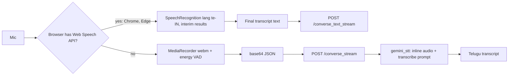

# 02.1 · Speech-to-Text (ASR)

> **Modality:** audio → text · **Prereqs:** [00.4 Audio](../00-foundations/04-audio.md), [01.3 Transformer](../01-text/03-attention-transformer.md) · **Used in project:** ✅

## 1. First principles

ASR maps a long, continuous waveform (16,000 samples/s) to a short discrete token sequence (~3 words/s). The core difficulty is **alignment**: we don't know which audio frames correspond to which characters.

Approaches:

| Architecture | Alignment handling | Examples |
|---|---|---|
| HMM-GMM / hybrid | Explicit phonetic alignment, pronunciation lexicon | Kaldi (classic) |
| **CTC** | Per-frame label distribution + a "blank" token. Sums over all valid alignments. | wav2vec2-CTC, IndicWav2Vec |
| **Encoder–decoder (attention)** | Decoder attends over encoder frames and learns alignment implicitly | **Whisper**, many Indic ASR models |
| **RNN-T / Transducer** | Streaming-friendly alignment | On-device / streaming ASR |
| **Audio-native LLM** | Audio encoder → tokens fed to an LLM, prompted to "transcribe" | **Gemini** (as used in our project) |

Standard front end: waveform → log-mel spectrogram (80–128 mel bins, 10 ms hop) → conv subsampling → Transformer encoder.

## 2. Diagram

## 3. Deep dive

- **WER/CER:** word or character error rate = (substitutions + deletions + insertions) / reference length. For Telugu, CER is often more meaningful, because agglutinative words make WER harsh.
- **Indic ASR challenges:**
  - code-switching (Telugu + English mid-sentence)
  - dialect variation (Telangana vs coastal Andhra)
  - numerals and dates
  - limited labeled data
- **Streaming vs batch:**
  - Streaming (RNN-T, chunked attention) emits partial hypotheses as you speak, giving low perceived latency.
  - Batch waits for end of speech, then transcribes. Simpler, but adds full-utterance latency.
- **LLM-as-ASR trade-offs:** an audio-native LLM is easy to integrate and handles code-switching well. But it can **paraphrase, translate or "clean up"** instead of transcribing verbatim, costs more, and is slower than a dedicated ASR model.
- **Vendor options for Telugu:** Sarvam Saarika (Indic-specialized), Google STT, Whisper large-v3 (multilingual, weaker on Telugu), AI4Bharat IndicConformer (open).

## 4. In our project

**ASR has gone through three backends.**

| Phase | STT | Evidence |
|---|---|---|
| v1–v4.2 (README) | **Sarvam Saarika** | README pipeline: "Audio In → Sarvam Saarika STT → …" |
| v8 | **Gemini 2.0 Flash** with inline `audio/webm` | [`telugu_voice_api.py`](https://github.com/SEVT-Logistics-Private-Limited/tiny-llm-jetson/blob/9a7b564c8d764d1eff92218261f2fd2cef99099e/telugu_voice_api.py) `gemini_stt` |
| v10 (current) | **Browser Web Speech API (`te-IN`) as primary**, Gemini (with model fallback) as server-side fallback | below |

- **Primary: client-side STT** ([`telugu_assistant.html#L612-L661`](https://github.com/SEVT-Logistics-Private-Limited/tiny-llm-jetson/blob/9a7b564c8d764d1eff92218261f2fd2cef99099e/voice-assistant/telugu_assistant.html#L612-L661)):
  - `SpeechRecognition` with `lang='te-IN'` and `interimResults=true`. Live partial text is shown in the status label.
  - Auto-restarts on no-speech.
  - The final text goes to `/converse_text_stream`, so **no audio upload and no server STT**. That's the biggest latency win in the system.
- **Fallback: server-side STT:**
  - For browsers without the Web Speech API (Firefox, some iOS), the client records WebM with VAD and posts base64 to `/converse_stream`.
  - `gemini_stt` prompts "Transcribe exactly what is spoken in Telugu… no explanations or translations" across the `LLM_MODELS` fallback chain ([`api.py#L159-L176`](https://github.com/SEVT-Logistics-Private-Limited/tiny-llm-jetson/blob/9a7b564c8d764d1eff92218261f2fd2cef99099e/voice-assistant/api.py#L159-L176)).
- **Empty transcript handling:** the API returns 400 or an SSE `error`, and the client resumes listening.

## 5. Common pitfalls

- **Web Speech API is a black box:** Chrome streams audio to Google servers, so it needs network access and can't run offline or on-prem. Availability varies by browser, and accuracy and quotas aren't controllable. Fine for an MVP, but a risk for "offline edge deployment" on the roadmap.
- **LLM transcription hallucination:** on silence or noise, LLMs may invent plausible text. Gate with VAD and reject transcripts with low Telugu-script ratio.
- **Hard-coded `audio/webm`:** Safari records `audio/mp4`. Pass the actual `blob.type` to the server and on to the model.
- **No WER tracking:** collect a small labeled Telugu test set (including code-switched and numeric utterances) and track CER per backend.
- **Punctuation and numerals:** ASR outputs "పది వేల" vs "10,000" inconsistently, which affects downstream instant-match and RAG.

## 6. References
- Graves et al., *Connectionist Temporal Classification*, ICML 2006.
- Radford et al., *Whisper*, arXiv:2212.04356. Baevski et al., *wav2vec 2.0*, arXiv:2006.11477.
- W3C Web Speech API specification.
