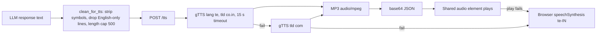

# 02.2 · Text-to-Speech (TTS)

> **Modality:** text → audio · **Prereqs:** [00.4 Audio](../00-foundations/04-audio.md) · **Used in project:** ✅

## 1. First principles

TTS is the inverse of ASR: a short token sequence becomes a long waveform. It's a **one-to-many** problem, because the same text can be spoken with countless prosodies (rhythm, stress, intonation). Modern systems split it into stages:

1. **Text frontend:** normalization ("10" → "పది"), grapheme-to-phoneme, prosody hints.
2. **Acoustic model:** text/phonemes → mel spectrogram (Tacotron 2, FastSpeech 2) or → discrete audio-codec tokens (LLM-style TTS).
3. **Vocoder:** mel → waveform (WaveNet, HiFi-GAN), or codec decoder → waveform.

End-to-end models (VITS) and **codec-language-model TTS** (VALL-E style, Gemini TTS, Sarvam Bulbul-class) merge these stages. They produce natural prosody and can clone voices.

## 2. Diagram

## 3. Deep dive

- **Text normalization is where TTS quietly fails.** Numbers, dates, abbreviations, symbols and mixed scripts must become speakable words *before* synthesis.
- **Latency anatomy:**
  - Time-to-first-audio matters most for conversation.
  - Streaming TTS (sentence- or chunk-level) starts playback while later sentences synthesize.
  - Non-streaming TTS waits for the whole response.
- **Output formats:**
  - Raw PCM needs a WAV header to play.
  - MP3/Opus are compressed (smaller over the network) but add encode time.
- **Voice quality vs cost:**

  | Option | Quality | Latency | Cost / control |
  |---|---|---|---|
  | gTTS (unofficial Google Translate TTS) | Robotic | Medium | Free, **no SLA**, can rate-limit |
  | Gemini TTS (`*-preview-tts`) | Natural | Medium–high | Preview API, voice presets |
  | Sarvam Bulbul | Natural, Indic-native | Low–medium | Paid, Indic-specialized |
  | Browser `speechSynthesis` | Varies by OS | Instant | Free, inconsistent Telugu voices |
  | Self-hosted (VITS/Piper/IndicTTS) | Good | Low on GPU | Full control, ops burden |

## 4. In our project

**TTS has also gone through three backends.**

| Phase | TTS | Evidence |
|---|---|---|
| v1–v4.2 | **Sarvam Bulbul** | README pipeline |
| v8 | **Gemini 2.0 Flash preview TTS**, voice "Aoede", raw 24 kHz PCM wrapped into WAV | `do_tts` + `_pcm_to_wav` in [`telugu_voice_api.py`](https://github.com/SEVT-Logistics-Private-Limited/tiny-llm-jetson/blob/9a7b564c8d764d1eff92218261f2fd2cef99099e/telugu_voice_api.py) |
| v10 (current) | **gTTS** (`lang='te'`) with a TLD fallback chain and a server-side timeout. Gemini TTS is kept only as a `/debug` probe. | [`api.py#L240-L261`](https://github.com/SEVT-Logistics-Private-Limited/tiny-llm-jetson/blob/9a7b564c8d764d1eff92218261f2fd2cef99099e/voice-assistant/api.py#L240-L261) |

- **Hard timeout around a blocking library:** gTTS runs in a `ThreadPoolExecutor` with `future.result(timeout=15)`, then retries `co.in` → `com` and raises if both fail.
- **Text sanitation before TTS** (`clean_for_tts`) removes markdown symbols, parenthetical English, list numbering and pure-English lines. If fewer than 3 Telugu characters remain, the answer becomes "మళ్ళీ చెప్పగలరా?" ([`api.py#L178-L191`](https://github.com/SEVT-Logistics-Private-Limited/tiny-llm-jetson/blob/9a7b564c8d764d1eff92218261f2fd2cef99099e/voice-assistant/api.py#L178-L191)).
- **Overlapping TTS with streaming:** when the SSE `response` event arrives, the client fires the `/tts` request *immediately*, in parallel with the rest of the stream ([`telugu_assistant.html#L786-L800`](https://github.com/SEVT-Logistics-Private-Limited/tiny-llm-jetson/blob/9a7b564c8d764d1eff92218261f2fd2cef99099e/voice-assistant/telugu_assistant.html#L786-L800)).
- **Client fallback:** if `/tts` fails or playback is blocked, the client uses the browser's `speechSynthesis` with `lang='te-IN'`.

## 5. Common pitfalls

- **gTTS in production:** it scrapes an undocumented Google Translate endpoint. It can break or rate-limit without notice, and the 15 s timeout ×2 TLDs means a worst case of **30 s** before the browser fallback. Treat it as a temporary bridge to a supported TTS (Sarvam Bulbul, Google Cloud TTS, or self-hosted).
- **Silent truncation:** `text[:500]` cuts mid-sentence. Split on sentence boundaries and synthesize in chunks (that also enables streaming playback).
- **Numbers read wrong:** "10000" read digit by digit. Normalize numerals to Telugu words before TTS.
- **No audio caching:** the same instant replies ("నమస్కారం! నేను యోధను…") are re-synthesized every time. Cache audio keyed by text hash.
- **Headerless PCM** (the v8 Gemini path) must be wrapped (rate 24 kHz, 16-bit, mono). A wrong header gives noise or chipmunk speed.

## 6. References
- Shen et al., *Tacotron 2*, arXiv:1712.05884. Kong et al., *HiFi-GAN*, arXiv:2010.05646.
- Kim et al., *VITS*, arXiv:2106.06103. Wang et al., *VALL-E*, arXiv:2301.02111.
