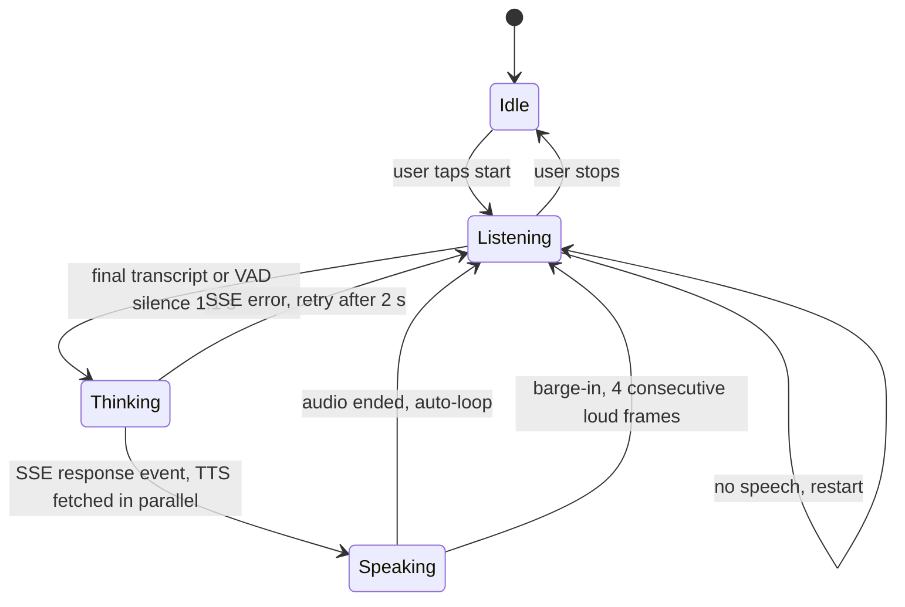
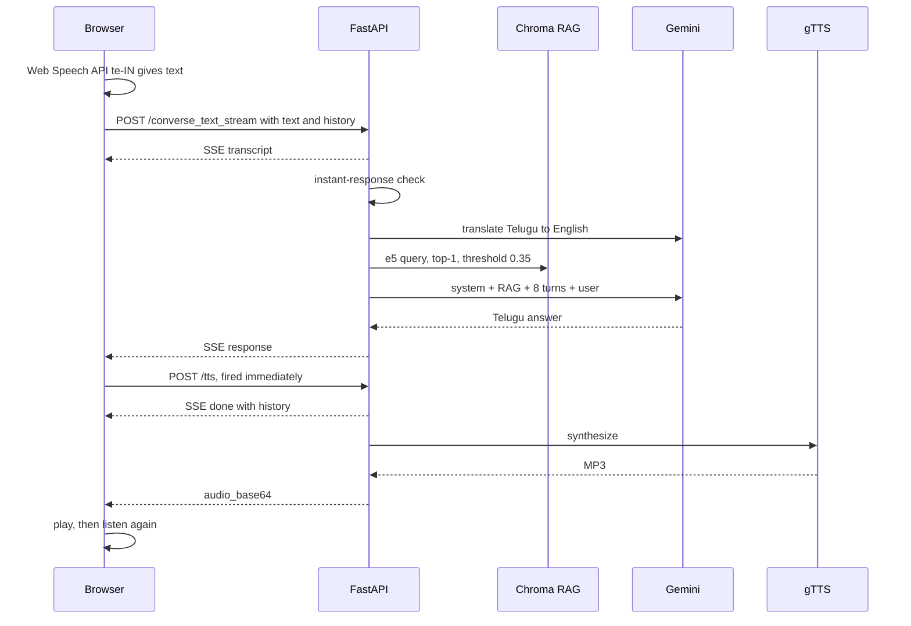

# 02.3 · Voice Agents: VAD, Barge-in, Streaming, Latency

> **Modality:** audio → text → audio · **Prereqs:** [02.1](01-speech-to-text.md), [02.2](02-text-to-speech.md), [01.9 RAG](../01-text/09-rag.md) · **Used in project:** ✅ (Yodha)

## 1. First principles

A voice agent is a **real-time loop**: listen → understand → think → speak → listen again. Humans expect a reply within **~300–800 ms** of finishing a turn. Anything past ~1.5 s feels broken. The engineering problem is the **latency budget across a chain of models**, plus turn-taking.

Two architectures:

| | **Cascaded** (STT → LLM → TTS) | **Speech-to-speech** (audio-native model) |
|---|---|---|
| Control | Each stage swappable, inspectable text | Black box |
| Latency | Sum of stages unless streamed | Lowest |
| Tools / RAG | Easy (text in the middle) | Harder |
| Prosody / emotion | Lost at the text bottleneck | Preserved |

Turn-taking primitives:
- **VAD (voice activity detection):** is the user speaking?
- **Endpointing:** has the user *finished*? (silence duration, semantic completeness)
- **Barge-in:** the user interrupts while the agent is speaking, so stop playback and listen.

## 2. Diagram

## 3. Deep dive

### Latency budget (cascaded, per turn)
| Stage | Typical | Mitigation |
|---|---|---|
| Endpointing silence | 500–1100 ms | Semantic endpointing, shorter timeouts |
| STT | 200–1000 ms | Streaming ASR, client-side STT |
| RAG (translate + embed + search) | 300–800 ms | Skip translation, cache, async |
| LLM TTFT + generation | 500–2000 ms | Smaller model, `max_tokens`, streaming tokens |
| TTS | 300–2000 ms | Streaming TTS by sentence, cache common phrases |
| Network round trips | 50–300 ms each | Fewer hops, regional hosting |

**The highest-leverage pattern is pipelining.** Stream LLM tokens → cut at sentence boundaries → TTS each sentence → play the first sentence while the rest are generated.

### Barge-in & echo
The mic hears the agent's own TTS. Without **acoustic echo cancellation (AEC)**, the agent interrupts itself. Browsers apply AEC on `getUserMedia({audio: {echoCancellation: true}})`, which is on by default but not guaranteed.

## 4. In our project: Yodha Telugu voice assistant

**Live:** [https://telugu-voice-app.gentletree-f4002f64.southindia.azurecontainerapps.io/assistant](https://telugu-voice-app.gentletree-f4002f64.southindia.azurecontainerapps.io/assistant) (Azure Container Apps). Code: [`voice-assistant/`](https://github.com/SEVT-Logistics-Private-Limited/tiny-llm-jetson/tree/9a7b564c8d764d1eff92218261f2fd2cef99099e/voice-assistant).

| Capability | Implementation | Link |
|---|---|---|
| Continuous conversation loop | State machine idle → listening → thinking → speaking → listening | [`telugu_assistant.html#L601-L610`](https://github.com/SEVT-Logistics-Private-Limited/tiny-llm-jetson/blob/9a7b564c8d764d1eff92218261f2fd2cef99099e/voice-assistant/telugu_assistant.html#L601-L610) |
| Client-side STT (skips audio upload) | Web Speech API `te-IN` → `/converse_text_stream` | [`#L612-L687`](https://github.com/SEVT-Logistics-Private-Limited/tiny-llm-jetson/blob/9a7b564c8d764d1eff92218261f2fd2cef99099e/voice-assistant/telugu_assistant.html#L612-L687) |
| Energy VAD + endpointing (fallback path) | `AnalyserNode` avg > 12 = speech, 1.1 s silence = end, 9 s no-speech abort | [`#L689-L729`](https://github.com/SEVT-Logistics-Private-Limited/tiny-llm-jetson/blob/9a7b564c8d764d1eff92218261f2fd2cef99099e/voice-assistant/telugu_assistant.html#L689-L729) |
| SSE streaming of stages | `transcript` → `response` → `done` (history) / `error` events | [`api.py#L479-L571`](https://github.com/SEVT-Logistics-Private-Limited/tiny-llm-jetson/blob/9a7b564c8d764d1eff92218261f2fd2cef99099e/voice-assistant/api.py#L479-L571) |
| TTS overlapped with stream completion | `/tts` fired on the `response` event | [`telugu_assistant.html#L786-L800`](https://github.com/SEVT-Logistics-Private-Limited/tiny-llm-jetson/blob/9a7b564c8d764d1eff92218261f2fd2cef99099e/voice-assistant/telugu_assistant.html#L786-L800) |
| Barge-in | Separate analyser: avg > 18 for 4 consecutive frames → stop audio, listen | [`#L836-L873`](https://github.com/SEVT-Logistics-Private-Limited/tiny-llm-jetson/blob/9a7b564c8d764d1eff92218261f2fd2cef99099e/voice-assistant/telugu_assistant.html#L836-L873) |
| Conversation memory | Client holds `history`; server windows the last 8 and returns the updated history | `api.py` converse endpoints |
| Zero-LLM fast path | Exact-match instant replies for time, date, greetings | [`api.py#L141-L157`](https://github.com/SEVT-Logistics-Private-Limited/tiny-llm-jetson/blob/9a7b564c8d764d1eff92218261f2fd2cef99099e/voice-assistant/api.py#L141-L157) |
| Grounded answers | RAG over vehicle manuals | [01.9](../01-text/09-rag.md) |
| Mobile autoplay fix | One shared `<audio>` element unlocked on first gesture | README v4.2 |

**Evolution:**
1. Sarvam Saarika → Sarvam-105b → Bulbul (README v1)
2. All-Gemini v8 (STT, LLM, TTS)
3. v10: browser STT + Gemini LLM fallback chain + gTTS + RAG + SSE + barge-in

Each step traded vendor quality for latency, cost or reliability.

**Roadmap (README):**
- Replace the hosted LLM with our own Telugu model (the LoRA → ternary pipeline is the path).
- Streaming for under 4 s end-to-end latency.
- Offline edge deployment on the Jetson Orin Nano.

## 5. Common pitfalls

- **Not streaming LLM tokens:** the server waits for the full Gemini response before emitting `response`, so TTS starts late. Use `generate_content_stream` and sentence-chunked TTS.
- **Fixed energy thresholds** (12 / 18) misfire across devices and noise levels. Calibrate per session or use a learned VAD (Silero VAD via ONNX/WebAssembly). The README says 25, but the code says 12: keep docs and code in sync.
- **Barge-in self-triggering** from TTS echo on speakerphone. Make sure `echoCancellation` is on, and require sustained energy (already 4 frames) plus optional transcript confirmation.
- **Client-owned history** can be tampered with and grows unbounded in the payload. Use server-side sessions keyed by ID.
- **Every stage synchronous in one request:** a slow TTS blocks a worker. FastAPI runs `def` endpoints in a threadpool (default ~40 threads), so under load it saturates quickly. Use async clients or a queue.
- **No per-stage timing logs:** you can't optimize what you don't measure. Emit timings in the SSE `done` event.

## 6. References
- W3C Media Capture and Streams (`getUserMedia`), Web Audio API (`AnalyserNode`).
- WHATWG Server-Sent Events.
- Silero VAD (open-source learned VAD).
