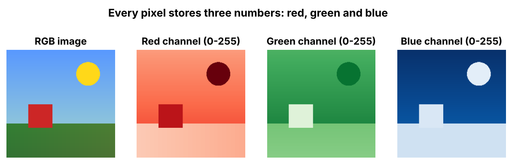

# 3. Image

> An image is a visual representation of something we see in the real world. To a computer, it's a grid of pixels, and each pixel is a set of numbers.

## Introduction

When you look at a photo you see a scene. When a computer looks at it, it sees **millions of numbers**.

## What is it?

- An **image** is a visual representation of something that we see in the real world.
- An image is made up of **millions of tiny squares** called **pixels**.
- **Pixel** = **Picture Element**.

## Why is it needed?

Understanding how images are stored as numbers is the first step to understanding how AI can "see": face recognition, self-driving cars and VLMs.

## How does it work?

### How does a computer represent colours?

It uses the **RGB colour model**:
- **R** = Red
- **G** = Green
- **B** = Blue

Every pixel has **3 numerical values**, one each for red, green and blue. Each value ranges from **0 to 255**.

| Colour | RGB value |
|---|---|
| Red | (255, 0, 0) |
| Green | (0, 255, 0) |
| Blue | (0, 0, 255) |
| White | (255, 255, 255) |
| Black | (0, 0, 0) |
| Yellow | (255, 255, 0) |
| Magenta | (255, 0, 255) |



### How does a computer process an image?

1. **Image input:** a photo file (jpg / png)
2. **Image decoding:** the file is opened
3. **Pixel representation:** every pixel becomes RGB numbers
4. **Image as an array:** a big grid of numbers
5. **Image processing:** resize, filter, recognise
6. **Processed image**

## Flow diagram

```text
Image input → Image decoding → Pixel representation
                                        ↓
Processed image ← Image processing ← Image as an array
```

## Real-world use cases

- Photo editing and filters
- Face recognition
- Medical images (X-ray, MRI)
- Input for AI models that understand images ([VLM](09-vlm.md))

## In our project

**Not used yet.** Our project works with voice and text only, so it doesn't process images yet.

A natural next step would be letting a user send a photo (for example, of a dashboard warning light) and answering about it with a [VLM](09-vlm.md).

---

**Previous:** [← GPU](02-gpu.md) · [Home](../README.md) · **Next:** [Image Resolution →](04-image-resolution.md)
