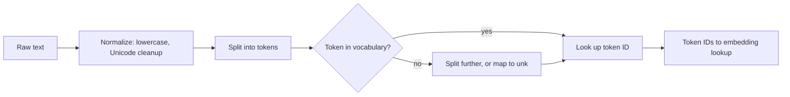

# Tokenization

> LLMs never see raw words. Tokenization converts text into a sequence of token IDs that the model can process.

| | |
|---|---|
| **Chapter** | [Language Models](README.md) · Topic 1 of 8 |
| **Prerequisites** | [Computing Foundations](../01-computing-foundations/README.md) |
| **Example code** | [`examples/language_models/tokenizer.py`](../../examples/language_models/tokenizer.py) |
| **Used in project** | Yes. Character-level tokenizer for the Telugu GPT. |

---

## Introduction

Tokenization is the first step of every language model. Computers only understand numbers, so before a model can read "AI is amazing", the text must be split into pieces and each piece mapped to a number.

## What is it?

- A **token** is a unit of text processed by an LLM. Depending on the tokenizer, a token can be a whole word, part of a word, a punctuation mark, or another piece of text.
- **Tokenization** is the process of converting text into tokens that the model can process.
- Each token is then converted into a **token ID**: its index in the model's vocabulary.

```text
Tokens   ->  Token IDs
"AI"     ->  2451
"is"     ->  318
"amazing"->  4567
```

These IDs are then used to look up **embeddings** (see the [next topic](02-embeddings.md)).

## Why is it needed?

Neural networks work on numbers, and a vocabulary has to be finite. Tokenization gives every possible input a representation from a fixed list of pieces.

Tokens also have practical consequences. They affect:

| Affects | Why |
|---|---|
| **Context window usage** | A model can only read a fixed number of tokens at once |
| **API cost** | Hosted LLMs bill per input and output token |
| **Processing time** | More tokens means more computation |
| **Max prompt length** | Limited by the context window |
| **Max output length** | Generation stops at a token limit |

## How does it work?

There are three main strategies:

| Strategy | Vocabulary size | Tokens per sentence | Weakness |
|---|---|---|---|
| **Character** | Tiny (tens to hundreds) | Many | Long sequences use up the context window |
| **Word** | Huge (100k+) | Few | Unknown words become `<unk>` |
| **Subword** (BPE, SentencePiece) | 32k–256k | Medium | Under-represented languages get split into many pieces |

Modern LLMs use **subword** tokenizers. Common words stay whole ("the"), while rare words are split into known pieces ("tokenization" → "token" + "ization"). Punctuation and spaces also affect how text is split.

## Architecture



## Practical implementation

In production you use the tokenizer that ships with the model, because a model only understands the token IDs it was trained with:

```python
# Hugging Face Transformers (not required to run this repo's examples)
from transformers import AutoTokenizer
tok = AutoTokenizer.from_pretrained("gpt2")
ids = tok.encode("AI is amazing")
```

## Code example

[`examples/language_models/tokenizer.py`](../../examples/language_models/tokenizer.py) builds a character tokenizer and a word tokenizer from scratch:

```python
class CharTokenizer:
    def __init__(self, corpus: str):
        self.chars = sorted(set(corpus))
        self.stoi = {c: i for i, c in enumerate(self.chars)}   # string -> id
        self.itos = {i: c for c, i in self.stoi.items()}       # id -> string

    def encode(self, text): return [self.stoi[c] for c in text]
    def decode(self, ids):  return "".join(self.itos[i] for i in ids)
```

```bash
python examples/language_models/tokenizer.py
```

```text
Character tokenizer (vocab size 20)
  'AI is amazing.' -> [3, 4, 0, 9, 16, 0, 5, 12, 5, 19, 9, 13, 8, 2]
  14 characters -> 14 tokens

Word tokenizer (vocab size 12)
  'AI is amazing.' -> [3, 5, 4, 2]
  tokens: ['ai', 'is', 'amazing', '.']

Unseen word: 'AI is incredible.' -> [3, 5, 0, 2] -> 'ai is <unk> .'
```

The same sentence costs 14 character tokens but only 4 word tokens. That trade-off is why subword tokenizers exist.

## Real-world use cases

- Estimating the **cost** of an API call before sending it
- Making sure a document **fits the context window**, or chunking it if it doesn't (see [RAG](08-retrieval-augmented-generation.md))
- Choosing or training a tokenizer that handles your **language** efficiently

**In my project:** the Telugu GPT uses a **character-level tokenizer**: one token for each of the **245 unique Telugu characters** in the training corpus ([`tiny_llm_telugu.py`](https://github.com/SEVT-Logistics-Private-Limited/tiny-llm-jetson/blob/main/tiny_llm_telugu.py)). The English toy models have a vocabulary of just 13 characters.

## Common mistakes and best practices

| Mistake | Better approach |
|---|---|
| Counting words or characters to estimate cost | Count tokens with the model's own tokenizer |
| Using a different tokenizer than the model was trained with | Always load the tokenizer that matches the model |
| Ignoring non-English token inflation | Indic scripts often take several times more tokens than English, so budget for it |
| Silently dropping unknown characters | Map them to an `<unk>` token and log how often it happens |

## Key takeaways

- LLMs process **tokens, not raw words**.
- Text → tokens → token IDs → embeddings.
- Tokens drive context-window usage, cost, speed and length limits.

---

**Previous:** [← Chapter overview](README.md) · [Home](../../README.md) · **Next:** [Embeddings →](02-embeddings.md)
