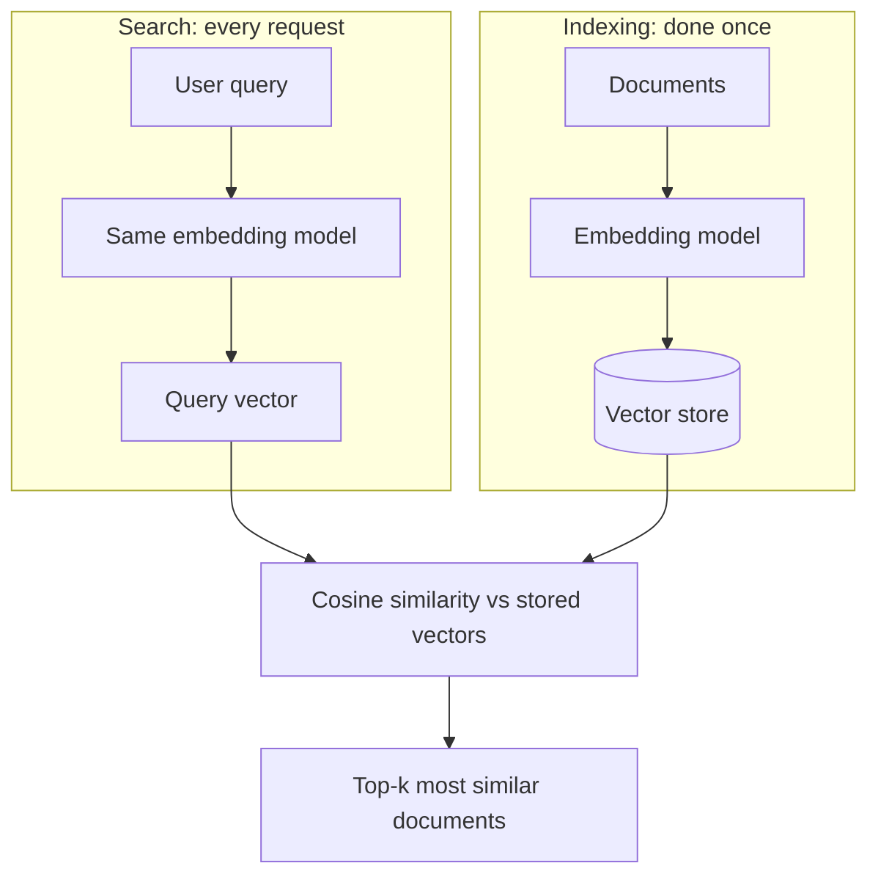
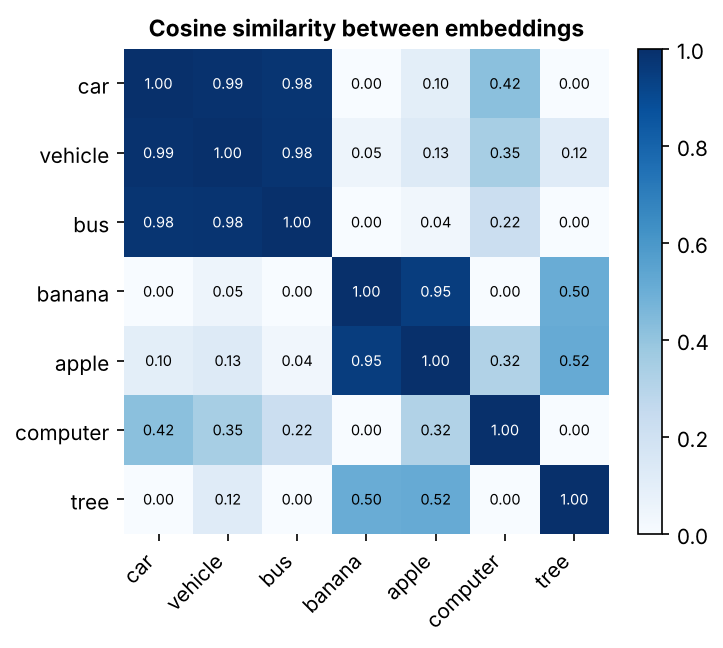

# Embeddings

> An embedding is a vector of numbers that represents the meaning of a piece of data, so that similar meanings end up close together.

| | |
|---|---|
| **Chapter** | [Language Models](README.md) · Topic 2 of 8 |
| **Prerequisites** | [Tokenization](01-tokenization.md) |
| **Example code** | [`examples/language_models/embeddings_similarity.py`](../../examples/language_models/embeddings_similarity.py) |
| **Used in project** | Yes. `multilingual-e5-small` embeddings for vehicle-manual search. |

---

## Introduction

A token ID like `2451` is just a label, and the number itself carries no meaning. Embeddings turn those labels into vectors where **distance means something**: "car" lands near "vehicle", and far from "banana".

## What is it?

An **embedding** is a numerical vector representation of data, such as text, designed to capture useful **semantic relationships**.

| Tokens | Embeddings |
|---|---|
| Units of text | Numerical representations of those units |
| `"love"` | `[0.21, -0.83, 0.45, …]` (hundreds of dimensions) |


## Why is it needed?

Embeddings let computers compare meaning instead of exact words. They're mostly used in:

1. **Semantic search:** find "engine oil change interval" even when the user types "when to replace oil"
2. **Recommendation systems:** suggest items similar to what a user liked
3. **Clustering:** group similar documents automatically
4. **RAG:** retrieve relevant context for an LLM
5. **Document retrieval**

## How does it work?

There are two kinds of embedding:

| Kind | What it represents | Where it lives |
|---|---|---|
| **Token embeddings** | One vector per token | The first layer of every LLM (an `[vocab_size × d_model]` lookup table) |
| **Sentence / document embeddings** | One vector per whole passage | Produced by an embedding model, used for search and RAG |

Similarity is usually measured with **cosine similarity**, the angle between two vectors:

```text
cosine(a, b) = (a · b) / (|a| × |b|)      1.0 = same direction, 0.0 = unrelated
```

## Architecture



## Practical implementation

- Use a dedicated embedding model (e.g. `multilingual-e5-small`, OpenAI or Gemini embedding APIs) for sentences.
- Use the **same model** to embed both the documents and the queries.
- Store the vectors in a **vector database** (ChromaDB, FAISS, pgvector) for fast nearest-neighbour search.

## Code example

[`examples/language_models/embeddings_similarity.py`](../../examples/language_models/embeddings_similarity.py) uses hand-made 4-dimensional vectors (`[transport, food, technology, nature]`) so the numbers are easy to read:

```python
def cosine_similarity(a, b):
    return float(np.dot(a, b) / (np.linalg.norm(a) * np.linalg.norm(b)))
```

```bash
python examples/language_models/embeddings_similarity.py
```

```text
car vs vehicle: 0.990
car vs banana : 0.000

semantic search for 'car': vehicle (0.99), bus (0.98), computer (0.42)

semantic search for 'banana': apple (0.95), tree (0.50), vehicle (0.05)
```



Related words form bright blocks: transport words together, food words together.

## Real-world use cases

- Search engines that understand intent, not just keywords
- "Customers also bought" recommendations
- Duplicate detection and document clustering
- The retrieval step of every RAG system

**In my project:** the voice assistant embeds vehicle-manual chunks and user questions with **`intfloat/multilingual-e5-small`**, stores them in **ChromaDB**, and retrieves the closest chunk for each question (`retrieve_manual_context` in [`voice-assistant/api.py`](https://github.com/SEVT-Logistics-Private-Limited/tiny-llm-jetson/blob/main/voice-assistant/api.py)). The model is baked into the Docker image so it never downloads at runtime.

## Common mistakes and best practices

| Mistake | Better approach |
|---|---|
| Embedding documents and queries with different models | Their vectors are incomparable. Always use the same model. |
| Ignoring model-specific prefixes | E5 models expect `"query: "` and `"passage: "` prefixes |
| Comparing unnormalised vectors with dot product | Normalise, or use cosine similarity |
| Not re-embedding after changing models | Re-index everything when the embedding model changes |

## Key takeaways

- Embeddings are vectors of numbers that capture **meaning**.
- Tokens are units of text; embeddings are their numerical representations.
- Cosine similarity measures how close two meanings are. It powers semantic search, recommendations and RAG.

---

**Previous:** [← Tokenization](01-tokenization.md) · [Chapter overview](README.md) · **Next:** [Transformer Architecture →](03-transformer-architecture.md)
