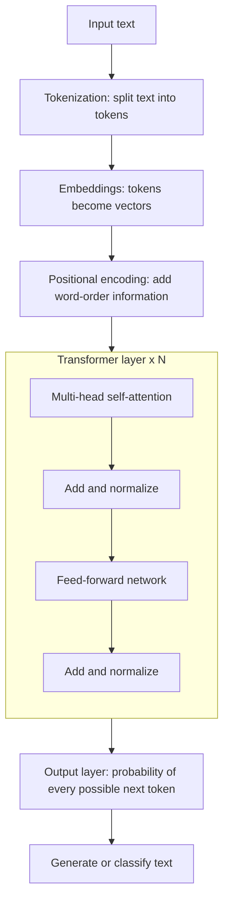

# Transformer Architecture

> The Transformer is the deep learning architecture behind every modern LLM, including GPT, Claude, Gemini and Llama.

| | |
|---|---|
| **Chapter** | [Language Models](README.md) · Topic 3 of 8 |
| **Prerequisites** | [Embeddings](02-embeddings.md) |
| **Example code** | See [Attention Mechanism](04-attention-mechanism.md) for the core building block |
| **Used in project** | Yes. Telugu GPT with 8 Transformer layers. |

---

## Introduction

Before Transformers (2017), language models read text one word at a time (RNNs), which was slow and forgot long-range context. The Transformer processes **all tokens at once** and lets every token look at every other token through **attention**. That made it both faster to train and far better at understanding context.

## What is it?

A **Transformer** is a type of deep learning architecture that helps computers **understand and generate human language**. It's built from a stack of identical **layers**, and each layer contains:

- **Self-attention:** lets each token gather information from the other tokens
- **Feed-forward network:** processes each token's updated vector independently

## Why is it needed?

| Problem with older models (RNNs) | How the Transformer solves it |
|---|---|
| Reads tokens one at a time, so it's slow | Processes all tokens in parallel, so it trains fast on GPUs |
| Forgets early words in long text | Attention connects any two tokens directly |
| Hard to scale | Scales to billions of parameters |

## How does it work?

| Stage | What it does |
|---|---|
| **Tokenization** | Split the text into tokens |
| **Embeddings** | Convert the tokens into vectors |
| **Positional encoding** | Add word-order information. Attention on its own has no sense of order, so "dog bites man" and "man bites dog" would look identical. |
| **Transformer layers** | Understand context. One layer processes the input, and the next layer processes the updated result. Each layer = self-attention + feed-forward network. |
| **Output predictions** | Generate or classify text |

**Context length** is the maximum number of tokens the model can process together in one input.

### Encoder vs decoder

Transformers come in two flavours (and a combination of both):

| Encoder | Decoder |
|---|---|
| **Understands** the given text | **Generates** the next token |
| A neural network that processes input text and understands the relationships between tokens | Generates text one token at a time, using the previous tokens as context |
| Builds rich representations of the input | Designed for generating output tokens |
| Every token can see every other token | Each token sees only earlier tokens ([masking](04-attention-mechanism.md#masking)) |
| Used for understanding and classification | Used for text generation |
| Examples: text classification, sentiment analysis (BERT) | Examples: GPT-style models |

Translation models (the original 2017 Transformer, T5) use **both**: an encoder reads the source sentence and a decoder writes the translation.

## Architecture



"Add and normalize" means the layer's input is added back to its output (a **residual connection**) and then normalised. This keeps training stable in deep stacks.

## Practical implementation

You rarely build a Transformer from scratch in production. Pretrained models are loaded from libraries such as Hugging Face Transformers or called through APIs. Building one from scratch, as in tiny-llm-jetson, is the best way to understand it.

A Transformer's size is set by a handful of hyperparameters:

| Hyperparameter | Meaning |
|---|---|
| `n_layer` | Number of stacked Transformer layers |
| `n_head` | Number of attention heads per layer |
| `n_embd` (d_model) | Size of each token's vector |
| `block_size` | Context length |
| `vocab_size` | Number of distinct tokens |

## Code example

The heart of every Transformer layer is attention. It's implemented and run in [`examples/language_models/self_attention.py`](../../examples/language_models/self_attention.py) and explained in the [next topic](04-attention-mechanism.md).

A minimal pre-norm decoder layer in PyTorch (the same structure tiny-llm-jetson uses):

```python
import torch.nn as nn

class Block(nn.Module):
    def __init__(self, d_model: int, n_head: int):
        super().__init__()
        self.ln1 = nn.LayerNorm(d_model)
        self.attn = nn.MultiheadAttention(d_model, n_head, batch_first=True)
        self.ln2 = nn.LayerNorm(d_model)
        self.mlp = nn.Sequential(nn.Linear(d_model, 4 * d_model), nn.GELU(), nn.Linear(4 * d_model, d_model))

    def forward(self, x, causal_mask):
        a = self.ln1(x)
        x = x + self.attn(a, a, a, attn_mask=causal_mask, need_weights=False)[0]  # attention + residual
        return x + self.mlp(self.ln2(x))                                          # feed-forward + residual
```

## Real-world use cases

| Model type | Examples | Used for |
|---|---|---|
| Encoder-only | BERT | Classification, sentiment, search ranking |
| Decoder-only | GPT, Claude, Gemini, Llama | Chat, writing, coding |
| Encoder–decoder | T5, original Transformer | Translation, summarisation |
| Vision Transformer | ViT | Image understanding (see [VLMs](../04-computer-vision/03-vision-language-action.md)) |

**In my project:** the Telugu GPT is a decoder-only Transformer with **8 layers**, **8 attention heads**, `n_embd = 512` and a **context length of 128** tokens, about 25 million parameters in total ([`tiny_llm_telugu.py`](https://github.com/SEVT-Logistics-Private-Limited/tiny-llm-jetson/blob/main/tiny_llm_telugu.py)). The same `Block` class was scaled from 984 parameters to 3 billion by changing only these hyperparameters.

## Common mistakes and best practices

| Mistake | Better approach |
|---|---|
| Forgetting positional information | Without it the model treats a sentence as an unordered bag of words |
| Feeding more tokens than the context length | Truncate, or chunk the input |
| Choosing `n_embd` not divisible by `n_head` | Each head gets `n_embd / n_head` dimensions, so it must divide evenly |
| Scaling parameters without scaling data | A huge model on tiny data just memorises it |

## Key takeaways

- A Transformer = embeddings + positional encoding + a stack of (attention + feed-forward) layers.
- **Encoder** = understands. **Decoder** = generates. GPT-style models are decoder-only.
- Context length = how many tokens the model can process in one input.

---

**Previous:** [← Embeddings](02-embeddings.md) · [Chapter overview](README.md) · **Next:** [Attention Mechanism →](04-attention-mechanism.md)
