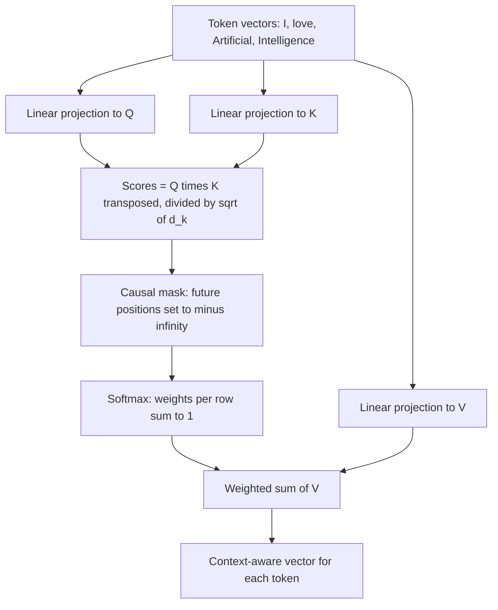
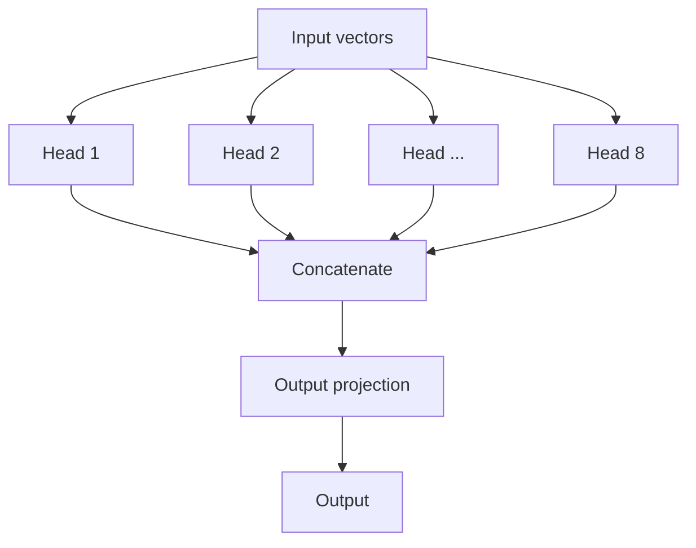
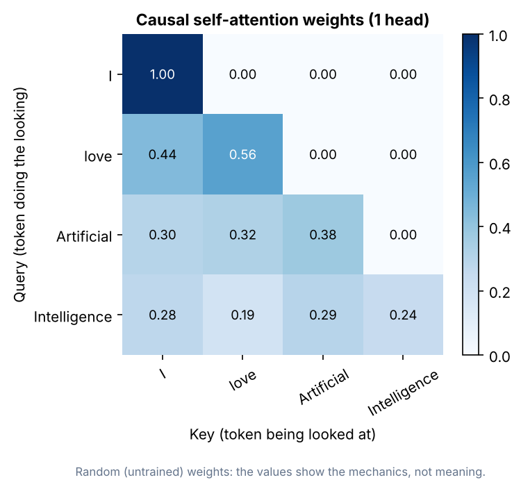

# Attention Mechanism

> Attention lets every token decide which other tokens matter for understanding it. It is the core operation inside every Transformer layer.

| | |
|---|---|
| **Chapter** | [Language Models](README.md) · Topic 4 of 8 |
| **Prerequisites** | [Transformer Architecture](03-transformer-architecture.md) |
| **Example code** | [`examples/language_models/self_attention.py`](../../examples/language_models/self_attention.py) |
| **Used in project** | Yes. 8-head causal attention in the Telugu GPT. |

---

## Introduction

The word **"bank"** means different things in "I deposited money in the bank" and "we sat on the river bank". A model can only tell which meaning is right by looking at the surrounding words. **Self-attention** is the mechanism that does this looking. This page covers self-attention, the Query/Key/Value idea, multi-head attention, and masking.

## What is it?

| Concept | Definition |
|---|---|
| **Self-attention** | A mechanism that lets the Transformer understand relationships between different words (tokens) in a sentence |
| **Query (Q)** | What am I looking for? |
| **Key (K)** | What does each item offer? How relevant is it? (used for matching) |
| **Value (V)** | What information do I get? (the actual content) |
| **Multi-head attention** | Several attention operations running **in parallel**, each with its own learned Q/K/V projections |
| **Masking** | Hiding selected tokens from the attention mechanism so the model can't access information it shouldn't |

## Why is it needed?

- Words get their meaning from **context**. Attention lets each token pull in information from the relevant tokens.
- **Multiple heads** let the model track several kinds of relationships at once.
- **Masking** keeps training honest: when learning to predict the next word, the model must not see the answer.

## How does it work?

### Query, Key, Value: the library analogy

Imagine you're in a library with 1000 books, and you want a book about AI.

1. **Query:** you tell the librarian "I want a book about AI." This is what you're looking for.
2. **Key:** the librarian compares your request with the label on each book (Book 1: Python, Book 2: AI, Book 3: Cooking). The labels are used to decide which book matches.
3. **Value:** the librarian hands you the best match. You open it and get the actual content.

In a sentence such as **"I love Artificial Intelligence"**, each token is turned into a vector, and **every token gets its own Query, Key and Value**.

### The math

```text
Attention(Q, K, V) = softmax( Q · Kᵀ / √d_k ) · V
```

1. `Q · Kᵀ`: score how well every query matches every key
2. `/ √d_k`: scale the scores so the softmax doesn't saturate when vectors are large
3. `softmax`: turn each token's scores into weights that sum to 1
4. `· V`: each token's output is a weighted mix of all the values

### Multi-head attention

Instead of performing a single attention calculation, Transformers use multiple attention heads. Each head can learn a different type of relationship:

| Head | Might learn |
|---|---|
| Head 1 | Grammatical relationships |
| Head 2 | Nearby-word relationships |
| Head 3 | Coreference: what "it" or "she" refers to |
| Head 4 | Semantic relationships |

**Definition:** multi-head attention performs attention in multiple learned representation subspaces in parallel, which lets the model capture different relationships between tokens.

| Self-attention | Multi-head attention |
|---|---|
| One attention operation | Multiple attention operations running in parallel |

### Masking

**The exam analogy.** You are writing an exam and the question is:

> "The capital of India is ______"

You need to fill in the blank. Now imagine the teacher shows you the answer before you even attempt it. You'd learn nothing. **This is where masking comes in.**

A decoder learns by predicting the next token. A **causal mask** hides every future token, so position 3 can see positions 1–3 but not 4 onwards:

```text
            I    love  Artificial  Intelligence
I           ✓     ✗       ✗            ✗
love        ✓     ✓       ✗            ✗
Artificial  ✓     ✓       ✓            ✗
Intelligence✓     ✓       ✓            ✓
```

## Architecture





## Practical implementation

In PyTorch, attention is a single fused call that is far faster than writing it by hand:

```python
import torch.nn.functional as F
out = F.scaled_dot_product_attention(q, k, v, is_causal=True)
```

## Code example

[`examples/language_models/self_attention.py`](../../examples/language_models/self_attention.py) implements attention, the causal mask and multi-head splitting in NumPy:

```python
def attention(q, k, v, mask=None):
    d_k = q.shape[-1]
    scores = q @ k.swapaxes(-1, -2) / np.sqrt(d_k)
    if mask is not None:
        scores = np.where(mask, -np.inf, scores)   # hide future tokens
    weights = softmax(scores, axis=-1)
    return weights @ v, weights

def causal_mask(seq_len):
    return np.triu(np.ones((seq_len, seq_len), dtype=bool), k=1)
```

```bash
python examples/language_models/self_attention.py
```

```text
input  shape: (4, 8)  (tokens, d_model)
output shape: (4, 8)  (tokens, d_model)
attention weights shape: (2, 4, 4)  (heads, query tokens, key tokens)

Head 1 attention weights (rows = query token, columns = key token):
                         I        love  Artificial  Intelligen
           I          1.00        0.00        0.00        0.00
        love          0.44        0.56        0.00        0.00
  Artificial          0.30        0.32        0.38        0.00
Intelligence          0.28        0.19        0.29        0.24
```



Every row sums to 1, and everything above the diagonal is 0. That's the causal mask at work. The weights come from random (untrained) projections, so they show the mechanics, not learned meaning.

## Real-world use cases

- Resolving ambiguous words ("bank", "bat") from context
- Linking pronouns to the nouns they refer to
- Long-document understanding: any token can attend to any earlier token
- Vision: image patches attend to each other the same way (see [VLMs](../04-computer-vision/03-vision-language-action.md))

**In my project:** every tiny-llm-jetson model applies a causal mask built with `torch.triu(...)`, and the Telugu GPT uses **8 attention heads** per layer ([`tiny_llm.py`](https://github.com/SEVT-Logistics-Private-Limited/tiny-llm-jetson/blob/main/tiny_llm.py), [`tiny_llm_telugu.py`](https://github.com/SEVT-Logistics-Private-Limited/tiny-llm-jetson/blob/main/tiny_llm_telugu.py)).

## Common mistakes and best practices

| Mistake | Better approach |
|---|---|
| Forgetting the causal mask in a decoder | Training loss looks perfect but generation is garbage, because the model peeked at the answers |
| Flipping the mask convention | In PyTorch's `nn.MultiheadAttention`, a boolean mask value of `True` means **hide**. Check your library's convention. |
| Skipping the `√d_k` scaling | Large scores saturate the softmax and gradients vanish |
| Writing attention by hand in production | Use fused kernels (`scaled_dot_product_attention`, FlashAttention) |

## Key takeaways

- Self-attention lets each token weigh every other token to understand context.
- **Query** = what I want, **Key** = what each item offers, **Value** = what I get. Every token has its own Q, K and V.
- Multi-head attention runs several attentions in parallel to learn different relationships.
- Masking hides future tokens so a decoder can't peek at the answer.

---

**Previous:** [← Transformer Architecture](03-transformer-architecture.md) · [Chapter overview](README.md) · **Next:** [Large Language Models →](05-large-language-models.md)
