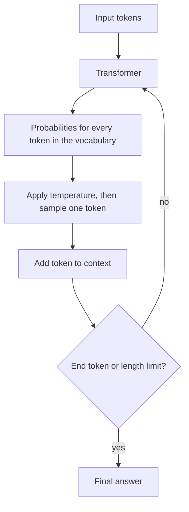
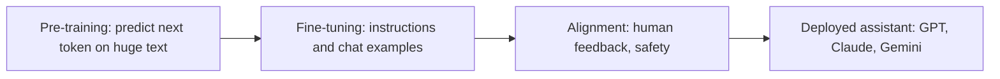
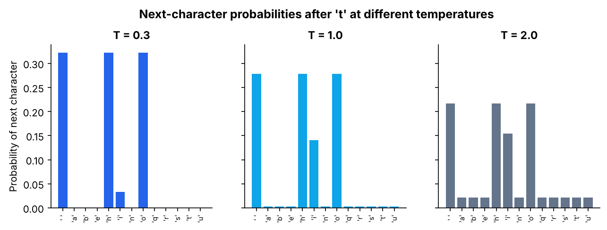

# Large Language Models

> An LLM is a Transformer trained on huge amounts of text to predict the next token. Generating a whole answer is just repeating that prediction.

| | |
|---|---|
| **Chapter** | [Language Models](README.md) · Topic 5 of 8 |
| **Prerequisites** | [Attention Mechanism](04-attention-mechanism.md) |
| **Example code** | [`examples/language_models/text_generation.py`](../../examples/language_models/text_generation.py) |
| **Used in project** | Yes. GPT-style models built from scratch, and Gemini in production. |

---

## Introduction

ChatGPT, Claude and Gemini all work the same way at their core: read the tokens so far, predict the most likely next token, append it, and repeat. This page explains what makes a model "large", what "GPT" means, how generation works, and how **temperature** controls randomness.

## What is it?

- **LLM (Large Language Model):** an AI model (a neural network) trained on a very large amount of text data to learn language patterns and the relationships between tokens, and to **predict the next token** in a sequence.
  - **In simple words:** it learns patterns from text and uses those patterns to understand and generate language.
  - Examples: models from families such as GPT, Claude and Gemini.
- **GPT** stands for **Generative Pre-trained Transformer**.
  - GPT-style models are generally **decoder-only** Transformer models designed for **autoregressive generation**: the model generates the answer **token by token**.
  - Examples: GPT-3, GPT-4, GPT-5, Llama, Qwen.
- **Temperature:** controls the **randomness of token selection** during generation. It affects the generation (sampling) process.

## Why is it needed?

One model trained only to predict the next token turns out to be able to answer questions, summarise, translate, write code and hold conversations. That's because all of these can be phrased as "continue this text".

## How does it work?

### Training: next-token prediction

From any text, the model learns to predict each token from the tokens before it:

| Input (context) | Target (next token) |
|---|---|
| `The` | `capital` |
| `The capital` | `of` |
| `The capital of` | `India` |
| `The capital of India` | `is` |

### Generation: the autoregressive loop

1. Input tokens go into the Transformer.
2. The model outputs a probability for **every** token in the vocabulary.
3. One token is picked (sampled).
4. That token is added to the context.
5. Repeat until an end-of-text token or the length limit.

### Temperature

Before sampling, the model's raw scores (logits) are divided by the temperature `T`:

```text
probabilities = softmax(logits / T)
```

| Temperature | Effect | Good for |
|---|---|---|
| Low (0–0.3) | Sharpens the distribution: the top token dominates. Focused and predictable. | Facts, code, data extraction |
| Medium (~0.7) | A balance | General chat |
| High (1.0+) | Flattens the distribution: unlikely tokens get picked more often. Creative and varied. | Brainstorming, stories |

## Architecture





## Practical implementation

Calling a hosted LLM means sending messages and generation settings:

```python
# Shape of a typical chat API request (provider SDKs differ slightly)
request = {
    "model": "your-model-name",
    "messages": [{"role": "user", "content": "Explain RAG in one sentence."}],
    "temperature": 0.2,   # low = focused
    "max_tokens": 200,    # caps output length (and cost)
}
```

## Code example

[`examples/language_models/text_generation.py`](../../examples/language_models/text_generation.py) trains a tiny character-level **bigram** model on the same toy corpus as tiny-llm-jetson, then generates text with the autoregressive loop:

```python
def apply_temperature(logits, temperature):
    z = logits / temperature
    p = np.exp(z - z.max())
    return p / p.sum()

for _ in range(n_tokens):
    probs = apply_temperature(model.logits[stoi[out[-1]]], temperature)
    out.append(chars[rng.choice(len(chars), p=probs)])   # sample, add to context, repeat
```

```bash
python examples/language_models/text_generation.py
```

```text
Next-token distribution after 't' (higher entropy = more random):
  T=0.3: top token ' ' with p=0.32, entropy=1.74 bits
  T=1.0: top token ' ' with p=0.28, entropy=2.15 bits
  T=2.0: top token ' ' with p=0.22, entropy=2.93 bits

T=0.3: 'to t be to to t t that que toto thathatoth'
T=1.0: 'tor bator que t t that be thutisthathatoth'
T=2.0: 'tor b tqtonto t r tion bisrauunorabnoeesth'
```



At `T = 0.3` almost all the probability sits on a few characters. At `T = 2.0` it spreads across many, so the output becomes less coherent.

## Real-world use cases

- Chat assistants and customer support
- Code generation and review
- Summarisation, translation and extraction
- Voice assistants (combined with speech-to-text and text-to-speech)

**In my project:**
- **From scratch:** [tiny-llm-jetson](https://github.com/SEVT-Logistics-Private-Limited/tiny-llm-jetson) contains GPT-style, decoder-only models scaled from **984 parameters to ~3 billion**. There's also a **25M-parameter Telugu GPT** trained on real Telugu text.
- **In production:** the live voice assistant uses **Google Gemini** as its LLM, with a fallback chain of models in case one fails.

## Common mistakes and best practices

| Mistake | Better approach |
|---|---|
| Using high temperature for factual tasks | Use low temperature for facts and code |
| Treating LLM output as verified truth | LLMs predict plausible text, so validate important answers (see [Hallucination](07-hallucination.md)) |
| No `max_tokens` limit | Always cap output length to control cost and latency |
| Expecting the model to know recent events | Its knowledge stops at the training cutoff. Use [RAG](08-retrieval-augmented-generation.md) for fresh data. |

## Key takeaways

- An LLM is a Transformer trained to **predict the next token**.
- GPT = Generative Pre-trained Transformer: decoder-only and autoregressive.
- Generation loop: predict → sample → append → repeat.
- Temperature controls randomness: low for focused answers, high for creative ones.

---

**Previous:** [← Attention Mechanism](04-attention-mechanism.md) · [Chapter overview](README.md) · **Next:** [Prompt Engineering →](06-prompt-engineering.md)
