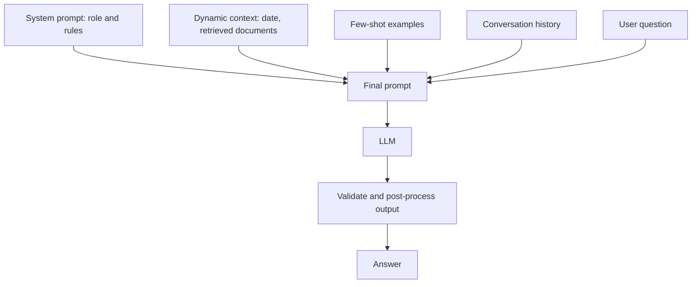

# Prompt Engineering

> How you phrase a request changes what an LLM gives back. Prompt engineering is designing that input deliberately.

| | |
|---|---|
| **Chapter** | [Language Models](README.md) · Topic 6 of 8 |
| **Prerequisites** | [Large Language Models](05-large-language-models.md) |
| **Example code** | [`examples/language_models/prompt_templates.py`](../../examples/language_models/prompt_templates.py) |
| **Used in project** | Yes. Role prompt and rules for the "Yodha" assistant. |

---

## Introduction

An LLM continues whatever text you give it. Everything it knows about your task (the goal, the format, the persona, the examples) has to be in the prompt. Small changes in wording or examples can turn a vague answer into a precise one, with no retraining.

## What is it?

| Technique | Definition | Examples given |
|---|---|---|
| **Zero-shot prompting** | Asking the model to perform a task **without** providing an example | None |
| **One-shot prompting** | Providing **one** example before asking the model to perform the task | One |
| **Few-shot prompting** | Providing **multiple** examples | Several |
| **Chain of thought** | Asking for **step-by-step reasoning** to solve a complex problem | – |
| **Role prompting** | Telling the model **what role or perspective** to adopt | – |

**Role prompting example:**

> "You are an experienced AWS cloud engineer. Explain AWS IAM."

## Why is it needed?

- It's the **cheapest** way to improve output: no training, no infrastructure.
- Examples (few-shot) teach the **format** you want.
- Step-by-step reasoning improves accuracy on multi-step problems.
- Clear rules reduce [hallucination](07-hallucination.md).

## How does it work?

A production prompt is usually built from layers:

| Layer | Contains | Changes |
|---|---|---|
| **System / role** | Persona, rules, output format | Rarely |
| **Context** | Retrieved documents, current date, user profile | Every request |
| **Examples** | Few-shot demonstrations | Occasionally |
| **User message** | The actual question | Every request |

## Architecture



## Practical implementation

Chat APIs separate the **system** message (role and rules) from **user** messages:

```python
messages = [
    {"role": "system", "content": "You are an experienced AWS cloud engineer."},
    {"role": "user", "content": "Explain AWS IAM."},
]
```

## Code example

[`examples/language_models/prompt_templates.py`](../../examples/language_models/prompt_templates.py) turns each technique into a reusable function:

```python
def few_shot(task, examples, text):
    shots = "\n\n".join(f"Text: {x}\nAnswer: {y}" for x, y in examples)
    return f"{task}\n\n{shots}\n\nText: {text}\nAnswer:"
```

```bash
python examples/language_models/prompt_templates.py
```

```text
--- few-shot ---
Classify the sentiment as Positive or Negative.

Text: I love this phone.
Answer: Positive

Text: Worst purchase ever.
Answer: Negative

Text: Setup took two minutes.
Answer:

--- role prompting (chat messages) ---
system: You are an experienced AWS cloud engineer.
  user: Explain AWS IAM.
```

## Real-world use cases

| Technique | Typical use |
|---|---|
| Zero-shot | Quick questions, simple classification |
| Few-shot | Consistent output formats, labelling data |
| Chain of thought | Maths, planning, debugging |
| Role prompting | Assistants with a fixed persona or domain |

**In my project:** the voice assistant's system prompt (`build_system` in [`voice-assistant/api.py`](https://github.com/SEVT-Logistics-Private-Limited/tiny-llm-jetson/blob/main/voice-assistant/api.py)) combines several layers:
- **Role:** "You are Yodha, a friendly Telugu AI assistant" (written in Telugu)
- **Rules:** answer mainly in Telugu, match the answer length to the question, don't use symbols like `*` or `#` (they would be read aloud), and say "I don't know" instead of guessing
- **Dynamic context:** the current IST time, date and weekday, plus the retrieved vehicle-manual passage when available

## Common mistakes and best practices

| Mistake | Better approach |
|---|---|
| Vague instructions ("make it better") | State the goal, audience, format and length |
| Relying on the prompt alone for strict formats | Also validate or post-process the output |
| Examples that conflict with the instructions | Keep examples consistent with the rules |
| Putting untrusted text into the prompt as instructions | Clearly separate user data and documents from instructions (prompt injection) |

## Key takeaways

- Zero-shot = no examples, one-shot = one, few-shot = several.
- Chain of thought asks for step-by-step reasoning. Role prompting sets a perspective.
- A good prompt layers role, context, examples and the question.

---

**Previous:** [← Large Language Models](05-large-language-models.md) · [Chapter overview](README.md) · **Next:** [Hallucination →](07-hallucination.md)
