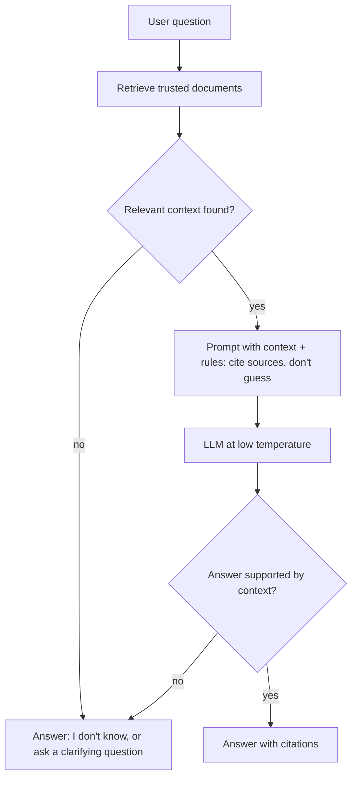

# Hallucination

> An LLM hallucinates when it confidently generates information that sounds plausible but is incorrect, unsupported or made up.

| | |
|---|---|
| **Chapter** | [Language Models](README.md) · Topic 7 of 8 |
| **Prerequisites** | [Large Language Models](05-large-language-models.md), [Prompt Engineering](06-prompt-engineering.md) |
| **Example code** | The mitigations are shown in [`prompt_templates.py`](../../examples/language_models/prompt_templates.py) and [`rag_pipeline.py`](../../examples/language_models/rag_pipeline.py) |
| **Used in project** | Yes. "Don't guess" rules plus RAG grounding. |

---

## Introduction

Hallucination is the biggest reliability problem with LLMs. The model doesn't know when it doesn't know. It just produces the most plausible continuation, and a fluent wrong answer looks exactly like a fluent right one.

## What is it?

An LLM hallucinates when it generates information that **appears plausible but is incorrect, unsupported or fabricated**.

> **Example:** "Who invented XYZ technology?" The model confidently names a person who never invented it.

## Why is it needed?

Understanding hallucination is essential before putting an LLM in front of users. A support bot that invents a refund policy, or a vehicle assistant that invents a service interval, causes real harm.

## How does it work?

### Why does hallucination happen?

LLMs generate outputs based on **learned patterns** and the **information or context available to them**. They don't automatically verify every statement against a trusted database or reality.

Contributing factors:

| # | Cause | Example |
|---|---|---|
| 1 | Missing information | The fact was never in the training data |
| 2 | Ambiguous questions | "What's the limit?" (which limit?) |
| 3 | Poor prompts | No instruction to admit uncertainty |
| 4 | Outdated knowledge | Events after the training cutoff |
| 5 | Insufficient context | The relevant document wasn't provided |
| 6 | Long or complex tasks | Errors compound across many steps |
| 7 | Retrieval failures | RAG fetched the wrong document |

### How can you reduce hallucinations?

| # | Mitigation | How it helps |
|---|---|---|
| 1 | **RAG** | Answers come from real documents |
| 2 | **Better prompts** | Explicit rules such as "say you don't know" |
| 3 | **Structured outputs** | A JSON schema limits free-form invention |
| 4 | **Validation against trusted sources** | Check key facts programmatically |
| 5 | **Lower randomness when appropriate** | Low temperature for factual tasks |
| 6 | **Citations / source grounding** | Every claim must point to a source |

## Architecture



## Practical implementation

A grounding instruction that pairs with RAG (this is the template used in [`rag_pipeline.py`](../../examples/language_models/rag_pipeline.py)):

```text
Answer the question using only the context below.
If the answer is not in the context, say you don't know.

Context:
[engine-manual.txt] Engine oil should be changed every 10,000 km or once a year...

Question: When should I change the engine oil?
Answer:
```

## Code example

There is no reliable "hallucination detector" in a few lines of code. The practical tools are the two examples above: [`prompt_templates.py`](../../examples/language_models/prompt_templates.py) for clear instructions, and [`rag_pipeline.py`](../../examples/language_models/rag_pipeline.py) for grounding plus a relevance threshold. If no chunk scores above `min_score`, the prompt says so explicitly:

```python
def build_prompt(question, results):
    if not results:
        context = "No relevant documents were found."
    ...
```

## Real-world use cases

- Customer support bots that must quote real policies
- Medical, legal and financial assistants, where wrong answers are costly
- Enterprise search over internal documents

**In my project:** the voice assistant uses three of these mitigations:
1. **Prompt rules:** "Don't imagine unknown facts", and for live data it should say "I don't know that live" (written in Telugu in `build_system`)
2. **RAG:** vehicle-manual passages are injected as context
3. **A relevance threshold:** retrieved passages are only used when they are close enough to the question (`distance_threshold=0.35` in `retrieve_manual_context`)

Code: [`voice-assistant/api.py`](https://github.com/SEVT-Logistics-Private-Limited/tiny-llm-jetson/blob/main/voice-assistant/api.py)

## Common mistakes and best practices

| Mistake | Better approach |
|---|---|
| Assuming a confident tone means a correct answer | Confidence and correctness are unrelated in LLMs |
| Adding RAG but never checking retrieval quality | Measure retrieval (Precision@K, Recall@K), because bad retrieval causes hallucination too |
| Using a high temperature for factual Q&A | Use low temperature for facts |
| No "I don't know" path | Explicitly allow and encourage the model to say it doesn't know |

## Key takeaways

- Hallucination = plausible but wrong or made-up output.
- It happens because LLMs generate from patterns and don't verify facts.
- Reduce it with RAG, clear prompts, structured outputs, validation, low temperature and citations.

---

**Previous:** [← Prompt Engineering](06-prompt-engineering.md) · [Chapter overview](README.md) · **Next:** [Retrieval-Augmented Generation →](08-retrieval-augmented-generation.md)
