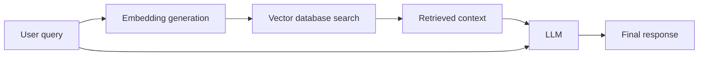
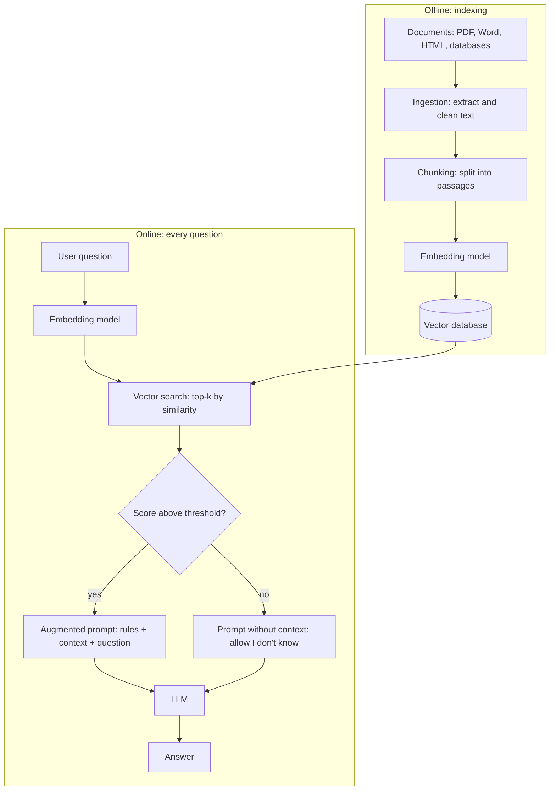
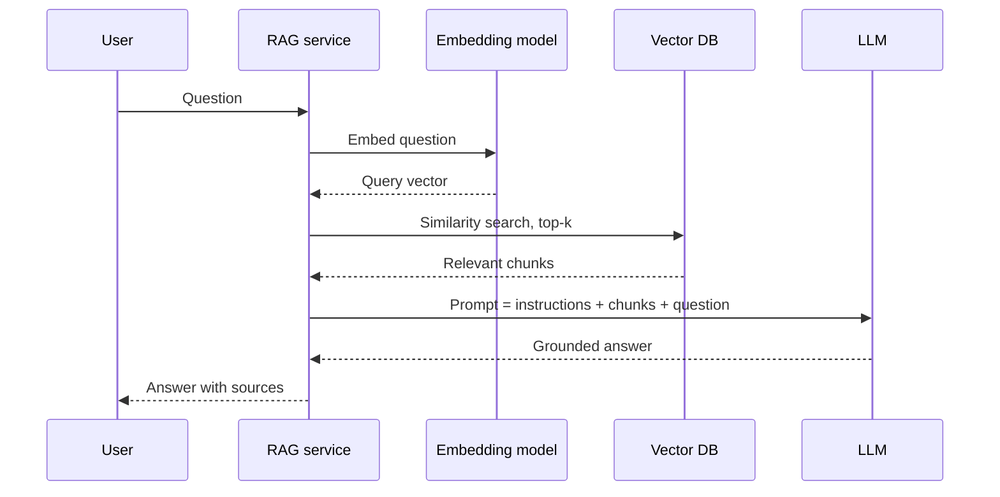
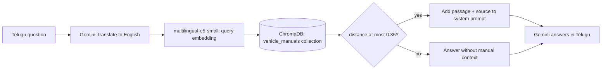

# Retrieval-Augmented Generation (RAG)

> RAG combines information retrieval with an LLM: find the relevant documents first, then let the LLM answer using them.

| | |
|---|---|
| **Chapter** | [Language Models](README.md) · Topic 8 of 8 |
| **Prerequisites** | [Embeddings](02-embeddings.md), [Hallucination](07-hallucination.md) |
| **Example code** | [`examples/language_models/rag_pipeline.py`](../../examples/language_models/rag_pipeline.py) |
| **Used in project** | Yes. Vehicle-manual RAG with ChromaDB and `multilingual-e5-small`. |

---

## Introduction

An LLM only knows what was in its training data. It doesn't know your company's documents, last week's policy change, or your vehicle's service manual. RAG fixes this without retraining: at question time, search your own knowledge base and hand the best passages to the model.

## What is it?

**RAG** is an approach that **combines information retrieval with an LLM to generate answers**.

| Step | What happens |
|---|---|
| **Retrieval** | Find relevant information in documents or a knowledge base |
| **Augmentation** | Add the retrieved information to the LLM's prompt |
| **Generation** | Let the LLM produce an answer using the question and the retrieved context |

### Building blocks

| Term | Definition |
|---|---|
| **Document ingestion** | The process of bringing source data into the RAG system and preparing it for retrieval. Sources include PDF files, Word documents, HTML pages, text files, knowledge bases and databases. |
| **Chunking** | Splitting a large document into smaller pieces of text |
| **Embedding** | A numerical vector representing text or other information (see [Embeddings](02-embeddings.md)) |
| **Retrieval** | The process of finding relevant information in the indexed knowledge base |

## Why is it needed?

1. **Reduces hallucination:** the model answers from real documents
2. **Latest information:** update the documents, not the model
3. **Cost effective:** no training runs needed
4. **Better accuracy** on domain-specific questions

### RAG vs fine-tuning

| RAG | Fine-tuning |
|---|---|
| Requires a retrieval pipeline | Requires a training dataset and workflow |
| Good for **private, changing knowledge** | Good for adapting **style, tone, behaviour and domain patterns** |
| Update knowledge by updating the sources | Requires another training or fine-tuning run |
| Can cite sources | Knowledge is baked into the weights, so there's nothing to cite |

They complement each other: fine-tune for *how* to answer, use RAG for *what facts* to use.

## How does it work?

RAG has two phases.

**Offline (indexing), done once and whenever documents change:**
1. **Ingest** documents (PDF, Word, HTML, databases)
2. **Chunk** them into small passages
3. **Embed** each chunk into a vector
4. **Store** the vectors and text in a vector database

**Online (query time), on every question:**
1. **Embed** the user's question with the same model
2. **Vector search:** find the most similar chunks
3. **Retrieve** the top-k chunks as context
4. **Augment** the prompt with that context
5. The **LLM generates** the final answer

## Architecture

The core query flow:



The full system, with both phases:



The same flow as a sequence:



## Practical implementation

A typical production stack:

| Component | Common choices |
|---|---|
| Ingestion | PDF/HTML parsers, OCR for scanned documents |
| Chunking | Fixed-size with overlap, or by headings and paragraphs |
| Embeddings | `multilingual-e5`, `bge`, OpenAI or Gemini embedding APIs |
| Vector database | ChromaDB, FAISS, pgvector, Pinecone |
| LLM | Gemini, GPT, Claude, Llama |

## Code example

[`examples/language_models/rag_pipeline.py`](../../examples/language_models/rag_pipeline.py) is a complete, runnable pipeline. It uses NumPy TF-IDF vectors in place of a neural embedding model so it runs anywhere, and three short sample documents written for the example.

```python
def chunk_text(text, chunk_size=25, overlap=5):
    words = text.split()
    step = chunk_size - overlap
    return [" ".join(words[i:i + chunk_size]) for i in range(0, max(len(words) - overlap, 1), step)]

chunks = ingest(SAMPLE_DOCUMENTS)          # ingestion + chunking
index = TfidfIndex(chunks)                 # embeddings + vector store
results = index.search(question, k=2)      # retrieval
prompt = build_prompt(question, results)   # augmentation -> send to any LLM
```

```bash
python examples/language_models/rag_pipeline.py
```

```text
ingested 3 documents -> 6 chunks, vocabulary of 75 words

query: When should I change the engine oil?
  0.43  [engine-manual.txt] Engine oil should be changed every 10,000 km or once a year,...
  0.29  [engine-manual.txt] on the filler cap. Check the oil level every month with the ...

--- augmented prompt sent to the LLM ---
Answer the question using only the context below. If the answer is not in the context, say you don't know.

Context:
[engine-manual.txt] Engine oil should be changed every 10,000 km or once a year, whichever comes first. Use the oil grade listed on the filler cap. Check
[engine-manual.txt] on the filler cap. Check the oil level every month with the dipstick while the engine is cold and the vehicle is on level ground.

Question: When should I change the engine oil?
Answer:

retrieval evaluation on 3 questions: Precision@1=1.00, Recall@1=1.00
```

The overlap is visible: "on the filler cap. Check" appears at the end of chunk 1 and the start of chunk 2, so no sentence is lost at a boundary.

## Evaluating a RAG system

How do you know your RAG system is working well? Evaluate it with several metrics:

| # | Metric | Question it answers |
|---|---|---|
| 1 | **Retrieval accuracy:** Precision@K, Recall@K | Did we fetch the right chunks? |
| 2 | **Faithfulness** | Does the answer stick to the retrieved context? |
| 3 | **Answer relevance** | Does the answer address the question? |
| 4 | **Context precision** | How much of the retrieved context was actually useful? |
| 5 | **Production monitoring** | Latency, response quality, hallucination rate |

- **Precision@K** = relevant chunks in the top K ÷ K
- **Recall@K** = relevant chunks in the top K ÷ all relevant chunks

## Real-world use cases

- Customer support over product documentation
- Enterprise search over internal wikis and policies
- Legal and medical research assistants with citations
- Vehicle-service assistants that answer from the owner's manual

**In my project:** the voice assistant answers vehicle questions using **RAG over vehicle manuals** (`retrieve_manual_context` in [`voice-assistant/api.py`](https://github.com/SEVT-Logistics-Private-Limited/tiny-llm-jetson/blob/main/voice-assistant/api.py)):



- The question is translated to English because the manuals are in English.
- Only the **single closest** chunk (`n_results=1`) is used, and only if it's close enough (`distance ≤ 0.35`).
- The knowledge base loads in a background thread, so the API keeps working even if the database is unavailable.

## Common mistakes and best practices

| Mistake | Better approach |
|---|---|
| Chunks too large or too small | Start with 200–500 tokens plus overlap, then tune using evaluation results |
| No overlap between chunks | Use overlap so sentences aren't cut at boundaries |
| Different embedding models for indexing and querying | Always use the same model |
| Retrieving only top-1 | Use top-3 to top-5 (optionally with a reranker) for robustness |
| No relevance threshold | Drop weak matches, because irrelevant context causes wrong answers |
| Never measuring retrieval | Track Precision@K and Recall@K on a labelled question set |

## Key takeaways

- RAG = **Retrieve** relevant chunks → **Augment** the prompt → **Generate** the answer.
- Offline: ingest → chunk → embed → store. Online: embed the query → search → prompt → LLM.
- Use RAG for private, changing knowledge, and fine-tuning for style and behaviour.
- Evaluate retrieval and answers separately.

---

**Previous:** [← Hallucination](07-hallucination.md) · [Chapter overview](README.md) · **Next chapter:** [Computer Vision →](../04-computer-vision/README.md)
