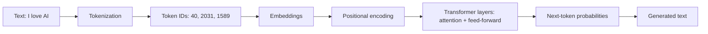

# Language Models

> How a machine reads, understands and generates text, from tokens all the way to Retrieval-Augmented Generation.

| | |
|---|---|
| **Chapter** | 3 of 5 |
| **Prerequisites** | [AI Fundamentals](../02-ai-fundamentals/README.md) |
| **Example code** | [`examples/language_models/`](../../examples/language_models/) |

---

## How an LLM reads text

Every topic in this chapter is one stage of this pipeline:

## Topics

Read in order. Each topic builds on the previous one.

| # | Topic | What you'll learn | Code |
|---|---|---|---|
| 1 | [Tokenization](01-tokenization.md) | Tokens, token IDs, why tokens matter | [`tokenizer.py`](../../examples/language_models/tokenizer.py) |
| 2 | [Embeddings](02-embeddings.md) | Vectors that capture meaning, semantic search | [`embeddings_similarity.py`](../../examples/language_models/embeddings_similarity.py) |
| 3 | [Transformer Architecture](03-transformer-architecture.md) | Layers, positional encoding, encoder vs decoder | – |
| 4 | [Attention Mechanism](04-attention-mechanism.md) | Self-attention, Query/Key/Value, multi-head attention, masking | [`self_attention.py`](../../examples/language_models/self_attention.py) |
| 5 | [Large Language Models](05-large-language-models.md) | LLMs, GPT-style models, autoregressive generation, temperature | [`text_generation.py`](../../examples/language_models/text_generation.py) |
| 6 | [Prompt Engineering](06-prompt-engineering.md) | Zero/one/few-shot, chain of thought, role prompting | [`prompt_templates.py`](../../examples/language_models/prompt_templates.py) |
| 7 | [Hallucination](07-hallucination.md) | Why models make things up, and how to reduce it | – |
| 8 | [Retrieval-Augmented Generation](08-retrieval-augmented-generation.md) | Ingestion, chunking, retrieval, evaluation | [`rag_pipeline.py`](../../examples/language_models/rag_pipeline.py) |

## Where these topics appear in my project

| Topic | In the [Telugu Voice Assistant](../../projects/telugu-voice-assistant/README.md) |
|---|---|
| Tokenization | Character-level tokenizer with 245 Telugu characters |
| Transformer, attention | Telugu GPT: 8 layers, 8 heads, context length 128 |
| Masking | Causal mask in every from-scratch model |
| LLM | Gemini generates the assistant's answers |
| Prompt engineering | Role prompt that defines the "Yodha" persona and its rules |
| Embeddings, RAG | Vehicle-manual search with `multilingual-e5-small` + ChromaDB |

---

**Previous:** [← AI Fundamentals](../02-ai-fundamentals/README.md) · [Home](../../README.md) · **Start:** [Tokenization →](01-tokenization.md)
