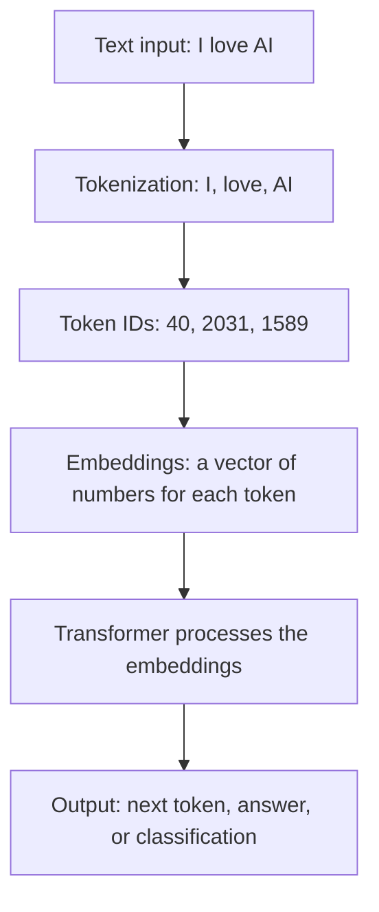
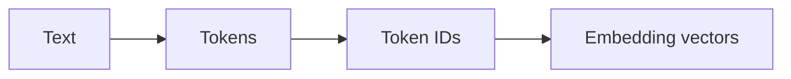
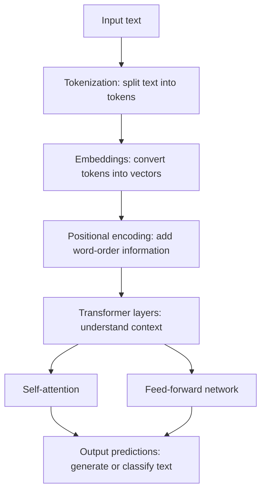
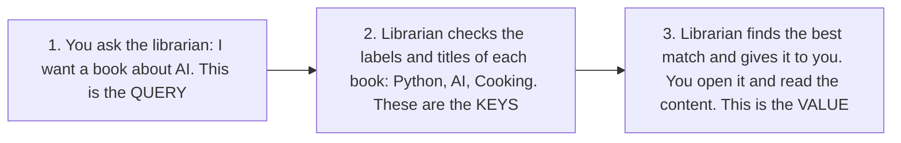
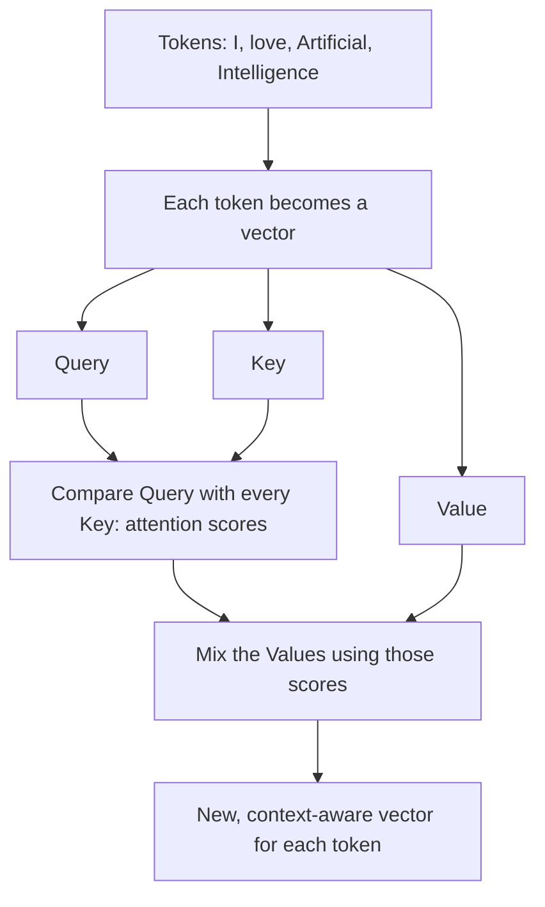
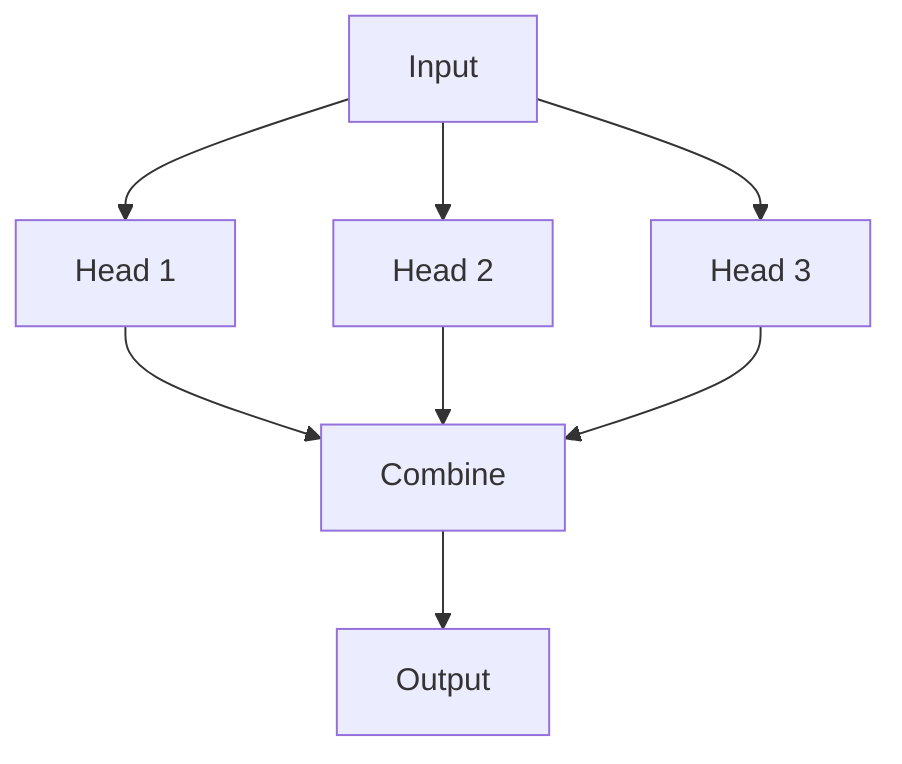
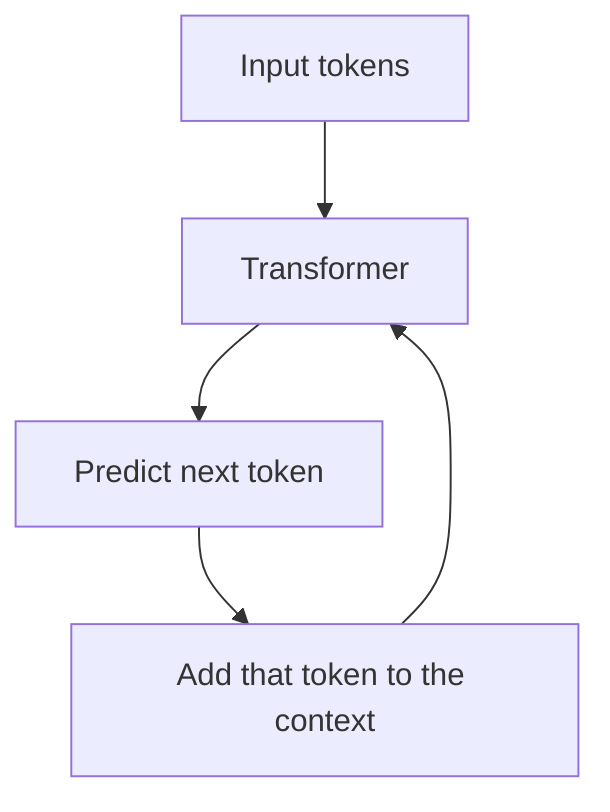
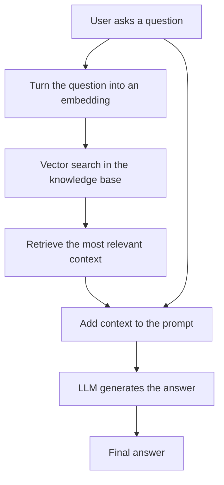
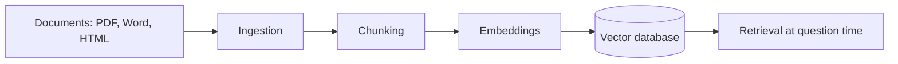

# 3. Text and LLMs

[← Back to contents](../README.md)

**In this chapter:**
1. [How does an LLM read text?](#1-how-does-an-llm-read-text)
2. [Tokens and tokenization](#2-tokens-and-tokenization)
3. [Embeddings](#3-embeddings)
4. [The Transformer](#4-the-transformer)
5. [Encoder vs Decoder](#5-encoder-vs-decoder)
6. [Self-attention: Query, Key, Value](#6-self-attention-query-key-value)
7. [Multi-head attention](#7-multi-head-attention)
8. [Masking](#8-masking)
9. [LLMs and GPT-style models](#9-llms-and-gpt-style-models)
10. [Temperature](#10-temperature)
11. [Prompt engineering](#11-prompt-engineering)
12. [Hallucination](#12-hallucination)
13. [RAG (Retrieval-Augmented Generation)](#13-rag-retrieval-augmented-generation)

---

## 1. How does an LLM read text?

Remember: computers only understand numbers. So an LLM never reads words directly. It goes through these steps:



The rest of this chapter explains each step.

---

## 2. Tokens and tokenization

### Token

A **token** is a unit of text processed by an LLM.

- Depending on the tokenizer, a token can be a whole word, part of a word, punctuation, or another piece of text.
- Punctuation and spaces also affect tokenization.
- LLMs process **tokens, not raw words**.

### Tokenization

**Tokenization** is the process of converting text into tokens that the model can process. Each token is then converted into an **ID** (a number).

```
Tokens  →  Token IDs

"AI"       → 2451
"is"       → 318
"amazing"  → 4567
```

These numbers are then used to look up the **embeddings**.

### Why do tokens matter?

Tokens affect:
- **Context window usage**: how much text fits into one input
- **API cost**: you pay per token
- **Processing time**: more tokens means slower
- **Max prompt length**
- **Max output length**

**In my project:** my first models used the simplest tokenizer possible, **one token per character**. The English model had 13 tokens. My Telugu model had **245 tokens**, one for each Telugu character in the training data ([`tiny_llm_telugu.py`](https://github.com/SEVT-Logistics-Private-Limited/tiny-llm-jetson/blob/main/tiny_llm_telugu.py)).

---

## 3. Embeddings

An **embedding** is a numerical vector (a list of numbers) representing data such as text, designed to capture useful **semantic relationships** (meaning).

Words with similar meaning get similar numbers. So "car" and "vehicle" end up close together, while "car" and "banana" end up far apart.

**Where embeddings are used:**
1. Semantic search: searching by meaning, not exact words
2. Recommendation systems
3. Clustering: grouping similar things
4. RAG
5. Document retrieval

### Tokens vs embeddings



| Tokens | Embeddings |
|---|---|
| Units of text | Numerical representations of those units |
| "love" | [0.21, -0.83, 0.45, …] |

**In my project:** the voice assistant uses an embedding model (`multilingual-e5-small`) to turn questions and vehicle-manual text into vectors, so it can find the manual section that matches the question ([`voice-assistant/api.py`](https://github.com/SEVT-Logistics-Private-Limited/tiny-llm-jetson/blob/main/voice-assistant/api.py), function `retrieve_manual_context`).

---

## 4. The Transformer

A **Transformer** is a type of deep learning architecture. It helps computers **understand and generate human language**. Almost every modern LLM (GPT, Claude, Gemini, Llama) is built on it.

### Architecture



- **Positional encoding** is needed because the Transformer looks at all tokens at once. Without it, "dog bites man" and "man bites dog" would look the same.
- **Transformer layers** are stacked. One layer processes the input, and the next layer processes the updated result. Each layer has **attention + feed-forward**.

**In my project:** my Telugu model has **8 Transformer layers**, **8 attention heads** and a **context length of 128**. Context length is the maximum number of tokens the model can process together in one input ([`tiny_llm_telugu.py`](https://github.com/SEVT-Logistics-Private-Limited/tiny-llm-jetson/blob/main/tiny_llm_telugu.py)).

---

## 5. Encoder vs Decoder

| Encoder | Decoder |
|---|---|
| **Understands** the given text | **Generates** the next token |
| A neural network that processes input text and understands the relationships between tokens | Generates text one token at a time, using the previous tokens as context |
| Builds rich representations of the input | Designed for generating output tokens |
| Used for understanding / classification | Used for text generation |
| Examples: text classification, sentiment analysis | Examples: GPT-style models |

**In my project:** my models are **decoder-only**, like GPT. They generate text one character at a time.

---

## 6. Self-attention: Query, Key, Value

**Self-attention** is a mechanism that lets the Transformer understand the relationships between different words (tokens) in a sentence.

Example: the word **"bank"** means different things:
- "I deposited money in the **bank**" → a money bank
- "We sat by the river **bank**" → a riverbank

Self-attention looks at the **other words around it** to work out which meaning is right.

### Query, Key and Value (Q / K / V)

| | Question it answers | Role |
|---|---|---|
| **Query** | What am I looking for? | The question |
| **Key** | What does each item offer? How relevant is it? | Used for matching |
| **Value** | What information do I get? | The actual information |

### The library example

Imagine you're in a library with 1000 books and you want a book about AI.



1. **Query:** "I want a book about AI." This is what you're looking for.
2. **Key:** the librarian compares your request with the label on each book (Book 1: Python, Book 2: AI, Book 3: Cooking). Keys are used to decide which book matches.
3. **Value:** the librarian hands you the matching book, and you get its actual content.

### In a sentence

For the input **"I love Artificial Intelligence"**:
- Each word becomes a token, and each token has its own vector of numbers.
- **Every token gets its own Q, K and V.**
- Each token's Query is compared with every other token's Key to decide how much attention to pay. The Values are then mixed according to that attention.



---

## 7. Multi-head attention

Instead of performing only **one** attention calculation, Transformers use **multiple attention heads** that run **in parallel**. Each head can learn a different type of relationship:

| Head | Might learn |
|---|---|
| Head 1 | Grammatical relationships |
| Head 2 | Nearby-word relationships |
| Head 3 | Coreference: which word "it" refers to |
| Head 4 | Semantic (meaning) relationships |



**Definition:** multi-head attention performs attention in **multiple learned representation subspaces in parallel**, which lets the model capture different relationships between tokens.

| Self-attention | Multi-head attention |
|---|---|
| One attention operation | Multiple attention operations running in parallel |

**In my project:** my Telugu model uses **8 attention heads**.

---

## 8. Masking

**Masking** is a technique that prevents the Transformer from accessing certain information when it shouldn't. It **hides selected words or tokens from the attention mechanism**.

### The exam example

Imagine you're writing an exam and the question is:

> "The capital of India is ______"

You need to fill in the blank. But imagine the teacher shows you the answer before you even attempt it. Then you haven't learned anything.

**This is where masking comes in.** When a decoder is learning to predict the next word, it must not be allowed to "peek" at the future words. Masking hides them.

```
Predicting word 3 →  can see: word 1, word 2   |  hidden: word 3, word 4, …
```

**In my project:** every model I trained uses a **causal mask**, so each token can only look at the tokens before it ([`tiny_llm.py`](https://github.com/SEVT-Logistics-Private-Limited/tiny-llm-jetson/blob/main/tiny_llm.py), the `mask = torch.triu(...)` line).

---

## 9. LLMs and GPT-style models

### LLM (Large Language Model)

An LLM is an AI model (a neural network) **trained on a very large amount of text data** to learn language patterns and the relationships between tokens, and to **predict the next token** in a sequence.

**In simple words:** it learns patterns from text and uses those patterns to understand and generate language.

Examples: models from families such as GPT, Claude and Gemini.

### GPT-style models

**GPT** stands for **Generative Pre-trained Transformer**.

GPT-style models are generally **decoder-only** Transformer models designed for **autoregressive generation**: the model generates its answer **token by token**.

Examples: GPT-3, GPT-4, GPT-5, Llama, Qwen.

### The basic idea



Predict the next token → add it to the context → predict the next one → repeat.

**In my project:**
- I built GPT-style models **from scratch**, scaling from 984 parameters up to 3 billion ([repo](https://github.com/SEVT-Logistics-Private-Limited/tiny-llm-jetson)).
- The live voice assistant uses **Gemini** as its LLM.

---

## 10. Temperature

**Temperature** controls the **randomness of token selection** during generation. It affects the generation (sampling) process.

| Temperature | Behaviour | Good for |
|---|---|---|
| Low (e.g. 0–0.3) | Picks the most likely tokens. Focused and predictable. | Facts, code, data extraction |
| High (e.g. 0.8–1.2) | More random. Creative and varied. | Stories, brainstorming |

---

## 11. Prompt engineering

How you ask the model changes what you get.

| Technique | What it means | Number of examples |
|---|---|---|
| **Zero-shot prompting** | Ask the model to perform a task **without** giving an example | None |
| **One-shot prompting** | Give **one** example before asking the model to perform the task | One |
| **Few-shot prompting** | Give **multiple** examples | Several |
| **Chain of thought** | Ask for **step-by-step reasoning** to solve a complex problem | – |
| **Role prompting** | Tell the model **what role or perspective** to adopt | – |

**Role prompting example:**
> "You are an experienced AWS cloud engineer. Explain AWS IAM."

**In my project:** the assistant uses role prompting. Its system prompt says (in Telugu) "You are Yodha, a friendly Telugu AI assistant". It adds rules (answer mainly in Telugu, no symbols like `*` or `#`, say "I don't know" instead of guessing) and gives it the current time and date ([`voice-assistant/api.py`](https://github.com/SEVT-Logistics-Private-Limited/tiny-llm-jetson/blob/main/voice-assistant/api.py), function `build_system`).

---

## 12. Hallucination

An LLM **hallucinates** when it generates information that **sounds plausible but is incorrect, unsupported or made up**.

> Example: "Who invented XYZ technology?" The model confidently names a person who never invented it.

### Why does hallucination happen?

LLMs generate outputs based on **learned patterns** and the **information or context available to them**. They don't automatically check every statement against a trusted database or reality.

**Common causes:**
1. Missing information
2. Ambiguous questions
3. Poor prompts
4. Outdated knowledge
5. Insufficient context
6. Long or complex tasks
7. Retrieval failures

### How can you reduce hallucinations?

1. **RAG**: give the model real documents to answer from
2. **Better prompts**
3. **Structured outputs**
4. **Validation against trusted sources**
5. **Lower randomness (temperature) when appropriate**
6. **Citations / source grounding**

**In my project:** the assistant's prompt tells it to say it doesn't know rather than make things up, and RAG gives it the vehicle manual to answer from.

---

## 13. RAG (Retrieval-Augmented Generation)

**RAG** is an approach that **combines information retrieval with an LLM** to generate answers.

| Step | What happens |
|---|---|
| **Retrieval** | Find relevant information in documents or a knowledge base |
| **Augmentation** | Add the retrieved information to the LLM's prompt |
| **Generation** | The LLM produces an answer using the question and the retrieved context |

### How RAG works



### Why do we need RAG?

1. **Reduces hallucination**: the model answers from real documents
2. **Latest information**: update the documents, not the model
3. **Cost effective**: no retraining needed
4. **Better accuracy**

### RAG vs fine-tuning

| RAG | Fine-tuning |
|---|---|
| Needs a retrieval pipeline | Needs a training dataset and workflow |
| Good for **private, changing knowledge** | Good for adapting **style, tone, behaviour, domain patterns** |
| Update knowledge by updating the sources | Needs another training or fine-tuning run to change |

### The building blocks

**Document ingestion:** the process of bringing source data into the RAG system and preparing it for retrieval. Sources include:
1. PDF files
2. Word documents
3. HTML pages, text files
4. Knowledge bases, databases

**Chunking:** splitting a large document into **smaller pieces of text**. The model can't take a whole 300-page manual at once, so we store it in chunks.

**Embeddings:** each chunk is turned into a numerical vector (see [section 3](#3-embeddings)).

**Retrieval:** the process of **finding relevant information in the indexed knowledge base**.



### How do you know your RAG system is working well?

Evaluate it with different metrics:
1. **Retrieval accuracy**: Precision@K, Recall@K (did it find the right chunks?)
2. **Faithfulness**: does the answer stick to the retrieved context?
3. **Answer relevance**: does the answer actually address the question?
4. **Context precision**: how much of the retrieved context was useful?
5. **Monitor latency, response quality and hallucination rate in production**

### In my project

The voice assistant answers vehicle-service questions using **RAG over vehicle manuals**:

1. The vehicle manuals were chunked and stored as embeddings in **ChromaDB** (a vector database).
2. When a user asks a question in Telugu, it is translated to English.
3. The question is turned into an embedding (`multilingual-e5-small`) and the closest manual chunk is retrieved.
4. If the chunk is relevant enough, it's added to the prompt along with its source.
5. The LLM answers in Telugu, grounded in that manual text.

Code: [`voice-assistant/api.py`](https://github.com/SEVT-Logistics-Private-Limited/tiny-llm-jetson/blob/main/voice-assistant/api.py), function `retrieve_manual_context`. See [my project page](../projects/telugu-voice-assistant.md) for the full flow.

---

## Remember

- LLMs read **tokens → IDs → embeddings**, never raw words.
- The Transformer = embeddings + positional encoding + layers of (attention + feed-forward).
- Encoder = understands. Decoder = generates. GPT = decoder-only.
- Attention uses **Query** (what I want), **Key** (what each item offers) and **Value** (what I get).
- Multi-head = several attention operations in parallel. Masking = no peeking at future tokens.
- Temperature = randomness. Prompting = how you ask.
- Hallucination = confident but wrong. RAG = give the model real documents to answer from.
