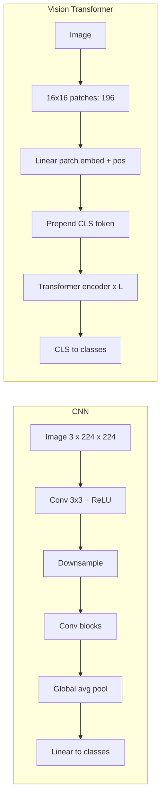

# 03.1 · Computer Vision: CNNs → Vision Transformers

> **Modality:** image → labels/boxes/masks/embeddings · **Prereqs:** [00.3 Images](../00-foundations/03-images.md), [01.3 Transformer](../01-text/03-attention-transformer.md) · **Used in project:** ⬜ Not yet used

## 1. First principles

Images are high-dimensional (224×224×3 = 150k numbers) but highly structured. Nearby pixels correlate, and an object is the same object wherever it appears. Good vision architectures exploit that structure.

**Convolution:** slide a small learned kernel (e.g., 3×3×C) across the image and compute a dot product at each location.
- **Locality:** each output depends on a small neighborhood.
- **Weight sharing:** the same kernel everywhere gives far fewer params and **translation equivariance**.
- Stacking conv + downsampling grows the **receptive field**. Early layers detect edges, middle layers textures and parts, late layers objects.

**Vision Transformer (ViT):** split the image into 16×16 patches, linearly embed each into a token, add position embeddings, and run a standard Transformer encoder. Because there's no locality bias, it needs more data, but it scales better and shares architecture with LLMs. That's what enables VLMs.

| Task | Output | Typical models |
|---|---|---|
| Classification | Label | ResNet, ViT, ConvNeXt |
| Detection | Boxes + labels | YOLO, DETR |
| Segmentation | Per-pixel mask | U-Net, Mask R-CNN, SAM |
| OCR | Text | TrOCR, PaddleOCR, VLMs |
| Embedding | Vector | CLIP / SigLIP image encoders |

## 2. Diagram

## 3. Deep dive

- **Conv output size:** `out = floor((in + 2p − k) / s) + 1`. Params per conv layer = `k·k·C_in·C_out`.
- **Residual connections (ResNet)** made 100+ layer CNNs trainable. That's the same idea the Transformer reuses.
- **Transfer learning:** fine-tune an ImageNet- or CLIP-pretrained backbone on small domain data. That's almost always better than training from scratch.
- **Edge deployment:** detection models (YOLO family) run in real time on a Jetson Orin via TensorRT (FP16/INT8). That's the vision analogue of our LLM compression work.
- **Augmentation** (crop, flip, color jitter, mixup) is the main tool for small datasets.

## 4. In our project

**Not yet used.**

Candidate integrations aligned with the Yodha / vehicle-service domain:
- **Dashboard warning-light recognition** from a phone photo, with the result fed into the RAG query.
- **OCR for manual ingestion:** scanned PDF manuals → text → chunks → embeddings ([01.9](../01-text/09-rag.md)).
- **On-edge inspection** on the Jetson Orin Nano with TensorRT, reusing the edge workflow from the scaling ladder.

## 5. Common pitfalls

- **Training/inference preprocessing mismatch** (resize method, normalization, RGB/BGR). See [00.3](../00-foundations/03-images.md).
- **Data leakage via near-duplicates** (burst photos split across train and test). Dedupe by perceptual hash.
- **Class imbalance:** accuracy looks great while the rare (important) class fails. Use per-class recall and PR-AUC.
- **Ignoring EXIF rotation** on mobile uploads.
- **ViT from scratch on small data:** underperforms a CNN. Start from pretrained weights.

## 6. References
- He et al., *ResNet*, arXiv:1512.03385. Dosovitskiy et al., *ViT*, arXiv:2010.11929.
- Redmon et al., *YOLO*, arXiv:1506.02640. Kirillov et al., *Segment Anything*, arXiv:2304.02643.
