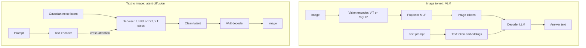

# 03.2 · Vision-Language Models & Image Generation

> **Modality:** image ↔ text · **Prereqs:** [03.1](01-computer-vision.md), [01.2 Embeddings](../01-text/02-embeddings.md) · **Used in project:** ⬜ Not yet used

## 1. First principles

Two directions, two families:

**Image → text (understanding)**
- **CLIP / SigLIP (contrastive):** train an image encoder and a text encoder so matching (image, caption) pairs have high cosine similarity and mismatched pairs low. The result is a *shared embedding space*: zero-shot classification ("a photo of a {label}"), image search, and RAG over images.
- **VLMs (LLaVA-style):** image encoder → patch embeddings → a **projector** (MLP) maps them into the LLM's token embedding space → the LLM reads "image tokens" alongside text tokens. The image becomes part of the prompt.

**Text → image (generation)**
- **Diffusion:** learn to reverse a gradual noising process. Training: add Gaussian noise at a random step `t` and train a network to predict the noise. Sampling: start from pure noise and iteratively denoise, conditioned on text embeddings (via cross-attention).
- **Latent diffusion:** diffuse in a VAE's compressed latent space (e.g., 64×64×4 instead of 512×512×3). That's ~48× fewer values, which is what makes it practical.
- **Classifier-free guidance:** mix conditional and unconditional predictions, `ε = ε_uncond + w·(ε_cond − ε_uncond)`, to trade diversity for prompt adherence.

## 2. Diagram

## 3. Deep dive

- **Contrastive loss (InfoNCE):** for a batch of N pairs, an N×N similarity matrix, then cross-entropy with the diagonal as targets, in both directions. Large batches give more negatives and better embeddings.
- **VLM training stages:**
  1. Freeze the LLM and vision encoder, and train only the projector on captions (alignment).
  2. Instruction-tune on visual Q&A.
- **Image token cost:** resolution drives token count, so high-res documents need tiling or dynamic resolution. Budget it like text context.
- **Diffusion speed:** 20–50 denoising steps per image. Distillation (consistency models, LCM, turbo variants) gets this down to 1–4 steps.
- **Multimodal RAG:** embed images with CLIP/SigLIP into the same vector DB, and retrieve images by text query.

## 4. In our project

**Not yet used.**

Natural extension for Yodha: a user sends a photo of a dashboard or part, a VLM describes it in English, that description drives the existing RAG retrieval over manuals, and the answer comes back in Telugu. Gemini (already integrated) accepts images inline the same way `gemini_stt` sends audio, so the integration cost is low ([`api.py#L159-L176`](https://github.com/SEVT-Logistics-Private-Limited/tiny-llm-jetson/blob/9a7b564c8d764d1eff92218261f2fd2cef99099e/voice-assistant/api.py#L159-L176)).

## 5. Common pitfalls

- **VLM hallucination:** confident descriptions of things not in the image. Ask for evidence ("which region shows…") and constrain to visible content.
- **Small text / OCR failure** at low input resolution. Crop or tile.
- **CLIP bias toward captions it saw:** poor at counting, spatial relations and negation.
- **Guidance scale too high:** oversaturated, artifact-heavy images.
- **Licensing and safety:** generated imagery and training data carry IP and likeness risks. Add filtering.

## 6. References
- Radford et al., *CLIP*, arXiv:2103.00020. Zhai et al., *SigLIP*, arXiv:2303.15343.
- Liu et al., *LLaVA*, arXiv:2304.08485.
- Ho et al., *DDPM*, arXiv:2006.11239. Rombach et al., *Latent Diffusion*, arXiv:2112.10752. Ho & Salimans, *Classifier-Free Guidance*, arXiv:2207.12598.
