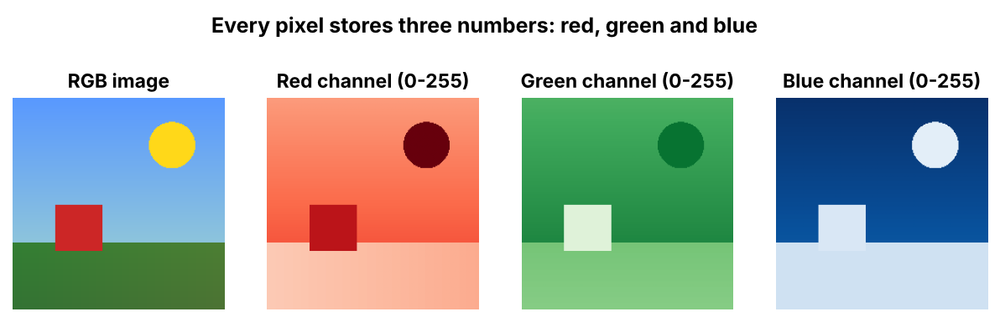
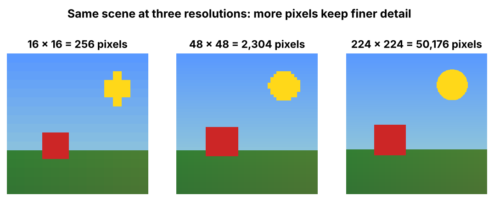
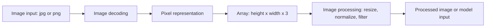

# Digital Images

> To a computer, an image is a grid of pixels, and every pixel is three numbers: red, green and blue.

| | |
|---|---|
| **Chapter** | [Computer Vision](README.md) · Topic 1 of 3 |
| **Prerequisites** | [Computing Foundations](../01-computing-foundations/README.md) |
| **Example code** | [`examples/computer_vision/image_as_array.py`](../../examples/computer_vision/image_as_array.py) |
| **Used in project** | Not yet |

---

## Introduction

Every vision model, from a face filter to a self-driving car, starts from the same raw material: a big array of numbers. Understanding that array (its shape, its value range, and how resolution changes its size) is the foundation for all image AI.

## What is it?

- An **image** is a visual representation of something we see in the real world.
- An image is made up of millions of tiny squares called **pixels**. ("Pixel" is short for **picture element**.)
- Computers represent colour using the **RGB colour model**: **R**ed, **G**reen, **B**lue.
- Every pixel holds **3 numbers** (red, green, blue), each ranging from **0 to 255**.
- **Image resolution** is the number of pixels in an image, written as **width × height**.

## Why is it needed?

A computer can't "see" a photo, only numbers. Representing images as arrays lets us:
- store and compress them
- edit them (brightness, crop, resize)
- feed them to neural networks for recognition and understanding

## How does it work?

### RGB colours

| Colour | RGB value |
|---|---|
| Red | (255, 0, 0) |
| Green | (0, 255, 0) |
| Blue | (0, 0, 255) |
| White | (255, 255, 255) |
| Black | (0, 0, 0) |
| Yellow | (255, 255, 0) |
| Magenta | (255, 0, 255) |



Each channel is its own grid of numbers. The yellow sun is bright in red and green but dark in blue, because yellow = red + green.

### Resolution

Resolution tells you how many pixels an image contains. More pixels let an image keep finer detail.

```text
        <------- 1920 px (width) ------->
   ^   +---------------------------------+
   |   |                                 |
 1080  |          1920 x 1080            |
  px   |      = 2,073,600 pixels         |
   |   |                                 |
   v   +---------------------------------+
```

- **1 MP (megapixel) = 1,000,000 pixels.** So 1920 × 1080 ≈ 2.1 MP.
- At 3 numbers per pixel, that's **6,220,800 numbers** for one Full HD image.



### How does a computer process an image?

1. **Image input:** a file such as `.jpg` or `.png`
2. **Image decoding:** the compressed file is unpacked
3. **Pixel representation:** every pixel becomes its RGB values
4. **Image as an array:** shape `(height, width, 3)`
5. **Image processing:** resize, filter, or run it through a model
6. **Processed image** (or a prediction about it)

## Architecture



## Practical implementation

| Task | Common tool |
|---|---|
| Load or save images | Pillow (`PIL.Image`), OpenCV |
| Array operations | NumPy |
| Model preprocessing | torchvision transforms, Hugging Face image processors |

Neural networks usually expect pixel values **normalised** to `0.0–1.0` (divide by 255), and often standardised further with a per-channel mean and standard deviation.

## Code example

[`examples/computer_vision/image_as_array.py`](../../examples/computer_vision/image_as_array.py) builds a tiny image pixel by pixel, then converts it to grayscale, resizes it and normalises it:

```python
img = np.array([[COLOURS[c] for c in row] for row in rows], dtype=np.uint8)  # (height, width, 3)

def to_grayscale(img):
    weights = np.array([0.299, 0.587, 0.114])   # the eye is most sensitive to green
    return (img[..., :3].astype(float) @ weights).round().astype(np.uint8)
```

```bash
python examples/computer_vision/image_as_array.py
```

```text
image shape (height, width, channels): (2, 4, 3), dtype=uint8
top-left pixel (red)   = (255, 0, 0)
bottom-left pixel (black) = (0, 0, 0)
red channel only:
[[255   0   0 255]
 [  0 255 255 255]]

grayscale (1 number per pixel):
[[ 76 150  29 255]
 [  0 226 105 255]]

resized (2, 4) -> (4, 8) with nearest-neighbour
normalized value range: 0.0 to 1.0

1920x1080 = 2,073,600 pixels = 2.1 MP = 6,220,800 numbers (RGB)
```

## Real-world use cases

- Photo editing (brightness, filters, cropping)
- Medical imaging (X-ray and MRI analysis)
- Face recognition and object detection
- Input to vision-language models (see [VLMs](03-vision-language-action.md))

## Common mistakes and best practices

| Mistake | Better approach |
|---|---|
| Mixing up RGB and BGR | OpenCV loads images as **BGR**, while Pillow and most models use RGB. Convert explicitly. |
| Forgetting to normalise | Models trained on 0–1 inputs give garbage when fed 0–255 |
| Mixing up `(height, width)` and `(width, height)` | NumPy arrays are `(height, width, channels)`, but many APIs take `(width, height)` |
| Ignoring memory size | A 2.1 MP image is 6.2 million numbers. Batches of them need a GPU. |

## Key takeaways

- An image = a grid of pixels, and each pixel = 3 numbers (R, G, B) from 0 to 255.
- Resolution = width × height. More pixels mean more detail and more numbers to process.
- Processing path: file → decode → pixels → array → process.

---

**Previous:** [← Chapter overview](README.md) · [Home](../../README.md) · **Next:** [Video Fundamentals →](02-video-fundamentals.md)
