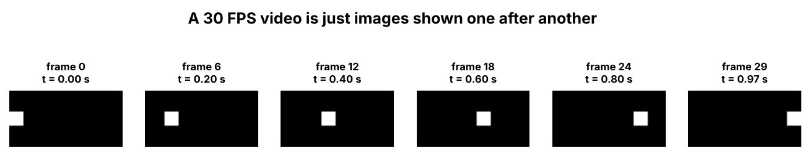
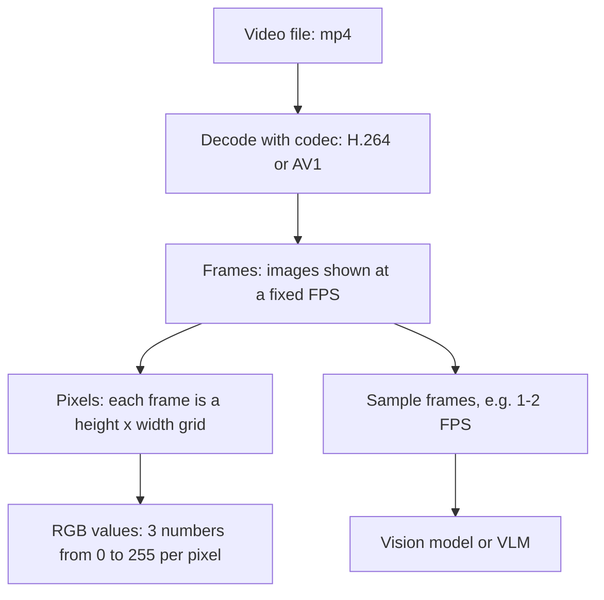

# Video Fundamentals

> A video is a sequence of images (frames) shown quickly one after another. Underneath, it's frames → pixels → RGB numbers.

| | |
|---|---|
| **Chapter** | [Computer Vision](README.md) · Topic 2 of 3 |
| **Prerequisites** | [Digital Images](01-digital-images.md) |
| **Example code** | [`examples/computer_vision/video_as_frames.py`](../../examples/computer_vision/video_as_frames.py) |
| **Used in project** | Not yet |

---

## Introduction

If you understand images, you already understand most of video. A video is just many images with a timing rule (frames per second). The real challenge is scale: video multiplies an image's numbers by 30 or more every second.

## What is it?

| Term | Definition |
|---|---|
| **Image** | One photograph |
| **Frame** | A single individual image inside a video |
| **Pixel** | One tiny square that makes up an image (images are made of millions of them) |
| **Video** | A collection of frames played continuously |
| **FPS** (frames per second) | How many frames are displayed in one second |

## Why is it needed?

Understanding the frame structure explains:
- why raw video is so large, and why codecs exist
- why video AI models analyse a few sampled frames instead of every frame
- why video processing needs a GPU

## How does it work?

### Frames per second

| FPS | Meaning |
|---|---|
| 1 FPS | 1 frame per second |
| 30 FPS | 30 frames per second (standard video) |
| 60 FPS | 60 frames per second (smoother, common in games) |
| 120 FPS | 120 frames per second (very smooth, slow motion) |

A 30 FPS video shows 30 separate images every second. Your eyes blend them into motion.



### How is a video stored inside a computer?

Video → frames → pixels → RGB values.

### The scale problem

| Raw 1920 × 1080 video | Numbers (1 byte each) |
|---|---|
| 1 frame | 6,220,800 |
| 1 second at 30 FPS | 186,624,000 |
| 1 minute at 30 FPS | 11,197,440,000 (about 10.4 GiB) |

Real video files are far smaller because **codecs** (H.264, H.265, AV1) store a full image only occasionally, and for the frames in between they store only what changed.

## Architecture



## Practical implementation

| Task | Common tool |
|---|---|
| Read and decode video | OpenCV (`cv2.VideoCapture`), FFmpeg, PyAV |
| Sample frames | Keep every Nth frame, or detect scene changes |
| Hardware decoding | NVIDIA NVDEC (also available on Jetson devices) |

## Code example

[`examples/computer_vision/video_as_frames.py`](../../examples/computer_vision/video_as_frames.py) builds a one-second synthetic clip as a 4-D array `(frames, height, width, 3)`, samples it, and computes raw sizes:

```python
video = np.zeros((n_frames, height, width, 3), dtype=np.uint8)   # 4-D: time x H x W x RGB

def sample_frames(video, fps, target_fps):
    step = max(int(round(fps / target_fps)), 1)
    return video[::step]
```

```bash
python examples/computer_vision/video_as_frames.py
```

```text
video shape (frames, height, width, channels): (30, 32, 64, 3)
duration: 1.0 s at 30 FPS
frame 0 is just an image of shape (32, 64, 3)
sampling at 2 FPS keeps 2 of 30 frames

1 minute of raw 1080p30 video = 11,197,440,000 numbers = 10.4 GiB uncompressed
Codecs like H.264 store only what changes between frames, shrinking this by 100x or more.
```

## Real-world use cases

- Streaming platforms (encoding at multiple resolutions and frame rates)
- Security and traffic cameras (object detection per frame)
- Sports analysis and motion tracking
- Video understanding with multimodal models (sampled frames + transcript)

## Common mistakes and best practices

| Mistake | Better approach |
|---|---|
| Processing every frame | Sample frames: consecutive frames are nearly identical |
| Assuming a constant FPS | Phone videos often have a variable frame rate. Use timestamps. |
| Decoding on the CPU at high resolution | Use hardware decoding (NVDEC) when available |
| Ignoring the audio track | Many questions about a video are answered by its speech |

## Key takeaways

- Video = frames played continuously. A frame = one image.
- FPS = frames per second. A 30 FPS video shows 30 images every second.
- Storage path: video → frames → pixels → RGB values, which is why codecs and frame sampling matter.

---

**Previous:** [← Digital Images](01-digital-images.md) · [Chapter overview](README.md) · **Next:** [Vision-Language-Action Models →](03-vision-language-action.md)
