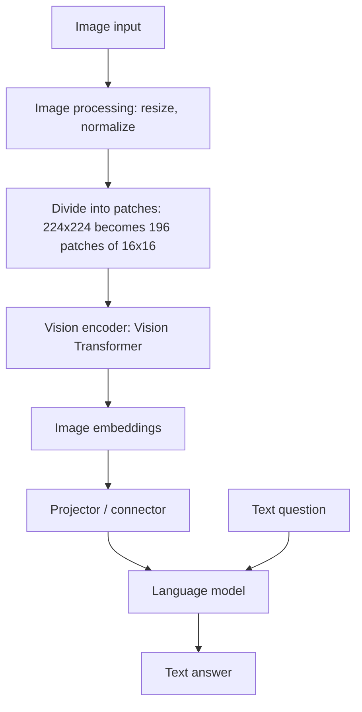
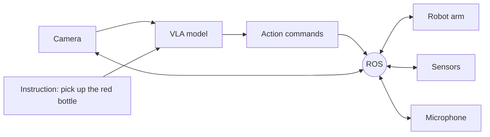
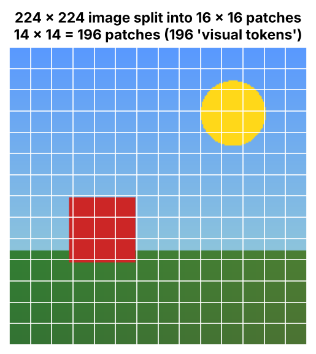

# Vision-Language-Action Models (VLM, VLA, ROS)

> A VLM sees and understands. A VLA sees, understands and acts. ROS connects the robot hardware that makes the acting possible.

| | |
|---|---|
| **Chapter** | [Computer Vision](README.md) · Topic 3 of 3 |
| **Prerequisites** | [Digital Images](01-digital-images.md), [Transformer Architecture](../03-language-models/03-transformer-architecture.md) |
| **Example code** | [`examples/computer_vision/image_patches.py`](../../examples/computer_vision/image_patches.py) |
| **Used in project** | Not yet |

---

## Introduction

LLMs work with text. The next step is giving AI **eyes** (vision-language models) and then **hands** (vision-language-action models running on robots). This page covers how these model families relate, how a VLM turns an image into something a language model can read, and where ROS fits in.

## What is it?

| Name | What it does |
|---|---|
| **NLP** | Understands human language |
| **LLM** | Understands and generates language using a trained model |
| **VLM** (Vision Language Model) | Understands images and text, and generates text responses |
| **VLA** (Vision Language Action) | Connects vision, language and physical actions |
| **ROS** (Robot Operating System) | Connects and coordinates robot software and hardware |

### VLM

A VLM is an AI model that can **understand visual information and connect it with human language**. It sees and understands. If you give it an image and ask a question, it analyses (reads) the image and answers in our language.

A VLM is a **multimodal AI system**: it can process and respond to both images (vision) and text (language).

| | Input | Output |
|---|---|---|
| **LLM** | Text | Text |
| **VLM** | Image + text | Text |

### VLA

A VLA helps **AI-powered robots understand their surroundings, follow instructions and perform physical actions**: sees → understands → acts.

### ROS

ROS is a **robotics software framework** that provides tools and communication mechanisms to build and control robots.

## Why is it needed?

- **VLMs:** many real questions are visual. "What's wrong with this part?" or "What does this warning light mean?"
- **VLAs:** robots need to turn instructions such as "pick up the red bottle" into movements.
- **ROS:** a robot has a camera, sensors, arms and a microphone, and all of them need to communicate with each other. ROS helps connect, communicate between and coordinate these components.

## How does it work?

### How does a VLM read an image?

1. **Image input**
2. **Image processing:** resize the image, normalise the pixel values, prepare it for the model
3. **Divide into patches:** the image is cut into smaller squares
4. **Vision encoder:** a neural network (often a Vision Transformer) analyses the patches
5. **Image embeddings:** the visual information becomes vectors the model can understand
6. **Projector / connector:** maps the image embeddings into the language model's embedding space
7. **Language model:** reads the image embeddings together with your text question and generates the answer

This mirrors [how an LLM reads text](../03-language-models/README.md#how-an-llm-reads-text):

| Text (LLM) | Image (VLM) |
|---|---|
| Split text into **tokens** | Split the image into **patches** |
| Token → **embedding** | Patch → **image embedding** (vision encoder) |
| Transformer processes the embeddings | Projector feeds the image embeddings into the LLM alongside the text |

### VLM vs VLA: the red bottle example

| VLM | VLA |
|---|---|
| Vision Language **Model** | Vision Language **Action** |
| Understands images and language | Connects vision and language **to action** |
| Describes images and answers questions | Helps control **physical actions** |
| Image question answering | Robotic manipulation |
| Shown a red bottle: "I can see a red bottle on the table." | Sees the red bottle, understands "pick it up", generates the actions and **picks it up** |
| Only says what it sees; takes no action | Sees, understands and **acts** |

When you tell a robot "pick up the red bottle", the VLA:
1. Sees the bottle using the camera
2. Understands the instruction
3. Determines the required movement
4. Generates the action

## Architecture





## Practical implementation

| Need | Typical approach |
|---|---|
| Ask questions about images | Multimodal APIs (Gemini, GPT-4o, Claude) or open VLMs (LLaVA, Qwen-VL) |
| Robot control from vision + language | VLA research models trained on robot demonstration data |
| Robot plumbing | ROS 2 nodes communicating over topics and services |

## Code example

[`examples/computer_vision/image_patches.py`](../../examples/computer_vision/image_patches.py) performs the first stages of a Vision Transformer: normalise, split into 16 × 16 patches, flatten each patch, and project it to an embedding:

```python
def patchify(img, patch):
    h, w, c = img.shape
    grid = img.reshape(h // patch, patch, w // patch, patch, c)
    return grid.transpose(0, 2, 1, 3, 4).reshape(-1, patch * patch * c)

patches = patchify(img / 255.0, patch=16)   # (196, 768)
embeddings = patches @ projection           # one vector per patch
```

```bash
python examples/computer_vision/image_patches.py
```

```text
image:            (224, 224, 3)  (height, width, channels)
patches:          (196, 768)  (14 x 14 = 196 patches, each 16*16*3 = 768 numbers)
patch embeddings: (196, 768)  (one vector per patch, like one vector per text token)
```



Each of the 196 squares becomes one "visual token". From there, the Transformer treats them just like text tokens.

## Real-world use cases

| Model | Where it's used |
|---|---|
| VLM | Self-driving cars, robotics and automation, healthcare imaging, visual Q&A |
| VLA | Warehouse picking robots, household robots, manipulation research |
| ROS | Research robots, drones, industrial and autonomous robots |

## Common mistakes and best practices

| Mistake | Better approach |
|---|---|
| Assuming a VLM can act | A VLM only produces text. Acting needs a VLA plus a robot control stack. |
| Sending huge images | Resolution drives the number of patches (tokens), and with it cost and latency. Resize first. |
| Trusting VLM descriptions blindly | VLMs can hallucinate objects. Verify anything safety-critical. |
| Skipping the communication layer in robots | Use ROS (or similar) instead of ad-hoc wiring between components |

## Key takeaways

- **VLM** = image + text in, text out. It sees and understands.
- VLM pipeline: image → patches → vision encoder → image embeddings → projector → LLM → answer.
- **VLA** = VLM + action. It sees, understands and acts.
- **ROS** connects a robot's camera, sensors, arms and microphone.

---

**Previous:** [← Video Fundamentals](02-video-fundamentals.md) · [Chapter overview](README.md) · **Next chapter:** [APIs →](../05-apis/README.md)
