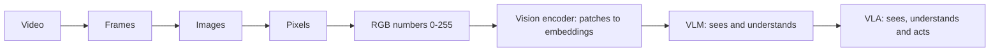

# Computer Vision

> How computers represent images and video as numbers, and how vision-language models connect what they see to language and action.

| | |
|---|---|
| **Chapter** | 4 of 5 |
| **Prerequisites** | [Computing Foundations](../01-computing-foundations/README.md). [Language Models](../03-language-models/README.md) is needed for topic 3. |
| **Example code** | [`examples/computer_vision/`](../../examples/computer_vision/) |

---

## From pixels to understanding

## Topics

| # | Topic | What you'll learn | Code |
|---|---|---|---|
| 1 | [Digital Images](01-digital-images.md) | Pixels, RGB, resolution, how a computer processes an image | [`image_as_array.py`](../../examples/computer_vision/image_as_array.py) |
| 2 | [Video Fundamentals](02-video-fundamentals.md) | Frames, FPS, how video is stored | [`video_as_frames.py`](../../examples/computer_vision/video_as_frames.py) |
| 3 | [Vision-Language-Action Models](03-vision-language-action.md) | VLM, VLA, ROS, how a VLM reads an image | [`image_patches.py`](../../examples/computer_vision/image_patches.py) |

---

**Previous:** [← Language Models](../03-language-models/README.md) · [Home](../../README.md) · **Start:** [Digital Images →](01-digital-images.md)
