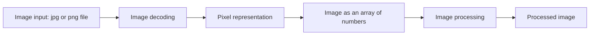

# 4. Images

[← Back to contents](../README.md)

---

## What is an image?

An image is a **visual representation of something we see in the real world**.

An image is made up of **millions of tiny squares called pixels**.

> **Pixel** = **Pic**ture **El**ement: the smallest dot of an image.

---

## How does a computer represent colour?

It uses the **RGB colour model**:
- **R** = Red
- **G** = Green
- **B** = Blue

Every pixel has **3 numbers**, one each for red, green and blue. Each number ranges from **0 to 255**. Mixing the three gives every colour.

| Colour | RGB value |
|---|---|
| Red | (255, 0, 0) |
| Green | (0, 255, 0) |
| Blue | (0, 0, 255) |
| White | (255, 255, 255) |
| Black | (0, 0, 0) |
| Yellow | (255, 255, 0) |
| Magenta | (255, 0, 255) |

So to a computer, an image is just a big grid of numbers:

```
Pixel (row 1, col 1) → (255, 0, 0)     red
Pixel (row 1, col 2) → (255, 255, 255) white
Pixel (row 1, col 3) → (0, 0, 0)       black
...
```

---

## Image resolution

**Resolution** is the **number of pixels in an image**, written as **width × height**.

- It tells you how many pixels the image contains.
- More pixels let the image keep finer details.

```
        ← 1920 px (width) →
  ┌───────────────────────────┐  ↑
  │ • • • • • • • • • • • • • │  │
  │ •                         │  1080 px
  │ •      1920 × 1080        │  (height)
  │ •                         │  │
  └───────────────────────────┘  ↓
```

**1 MP (megapixel) = 1,000,000 pixels.** A 1920 × 1080 image has about 2 million pixels (≈ 2 MP), and each pixel has 3 RGB numbers. That's about **6 million numbers** for one image. This is why images need a GPU.

---

## How does a computer process an image?



1. **Image input:** a file like `.jpg` or `.png`.
2. **Decoding:** the file is opened and unpacked.
3. **Pixel representation:** each pixel becomes RGB numbers.
4. **Array:** the whole image is a grid (array) of those numbers.
5. **Processing:** the computer (or an AI model) works on those numbers, for example to resize, filter or recognise what's in the image.

> AI models that "see" images (VLMs) follow this same path, then add a few more steps. See [chapter 6](06-vision-language-action.md#how-does-a-vlm-read-an-image).

---

## Quick definitions

| Term | Meaning |
|---|---|
| **Image** | One photograph |
| **Pixel** | One tiny square of an image (made of millions of tiny squares) |
| **RGB** | Three numbers (0–255) per pixel for red, green, blue |
| **Resolution** | Width × height in pixels |

**In my project:** not used yet. My voice assistant handles text and audio only.

---

## Remember

- An image = a grid of pixels. Each pixel = 3 numbers (R, G, B), each from 0 to 255.
- Resolution = width × height. More pixels = more detail = more numbers to process.
- Computer path: file → decode → pixels → array of numbers → process.
