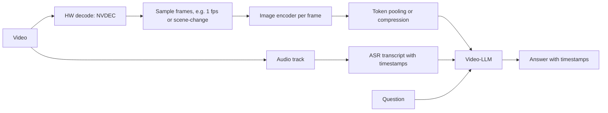

# 04.1 · Video Understanding & Generation

> **Modality:** video ↔ text · **Prereqs:** [00.5 Video](../00-foundations/05-video.md), [03.2](../03-vision/02-vision-language-generation.md) · **Used in project:** ⬜ Not yet used

## 1. First principles

Video adds **time** to images. The model must capture *appearance* (what) and *motion* (how it changes). The central constraint is **token budget**: frames × patches per frame grows fast.

**Understanding approaches**

| Approach | Idea | Trade-off |
|---|---|---|
| Frame sampling + image encoder | Encode N sampled frames independently and concatenate | Simple. Weak at motion. |
| 3D CNNs (I3D, SlowFast) | Convolve across T×H×W | Strong motion modeling. Heavy. |
| Video Transformers (ViViT, TimeSformer) | Tubelet tokens + factorized space/time attention | Scales well. Data hungry. |
| Video-LLMs | Sampled-frame tokens (often pooled/compressed) + transcript → LLM | General Q&A. Long-video context limits. |

**Generation:** latent **diffusion transformers** over spatio-temporal latents produced by a video VAE that compresses both space and time. Temporal consistency (objects persisting, physics) is the hard part.

## 2. Diagram

## 3. Deep dive

- **Factorized attention:** full space-time attention costs O((T·N)²). Divided attention (spatial within a frame, then temporal across frames at the same patch) reduces this to O(T·N² + N·T²).
- **Long video:** hierarchical summarization (clip-level captions, then summary), memory banks, or retrieval over clip embeddings (video RAG).
- **Use the transcript:** for instructional or service videos, ASR text carries most of the information at a fraction of the tokens. Combine it with sparse frames.
- **Edge pipelines:** decode → resize → infer on the GPU without CPU copies (DeepStream on Jetson) to sustain real-time fps.

## 4. In our project

**Not yet used.**

Possible direction: **video RAG over vehicle repair or how-to videos**. ASR the audio to Telugu/English text, embed transcript chunks plus keyframe CLIP embeddings, and answer "how do I…" questions with a timestamped clip. This reuses the existing e5 + Chroma stack ([01.9](../01-text/09-rag.md)).

## 5. Common pitfalls

- **Decoding every frame** when the model only uses 1 fps wastes 30× compute.
- **Timestamp drift** with variable-frame-rate sources. Use container PTS.
- **Context overflow** on long videos. Pool tokens or segment and summarize.
- **Ignoring audio:** many "video" questions are answered by speech, not pixels.
- **Evaluating on short clips only:** performance drops sharply on long-form content.

## 6. References
- Bertasius et al., *TimeSformer*, arXiv:2102.05095. Arnab et al., *ViViT*, arXiv:2103.15691.
- Feichtenhofer et al., *SlowFast*, arXiv:1812.03982. Peebles & Xie, *DiT*, arXiv:2212.09748.
