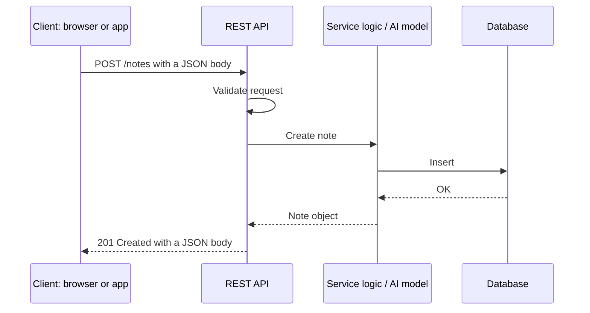
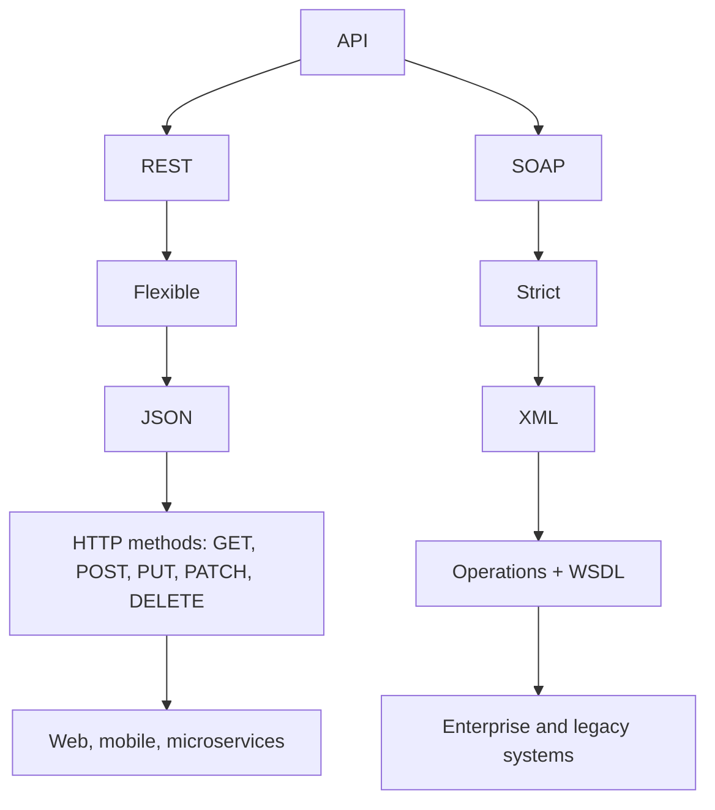
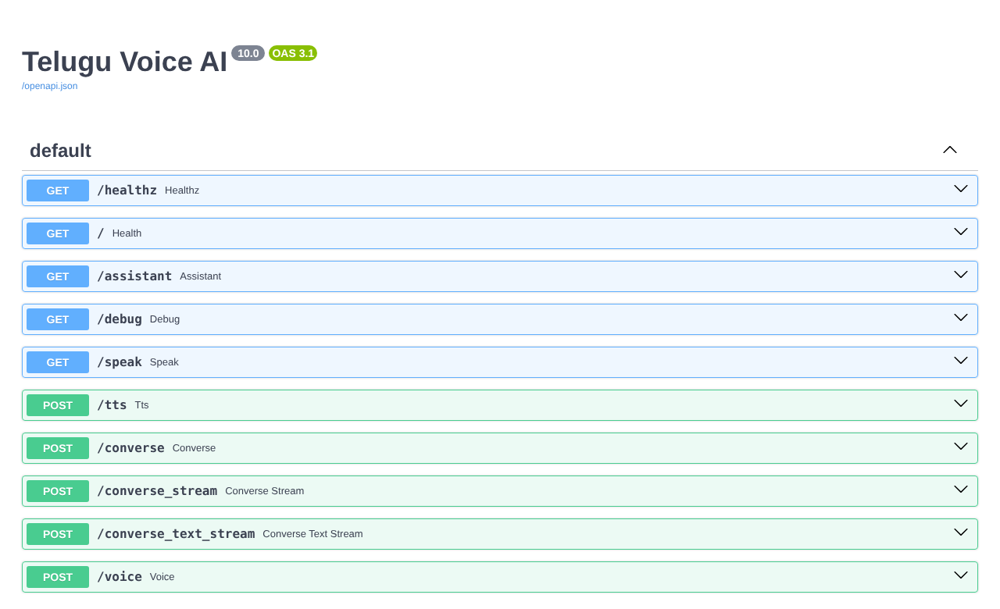

# APIs

> An API is a contract that lets two software systems communicate: send a request, get a response. It's how AI models become usable products.

| | |
|---|---|
| **Chapter** | 5 of 5 |
| **Prerequisites** | None. Helpful after [Language Models](../03-language-models/README.md). |
| **Example code** | [`examples/apis/rest_api.py`](../../examples/apis/rest_api.py) |
| **Used in project** | Yes. The voice assistant is a FastAPI REST service. |

---

## Introduction

A trained model sitting in a notebook helps no one. To use it from a web page, a mobile app or another service, you wrap it in an **API**. Every LLM you call (Gemini, GPT, Claude) is reached through one, and so is every app that serves its own model.

## What is it?

**API** stands for **Application Programming Interface**: a medium (contract) that lets two software systems communicate.

> You **send a request → to the API → and get a response**.

### Types of APIs

| # | Type | Key idea |
|---|---|---|
| 1 | **REST** (Representational State Transfer) | Resources over **HTTP**, usually JSON |
| 2 | **SOAP** (Simple Object Access Protocol) | Strict **XML** messages |
| 3 | **GraphQL** | The client asks for exactly the fields it needs |
| 4 | **WebSocket** | A persistent two-way connection (real-time chat, streaming) |
| 5 | **Webhooks** | The server calls *you* when an event happens |

## Why is it needed?

- **Decoupling:** the front end and back end can change independently
- **Reuse:** one AI service can power a website, a mobile app and other services
- **Security:** clients never touch the model, database or secrets directly

## How does it work?

### REST API

A REST API is a medium for two software systems to communicate **over HTTP**.
- Simple and flexible
- Follows REST principles and usually communicates over HTTP
- Usually exchanges **JSON**

| Method | Purpose |
|---|---|
| `GET` | Get (read) data |
| `POST` | Create data |
| `PUT` | Update (replace) data |
| `PATCH` | Partially update data |
| `DELETE` | Delete data |

Responses carry **status codes**: `200` OK, `201` Created, `204` No Content, `404` Not Found, `422` validation error, `500` server error.

### SOAP API

SOAP is **structured and strict**.
- A protocol that applications use to communicate with each other over a network
- Exchanges formatted **XML messages**
- Unlike REST's GET/POST/PUT/DELETE, SOAP uses **operations (functions)**, described in a **WSDL** file

### REST vs SOAP

| | REST | SOAP |
|---|---|---|
| Style | Flexible | Strict |
| Data format | JSON | XML |
| How you call it | HTTP methods | Operations + WSDL |
| Used in | Web, mobile, microservices | Enterprise and legacy systems |

## Architecture





## Practical implementation

**FastAPI** (Python) is a popular choice for AI services:
- Request validation from type hints (Pydantic)
- Automatic interactive docs at `/docs`
- Async support and streaming responses

## Code example

[`examples/apis/rest_api.py`](../../examples/apis/rest_api.py) is a complete CRUD API:

```python
app = FastAPI(title="Notes API")

class NoteIn(BaseModel):
    title: str = Field(min_length=1, max_length=100)
    body: str = ""

@app.post("/notes", status_code=201)
def create_note(note: NoteIn) -> Note: ...

@app.get("/notes/{note_id}")
def get_note(note_id: int) -> Note: ...
```

Run the demo, which calls every endpoint through FastAPI's test client:

```bash
python examples/apis/rest_api.py
```

```text
POST   /notes     -> 201 {"title":"RAG","body":"Retrieve, augment, generate","id":1}
GET    /notes/1   -> 200 {"title":"RAG","body":"Retrieve, augment, generate","id":1}
PUT    /notes/1   -> 200 {"title":"RAG","body":"Retrieval-Augmented Generation","id":1}
GET    /notes     -> 200 [{"title":"RAG","body":"Retrieval-Augmented Generation","id":1}]
DELETE /notes/1   -> 204
GET    /notes/1   -> 404 {"detail":"note not found"}
POST   /notes     -> 422 {"detail":[{"type":"string_too_short", ...}]}
```

Or start a real server and explore it in the browser:

```bash
uvicorn examples.apis.rest_api:app --reload   # then open http://127.0.0.1:8000/docs
```

## Real-world use cases

| API type | Example |
|---|---|
| REST | LLM APIs, payment gateways, most web back ends |
| SOAP | Banking, telecom and government systems |
| GraphQL | Apps that need flexible queries (GitHub API v4) |
| WebSocket | Live chat, real-time voice and streaming |
| Webhooks | "Payment succeeded" or "new commit pushed" notifications |

**In my project:** the Telugu voice assistant is a **FastAPI REST API** ([`voice-assistant/api.py`](https://github.com/SEVT-Logistics-Private-Limited/tiny-llm-jetson/blob/main/voice-assistant/api.py)). Live docs: [`/docs`](https://telugu-voice-app.gentletree-f4002f64.southindia.azurecontainerapps.io/docs)

| Method | Endpoint | Purpose |
|---|---|---|
| `GET` | `/healthz` | Liveness check |
| `GET` | `/assistant` | Serves the voice assistant web page |
| `POST` | `/tts` | Text → Telugu speech |
| `POST` | `/converse` | Voice + history → transcript, answer and audio |
| `POST` | `/converse_text_stream` | Text → answer, streamed as Server-Sent Events |



## Common mistakes and best practices

| Mistake | Better approach |
|---|---|
| Using `GET` to change data | `GET` should only read. Use `POST`, `PUT`, `PATCH` or `DELETE` to make changes. |
| Returning `200` for every response | Use meaningful status codes (`201`, `404`, `422`, …) |
| No input validation | Validate with schemas (Pydantic), including length limits |
| Public endpoints with no authentication | Add auth and rate limiting, especially in front of paid LLM APIs |
| Leaking internal errors to clients | Log details server-side and return a generic message |

## Key takeaways

- An API is a contract for request → response communication between systems.
- REST: flexible, JSON, HTTP methods. Used for web, mobile and microservices.
- SOAP: strict, XML, operations + WSDL. Used for enterprise and legacy systems.
- Other types: GraphQL, WebSocket, Webhooks.

---

**Previous:** [← Computer Vision](../04-computer-vision/README.md) · [Home](../../README.md) · **Next:** [Project: Telugu Voice Assistant →](../../projects/telugu-voice-assistant/README.md)
