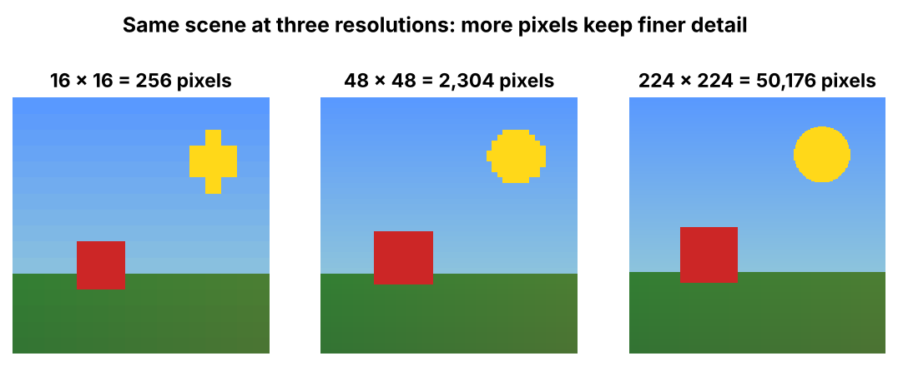

# 5. Image Resolution

> Resolution is the number of pixels in an image, written as width × height.

## Introduction

Two photos of the same scene can look very different: one sharp, one blurry. The difference is how many pixels each one contains.

## What is it?

**Image resolution** is the **number of pixels present in an image**, expressed as **width × height**.

- It tells you how many pixels an image contains.
- More pixels let the image keep finer details.

## Why is it needed?

- Higher resolution means a sharper, more detailed image.
- But more pixels also means **more numbers** to store and process, so it needs more memory and a more powerful GPU.

## How does it work?

A **1920 × 1080** image has 1920 pixels across (width) and 1080 pixels down (height).

```text
          ←——— 1920 px (width) ———→
    ↑   ┌───────────────────────────┐
    │   │ • • • • • • • • • • • • • │
 1080   │ •                         │
  px    │ •      1920 × 1080        │
    │   │ •                         │
    ↓   └───────────────────────────┘
```

- **1 MP (megapixel) = 1,000,000 pixels**
- 1920 × 1080 = 2,073,600 pixels ≈ **2 MP**
- Each pixel has 3 numbers (RGB), so one 1920 × 1080 image ≈ **6.2 million numbers**



## Flow diagram

```text
Width (pixels) × Height (pixels)
              ↓
     Total number of pixels
              ↓
        × 3 (R, G, B)
              ↓
  Total numbers the computer stores
```

## Real-world use cases

- Camera megapixels (12 MP, 48 MP phones)
- Screen resolutions (HD, Full HD 1920 × 1080, 4K)
- AI models resize images to a fixed resolution before processing

## Key takeaways

- Resolution = width × height in pixels.
- More pixels = finer detail = more numbers to process.
- 1 MP = 1,000,000 pixels.

---

**Previous:** [← Image](04-image.md) · [Home](../README.md) · **Next:** [Video →](06-video.md)
