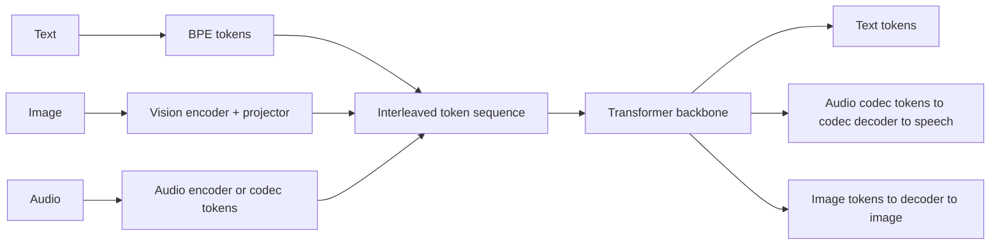

# 05.1 · Multimodal Models

> **Modality:** any → any · **Prereqs:** [00.1](../00-foundations/01-data-as-numbers.md), [01.3](../01-text/03-attention-transformer.md), [03.2](../03-vision/02-vision-language-generation.md) · **Used in project:** 🟡 (we consume a multimodal model; we don't build one)

## 1. First principles

The Transformer doesn't care what a token *means*. It only needs a sequence of `d`-dimensional vectors. So any modality can join an LLM if it can be turned into a sequence of embeddings:

| Modality | Tokenizer / encoder | Tokens |
|---|---|---|
| Text | BPE | ~1 per 0.75 English words, more for Telugu |
| Image | ViT patches → projector | Hundreds per image |
| Audio | Audio encoder (Whisper-like) on log-mels, or neural codec tokens | ~25–50 per second |
| Video | Sampled frames × image tokens | Thousands per minute |

Two integration styles:
1. **Encoder + projector ("late fusion" into the LLM):** pretrained modality encoders, a learned projection into LLM embedding space. Cheap and modular (LLaVA-style).
2. **Natively multimodal ("early fusion"):** trained from the start on interleaved modalities with a unified token space. Better cross-modal reasoning, and can *generate* non-text tokens (speech, images) through codec decoders.

## 2. Diagram

## 3. Deep dive

- **Cascaded vs native for voice:**
  - Cascaded STT → LLM → TTS loses prosody, emotion and speaker identity at the text bottleneck, and adds latency per hop.
  - Native speech-to-speech models keep paralinguistics and respond faster, but are harder to ground with RAG or tools and harder to audit.
- **Token economics:** audio and images consume context and cost far faster than text. One minute of audio can be ~1.5k–3k tokens.
- **Alignment data** (paired captions, transcribed speech) is the scarce resource, especially for low-resource languages like Telugu.
- **Evaluation is per-modality and cross-modal:** WER for speech in, MOS for speech out, VQA accuracy for images.

## 4. In our project

**Partially used.** We *consume* a natively multimodal model:
- **Audio understanding via an LLM:** `gemini_stt` sends raw `audio/webm` bytes as an inline `Blob` part next to a text instruction in one request. The LLM performs ASR ([`api.py#L159-L176`](https://github.com/SEVT-Logistics-Private-Limited/tiny-llm-jetson/blob/9a7b564c8d764d1eff92218261f2fd2cef99099e/voice-assistant/api.py#L159-L176)).
- **Audio generation via an LLM:** the v8 API used `response_modalities=["AUDIO"]` on `gemini-2.0-flash-preview-tts` to get speech PCM directly from the model ([`telugu_voice_api.py`](https://github.com/SEVT-Logistics-Private-Limited/tiny-llm-jetson/blob/9a7b564c8d764d1eff92218261f2fd2cef99099e/telugu_voice_api.py)). v10 still probes it in `/debug`.
- **The system as a whole is cascaded:** audio → text → LLM (+ RAG) → text → audio. Text in the middle is what makes RAG grounding, output sanitation and logging straightforward.

**Architectural option to evaluate:**
- Collapse STT + LLM into **one** Gemini call: audio in, Telugu text out, RAG context in the prompt. That removes one network hop and the separate transcription step.
- The trade-off is losing the explicit transcript, which RAG translation and instant-match currently depend on. One option is to ask the model to return both the transcript and the answer as structured JSON.

## 5. Common pitfalls

- **Assuming multimodal = better:** for narrow tasks, a dedicated ASR or TTS model is cheaper, faster and more controllable.
- **Losing observability:** without an intermediate transcript you can't debug why an answer was wrong.
- **Vendor lock-in:** inline-media request formats differ per provider. Keep an adapter layer.
- **Privacy:** sending raw voice to third-party APIs has consent and data-residency implications (Indian DPDP Act).
- **Context blow-up** from media tokens in multi-turn history. Store transcripts, not audio, in history.

## 6. References
- Alayrac et al., *Flamingo*, arXiv:2204.14198. Liu et al., *LLaVA*, arXiv:2304.08485.
- Défossez et al., *EnCodec*, arXiv:2210.13438. Zeghidour et al., *SoundStream*, arXiv:2107.03312.
