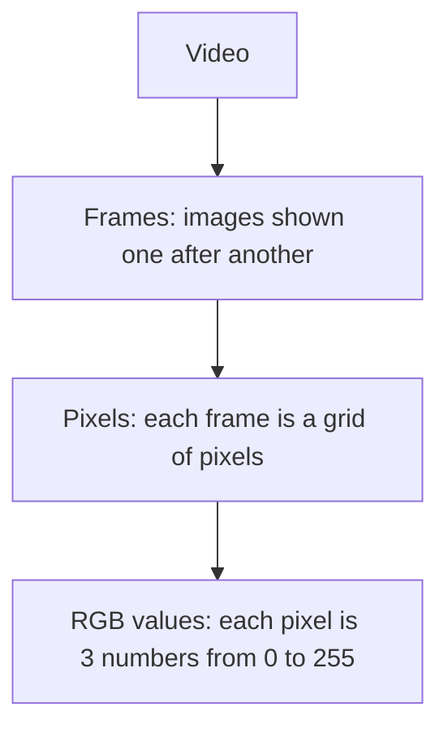

# 5. Video

[← Back to contents](../README.md)

> Read [chapter 4 (Images)](04-images.md) first. A video is built entirely out of images.

---

## What is a video?

A **video** is a **collection of images (frames) played continuously**.

## Frame

A **frame** is a **single individual image inside a video**.

| Term | Meaning |
|---|---|
| **Image** | One photograph |
| **Frame** | One image inside a video |
| **Pixel** | One tiny square that makes up an image |
| **Video** | A collection of frames played continuously |

---

## FPS (frames per second)

**FPS** is **how many frames are displayed in one second**.

| FPS | Meaning |
|---|---|
| 1 FPS | 1 frame per second |
| 30 FPS | 30 frames per second |
| 60 FPS | 60 frames per second (smoother) |
| 120 FPS | 120 frames per second (very smooth) |

If a video is 30 FPS, the screen shows 30 separate images every second. Your eyes blend them together, so it looks like movement.

---

## How is a video stored inside a computer?

So, all the way down, a video is just **numbers**:

> Video → frames → pixels → RGB values

### How many numbers is that?

A 1920 × 1080 video at 30 FPS:
- 1 frame ≈ 2 million pixels × 3 RGB values ≈ **6 million numbers**
- 1 second = 30 frames ≈ **180 million numbers**
- 1 minute ≈ **10.8 billion numbers**

This is why video needs a **GPU** ([chapter 1](01-how-computers-understand-data.md#cpu-vs-gpu-the-hardware-that-does-the-work)). It also explains why AI models usually look at only a few frames per second, not every single frame.

**In my project:** not used yet.

---

## Remember

- Video = frames played continuously. Frame = one image.
- FPS = frames per second. 30 FPS = 30 images every second.
- Storage: video → frames → pixels → RGB numbers.
