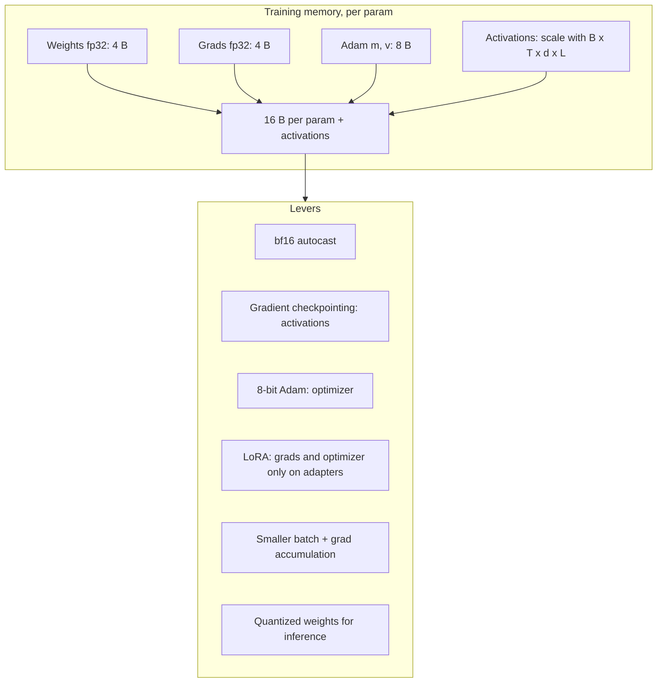

# 06.1 · GPU Memory Math & Hardware

> **Modality:** all · **Prereqs:** [00.1](../00-foundations/01-data-as-numbers.md), [01.4](../01-text/04-llm-training-scaling.md) · **Used in project:** ✅

## 1. First principles

Deep learning is matrix multiplication over large tensors. GPUs win because of **massive parallelism** (thousands of cores, tensor cores for low-precision matmul) and **high memory bandwidth**. Two limits decide almost everything:

1. **Capacity:** does the working set fit in VRAM? If not, it's OOM, offloading or sharding.
2. **Bandwidth vs compute:** is the op limited by FLOPs (compute-bound: training, prefill) or by bytes moved (memory-bound: decode, elementwise ops)?

**Arithmetic intensity** = FLOPs / bytes moved. An op below the hardware's FLOPs-to-bandwidth ratio is memory-bound. LLM decode at batch 1 has intensity ~1–2, which is deeply memory-bound.

## 2. Diagram

## 3. Deep dive

### Inference memory
`weights (params × bytes) + KV cache (2·L·T·n_kv·d_head·bytes·batch) + runtime overhead`

| Model | bf16 | int8 | 4-bit | ternary (ours) |
|---|---|---|---|---|
| 3B | 6 GB | 3 GB | ~2 GB | ~1.1 GB |
| 8B | 16 GB | 8 GB | ~5 GB | ~2.5 GB |

### Our two platforms
| | **Jetson Orin Nano Super** | **A100-SXM4-80GB** (Colab Pro) |
|---|---|---|
| Memory | 8 GB LPDDR5, **unified** (CPU+GPU share it) | 80 GB HBM2e |
| Bandwidth | ~102 GB/s | ~2,000 GB/s |
| AI compute | ~67 TOPS (sparse INT8) | 312 TFLOPS bf16 dense |
| Power | 7–25 W | 400 W |
| Role | Edge inference, small-scale training | Training up to ~3B full-param |

**Unified memory caveat:** on Jetson the OS, page cache and the PyTorch caching allocator all compete for the same 8 GB. The GPU can fail to get a contiguous allocation even when "free" memory looks sufficient.

## 4. In our project

- **Jetson Orin Nano Super** (JetPack 6.2.1, CUDA 12.6, MAXN_SUPER power mode, `dustynv/l4t-pytorch:r36.4.0` container) trained rungs 1–3.
  - Rung 3 (151M) crashed with a `CUDACachingAllocator` assertion.
  - A thermal-throttle warning was **ruled out** via `tegrastats` (~53 °C).
  - Fix: `sync && echo 3 > /proc/sys/vm/drop_caches` on the host before starting the container. That's **unified-memory pressure**, not heat ([`model-card-150m.md`](https://github.com/SEVT-Logistics-Private-Limited/tiny-llm-jetson/blob/9a7b564c8d764d1eff92218261f2fd2cef99099e/model-card-150m.md)).
- **A100-80GB** trained rungs 4–9. Each lever, introduced in sequence:
  - Rung 4: bf16 AMP + gradient checkpointing + clipping.
  - Rungs 6–8: batch cut to 4.
  - Rungs 7–8: bf16 checkpoint cast (6 GB on disk).
  - **3.07B (rung 8) is the measured full-parameter ceiling** at block_size 128 on 80 GB (~16 B/param × 3.07B ≈ 49 GB + activations).
- **3B QAT budget** in `compression/README.md`: student fp32 13 GB + grads 13 GB + 8-bit Adam 6.5 GB + teacher 6.5 GB + activations 10–15 GB ≈ **50–55 GB**. AdamW8bit is what makes it fit ([`ternary_qat_3b.py#L120-L126`](https://github.com/SEVT-Logistics-Private-Limited/tiny-llm-jetson/blob/9a7b564c8d764d1eff92218261f2fd2cef99099e/compression/ternary_qat_3b.py#L120-L126)).
- **LoRA budget:** ~6.5 GB model + 15–25 GB activations. It fits on a 40 GB A100 with `--batch-size 4 --grad-accum 4`.
- **Edge target:** the ternary 3B (~1.1 GB) is sized for the Orin Nano's 8 GB unified memory. That's the roadmap's "offline edge deployment".

## 5. Common pitfalls

- **Reading `nvidia-smi` as truth:** PyTorch's caching allocator holds freed memory. Use `torch.cuda.memory_allocated()` vs `memory_reserved()`, and set `PYTORCH_CUDA_ALLOC_CONF=expandable_segments:True` to reduce fragmentation.
- **Jetson page cache:** on unified memory, file reads (datasets, checkpoints) fill RAM the GPU needs. Drop caches, use swap or zram for headroom, and keep datasets small.
- **Forgetting activations** in memory estimates: they scale with batch × sequence × width × depth and often dominate.
- **Colab disconnects:** long jobs must checkpoint atomically and auto-resume. The LoRA and QAT scripts do this (tmp file + `os.replace`).
- **Assuming the speedup from compression:** dequantizing to bf16 at load time saves disk, not bandwidth. You need low-bit kernels.

## 6. References
- NVIDIA Jetson Orin Nano Super developer kit datasheet. NVIDIA A100 datasheet.
- Rajbhandari et al., *ZeRO*, arXiv:1910.02054. Dettmers et al., *8-bit Optimizers*, arXiv:2110.02861.
