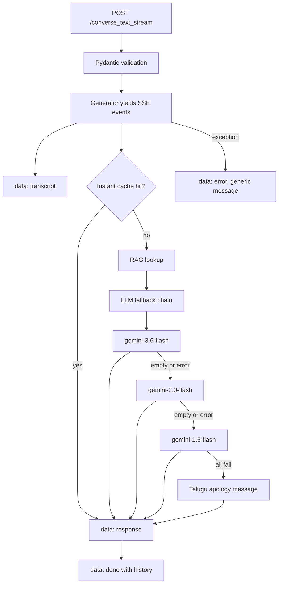

# 06.2 · Serving LLM APIs: FastAPI, SSE, Fallbacks, Caching

> **Modality:** all · **Prereqs:** [01.5](../01-text/05-decoding-inference.md), [02.3](../02-audio/03-voice-agents.md) · **Used in project:** ✅

## 1. First principles

A model becomes a product through an API that wraps it with:
- **Contracts:** typed request and response schemas.
- **Latency management:** streaming, caching, short-circuits.
- **Failure management:** timeouts, retries, fallbacks, graceful degradation.
- **Observability:** health checks, logs, metrics.

LLM calls are **slow (seconds), variable, and fail transiently** (5xx, rate limits, empty outputs). API design must assume that.

**Streaming transports**
| | SSE | WebSocket | Plain HTTP |
|---|---|---|---|
| Direction | Server → client | Bidirectional | Request/response |
| Complexity | Low (HTTP + `text/event-stream`) | Higher | Lowest |
| Fit | Token and stage streaming | Real-time duplex audio | Short calls |

## 2. Diagram

## 3. Deep dive

- **FastAPI execution model:** `def` endpoints run in a threadpool (default ~40). `async def` endpoints run on the event loop and must never block. Blocking SDK calls in `def` endpoints are safe but cap concurrency at the pool size.
- **Fallback chain design:**
  - Classify failures as transient (5xx, timeout: retry with backoff), permanent (4xx, bad request: don't retry), or empty output (try the next model).
  - Cap total time across the chain.
- **Short-circuit caches:** exact-match (fast, brittle) → normalized match → semantic cache (embedding similarity to past queries). Cache audio, not just text.
- **SSE details:**
  - `Content-Type: text/event-stream`, events are `data: <json>\n\n`.
  - Disable proxy buffering (`X-Accel-Buffering: no` for Nginx).
  - Use `ensure_ascii=False` to keep Telugu readable on the wire.
- **Health checks:** liveness (`/healthz`, no I/O) is separate from readiness (dependencies loaded). Orchestrators restart on liveness and route on readiness.

## 4. In our project

`voice-assistant/api.py`, **FastAPI "Telugu Voice AI" v10.0**:

| Pattern | Implementation | Link |
|---|---|---|
| Typed contracts | Pydantic `Msg`, `ConvReq`, `TextReq`, `AudioReq`, `TextConvReq` | [`#L267-L283`](https://github.com/SEVT-Logistics-Private-Limited/tiny-llm-jetson/blob/9a7b564c8d764d1eff92218261f2fd2cef99099e/voice-assistant/api.py#L267-L283) |
| LLM fallback chain + 1 retry on `ServerError`, next model on empty text | `_llm_call_with_fallback` | [`#L71-L99`](https://github.com/SEVT-Logistics-Private-Limited/tiny-llm-jetson/blob/9a7b564c8d764d1eff92218261f2fd2cef99099e/voice-assistant/api.py#L71-L99) |
| Robust response parsing (MAX_TOKENS-safe) | `_extract_text_from_response` | [`#L50-L68`](https://github.com/SEVT-Logistics-Private-Limited/tiny-llm-jetson/blob/9a7b564c8d764d1eff92218261f2fd2cef99099e/voice-assistant/api.py#L50-L68) |
| Instant-response cache (under 100 ms) | `INSTANT_RESPONSES` + exact match | [`#L141-L157`](https://github.com/SEVT-Logistics-Private-Limited/tiny-llm-jetson/blob/9a7b564c8d764d1eff92218261f2fd2cef99099e/voice-assistant/api.py#L141-L157) |
| SSE stage streaming with Nginx-safe headers | `/converse_stream`, `/converse_text_stream` | [`#L479-L571`](https://github.com/SEVT-Logistics-Private-Limited/tiny-llm-jetson/blob/9a7b564c8d764d1eff92218261f2fd2cef99099e/voice-assistant/api.py#L479-L571) |
| Liveness vs status | `/healthz` (no I/O) vs `/` (time + KB status) | [`#L285-L294`](https://github.com/SEVT-Logistics-Private-Limited/tiny-llm-jetson/blob/9a7b564c8d764d1eff92218261f2fd2cef99099e/voice-assistant/api.py#L285-L294) |
| Self-diagnostics | `/debug` probes each model × prompt mode, TTS backends, KB | [`#L303-L425`](https://github.com/SEVT-Logistics-Private-Limited/tiny-llm-jetson/blob/9a7b564c8d764d1eff92218261f2fd2cef99099e/voice-assistant/api.py#L303-L425) |
| Background dependency load | KB thread doesn't block startup | [`#L27-L47`](https://github.com/SEVT-Logistics-Private-Limited/tiny-llm-jetson/blob/9a7b564c8d764d1eff92218261f2fd2cef99099e/voice-assistant/api.py#L27-L47) |
| No internal error leakage | v10 returns `"Internal server error"` and logs the traceback (v8 returned `str(e)`) | endpoints |

**Endpoint surface:**
- `GET /`, `/healthz`, `/assistant`, `/debug`, `/speak`
- `POST /tts`, `/converse`, `/converse_stream`, `/converse_text_stream`, `/voice`

## 5. Common pitfalls

- **Duplicated pipeline logic:** `/converse`, `/converse_stream`, `/converse_text_stream` and `/voice` each re-implement instant check → RAG → messages → LLM → history. Extract one `answer_turn(text, history) -> (response, history)` service function. That's the single biggest maintainability fix in `api.py`.
- **Blocking work inside the SSE generator** (STT, RAG, LLM all run synchronously) means the "stream" emits stages, not tokens. Stream LLM tokens for real TTFT gains.
- **Fallback list hard-coded** to model names that get deprecated. Move it to config and alert when the primary model fails repeatedly.
- **Silent `except Exception: pass`** in retrieval and parsing hides outages. Log with context, and count failures.
- **`print` logging:** use structured logs (JSON) with request IDs and per-stage timings.
- **No request limits:** unbounded `audio_base64`/`history` sizes enable memory DoS. Set max body size (Nginx `client_max_body_size`) and validate lengths.

## 6. References
- FastAPI docs: concurrency and `async`, `StreamingResponse`.
- WHATWG HTML spec: Server-Sent Events.
