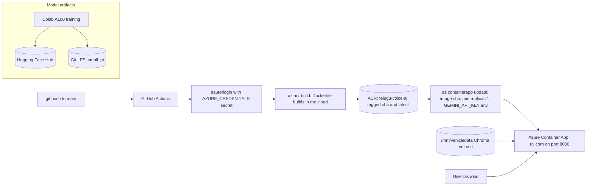

# 06.3 · Deployment & MLOps

> **Modality:** all · **Prereqs:** [06.2](02-serving-apis.md) · **Used in project:** ✅

## 1. First principles

Deployment turns "works on my machine" into "works reliably for users". The core principle is **reproducibility**: the same artifact (code + dependencies + model weights + config) must run identically in every environment.

| Concern | Tooling |
|---|---|
| Package the app | **Docker** image (pinned base, pinned deps, baked assets) |
| Store images | Container registry (**Azure ACR**, GHCR, ECR) |
| Run & scale | VM + systemd, **Azure Container Apps**, Kubernetes |
| Automate | CI/CD (**GitHub Actions**) |
| Expose securely | Reverse proxy (**Nginx**), TLS (**Let's Encrypt**) |
| Configure | Env vars + secret store (never in images or git) |
| Model artifacts | **Hugging Face Hub**, Git LFS, object storage |

**MLOps adds:** versioned data and models, reproducible training, evaluation gates before deploy, and monitoring for drift.

## 2. Diagram

## 3. Deep dive

- **Immutable image tags:** deploy by commit SHA, not `latest`, so rollbacks are exact.
- **Bake models into images** for startup speed and offline safety, at the cost of image size. Alternatively, mount them from a volume or pull from the HF Hub at startup (slower cold starts, network dependency).
- **Cold starts:** scale-to-zero platforms add model-load latency on the first request. `min-replicas 1` trades cost for latency.
- **Secrets:** inject at runtime from a secret store (GitHub secrets → Container App secrets / Key Vault). Plain `--set-env-vars` values are visible to anyone with read access to the app config.
- **TLS:** Let's Encrypt certificates via certbot with auto-renew. `nip.io` gives a hostname for a bare IP so certificates can be issued without buying a domain. Fine for demos, not for production branding or trust.
- **Process supervision on VMs:** a systemd unit with `Restart=always` survives crashes and reboots.

## 4. In our project

The repo shows **two generations** of deployment:

| | v1–v4 (README) | Current (in repo) |
|---|---|---|
| Compute | Azure VM Standard D2s v3, Ubuntu 24.04, South India | **Azure Container Apps** |
| Process | systemd (auto-restart on crash/reboot) | Container App replicas (`--min-replicas 1`) |
| Edge | Nginx + Let's Encrypt, `52.140.52.237.nip.io` | Container Apps ingress (managed TLS), `telugu-voice-app.gentletree-f4002f64.southindia.azurecontainerapps.io` |
| Deploy | Manual | **GitHub Actions on push to `main`** |

- **Dockerfile** ([`voice-assistant/Dockerfile`](https://github.com/SEVT-Logistics-Private-Limited/tiny-llm-jetson/blob/9a7b564c8d764d1eff92218261f2fd2cef99099e/voice-assistant/Dockerfile)):
  - `python:3.11-slim`, with pinned requirements (FastAPI 0.115.6, google-genai 2.23.0, sentence-transformers 3.3.1, chromadb 0.6.3, gTTS 2.5.3).
  - **Pre-downloads `multilingual-e5-small` at build time**, so RAG works under `TRANSFORMERS_OFFLINE=1`.
  - Serves the HTML from the path hard-coded in `api.py`.
- **CI/CD** ([`.github/workflows/deploy.yml`](https://github.com/SEVT-Logistics-Private-Limited/tiny-llm-jetson/blob/9a7b564c8d764d1eff92218261f2fd2cef99099e/.github/workflows/deploy.yml)):
  - `az acr build` (cloud build, no local Docker daemon) tags `:${{ github.sha }}` and `:latest`.
  - `az containerapp update` deploys the SHA tag and sets `GEMINI_API_KEY`.
  - `permissions: contents: read` (least privilege).
- **Model artifact strategy:**
  - Small checkpoints go in Git LFS (`*.pt filter=lfs`).
  - 3B+ checkpoints (6 GB+) go on Hugging Face `RishikUttejSasanala/*`, because they exceed GitHub LFS limits.
- **Training environment:** Colab Pro A100 with Google Drive checkpoints and resumable scripts.

## 5. Common pitfalls

- **No test or eval gate in CI:** every push to `main` deploys straight to production. Add a job that runs the CPU tests (`compression/test_*.py`) and an API smoke test (`/healthz`, one `/converse_text_stream` call) before `containerapp update`.
- **Secret passed as a plain env var** in `az containerapp update --set-env-vars GEMINI_API_KEY=...`. Store it as a Container App *secret* (`secretref:`) or in Key Vault.
- **Hard-coded paths** (`/home/azureuser/telugu_assistant.html`, `/mnt/vehicledata`) couple the code to one host layout. Make them env-configurable.
- **The RAG volume isn't provisioned by IaC:** a fresh environment silently runs with `kb: disabled`. **This happened:** the Container Apps deployment reported `"kb": "disabled"` on 2026-11-11. Declare the volume (Azure Files) in Bicep/Terraform and fail readiness if the KB is required.
- **Image bloat:** sentence-transformers pulls full PyTorch (with CUDA wheels by default). For a CPU container, install the CPU torch wheel to cut GBs.
- **LFS pointer surprises:** cloning without LFS gives ~130-byte pointer files instead of weights. Several `.pt` files in the repo are pointers. Document how to fetch them.

## 6. References
- Azure Container Apps docs (revisions, secrets, scaling). GitHub Actions `azure/login`.
- Let's Encrypt / certbot. Hugging Face Hub docs.
