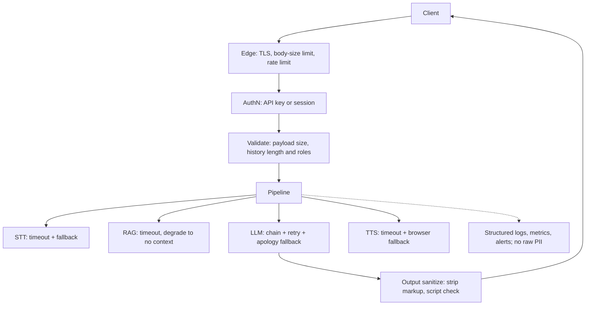

# 06.4 · Reliability & Security for AI Systems

> **Modality:** all · **Prereqs:** [06.2](02-serving-apis.md), [06.3](03-deployment-mlops.md), [01.8](../01-text/08-prompt-engineering.md) · **Used in project:** ✅

## 1. First principles

AI systems inherit every classic web risk and add new ones. The model is a **non-deterministic, externally-controlled dependency**, and natural-language input is an **attack surface**.

**Reliability:** a system is only as available as its weakest serial dependency. In a cascaded voice agent (STT, RAG, LLM, TTS, all external) availability multiplies: 0.99⁴ ≈ 0.96. Every dependency needs a timeout, a fallback and a degraded mode.

**Security (OWASP Top 10 for LLM apps, condensed):**
| Risk | Example |
|---|---|
| Prompt injection (direct/indirect) | User or retrieved text says "ignore your instructions…" |
| Sensitive data exposure | Logs or traces contain voice and PII. Errors leak internals. |
| Insecure output handling | LLM output rendered as HTML (XSS) or executed |
| Unbounded consumption | Large payloads or long histories increase cost and cause DoS |
| Supply chain | Unpinned models or packages, downloads at runtime |

## 2. Diagram

## 3. Deep dive

- **Timeouts everywhere:** client (`AbortSignal.timeout`), server-to-vendor, and an overall request deadline. Without them, one hung dependency exhausts all workers.
- **Graceful degradation ladder** for voice: full answer → answer without RAG → canned apology in Telugu → client-side TTS. Never just fail silently.
- **Prompt injection defenses:**
  - Delimit untrusted content.
  - Never give the LLM privileged tools without allow-lists.
  - Treat model output as untrusted (escape before rendering).
  - Keep authoritative state (history, user identity) server-side.
- **Cost controls:** per-IP/user rate limits, `max_tokens`, history caps, payload caps, budget alerts.
- **Privacy:** voice is biometric-adjacent personal data. Minimize retention, disclose third-party processing, and consider data residency (India's DPDP Act).

## 4. In our project

**What's done well**
- Multi-layer fallbacks:
  - LLM model chain + retry, then a Telugu apology string ([`api.py#L71-L99`](https://github.com/SEVT-Logistics-Private-Limited/tiny-llm-jetson/blob/9a7b564c8d764d1eff92218261f2fd2cef99099e/voice-assistant/api.py#L71-L99), [`#L214-L237`](https://github.com/SEVT-Logistics-Private-Limited/tiny-llm-jetson/blob/9a7b564c8d764d1eff92218261f2fd2cef99099e/voice-assistant/api.py#L214-L237)).
  - gTTS with TLD retry and a 15 s timeout, then browser TTS.
  - Web Speech API, then server STT.
- RAG degrades to "disabled" instead of crashing startup.
- v10 returns generic 500s (no `str(e)` leakage, unlike v8) and logs tracebacks server-side.
- Client timeouts on every fetch (12–45 s).
- Output sanitization before TTS (`clean_for_tts`).
- Pinned dependencies, embedding model baked into the image, `TRANSFORMERS_OFFLINE=1`.
- TLS via Let's Encrypt (VM era) / Container Apps ingress. CI uses least-privilege `contents: read`.

**Review findings (prioritized)**

| # | Severity | Finding | Fix |
|---|---|---|---|
| 1 | High | **No authentication or rate limiting** on any endpoint. Anyone can drive Gemini spend via `/converse_*`, `/tts`, `/debug`. | API key or session token. Per-IP rate limit at Nginx/ingress. |
| 2 | High | **`/debug` is public.** Each call fires ~9 LLM requests + 3 TTS calls and reveals model names and SDK versions. | Remove, or protect with an admin key. |
| 3 | Medium | **`CORSMiddleware(allow_origins=["*"])`.** Any website can call the API from a visitor's browser. | Restrict to the assistant's origin. |
| 4 | Medium | **Client-supplied `history`** with arbitrary roles allows fake assistant turns (prompt injection) and unbounded payloads. | Validate roles and length, or keep history server-side. |
| 5 | Medium | **No payload size limits** on `audio_base64` / `text`. | Nginx `client_max_body_size` + Pydantic `max_length`. |
| 6 | Medium | **Secret passed as a plain env var** in the deploy workflow. | Container Apps secret / Key Vault reference. |
| 7 | Low | **Silent exception swallowing** in `retrieve_manual_context`. RAG outages are invisible. | Log + metric. |
| 8 | Low | **Worst-case TTS latency of 30 s** (2 × 15 s gTTS attempts). | Lower the per-attempt timeout, or switch to a supported TTS with an SLA. |

## 5. Common pitfalls

- **"It's just a demo" APIs going viral:** unauthenticated LLM endpoints get scraped and abused within days.
- **Logging full prompts and transcripts** into third-party log tools creates a PII leak. Redact, or sample with consent.
- **Retry storms:** retrying every failure on every layer multiplies load during an outage. Retry once, with jitter, at one layer.
- **Trusting vendor model names to be stable:** deprecations break fallback chains. Monitor which model actually served each request.
- **Rendering model output with `innerHTML`:** XSS if the model echoes attacker text. Use `textContent`.

## 6. References
- OWASP Top 10 for Large Language Model Applications.
- Google SRE Book: *Handling Overload*, *Addressing Cascading Failures*.
- Digital Personal Data Protection Act, 2023 (India).
