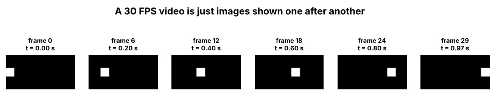

# 6. Video

> A video is a collection of images played continuously.

## Introduction

If you understand images, you already understand most of video. A video is simply many images shown one after another, fast enough that our eyes see movement.

## What is it?

**Video** is a **collection of images (frames) played continuously**.

| Term | Meaning |
|---|---|
| Image | One photograph |
| Frame | One image inside a video |
| Pixel | One tiny square of an image (images are made of millions of them) |
| Video | A collection of frames played continuously |

## Why is it needed?

Understanding how video is stored explains why videos are so large, and why video needs a GPU.

## How does it work?

### How is a video stored inside a computer?

A video is broken down into frames, each frame into pixels, and each pixel into RGB values. So in the end, a video is just numbers.



## Flow diagram

```text
Video
  ↓
Frames
  ↓
Pixels
  ↓
RGB values
```

## Real-world use cases

- YouTube, Netflix and other streaming
- CCTV and security cameras
- Video calls
- Self-driving cars (cameras record video all the time)

## Key takeaways

- Video = a collection of frames played continuously.
- Video → frames → pixels → RGB values.

---

**Previous:** [← Image Resolution](05-image-resolution.md) · [Home](../README.md) · **Next:** [Frame →](07-frame.md)
