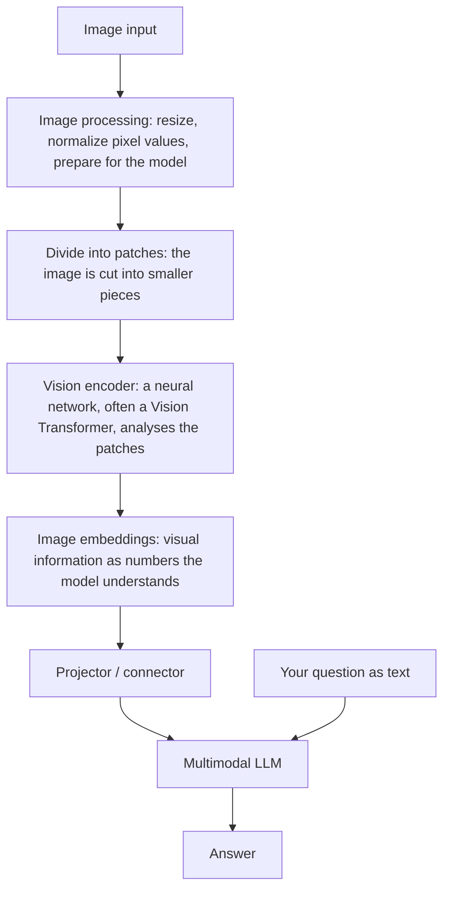
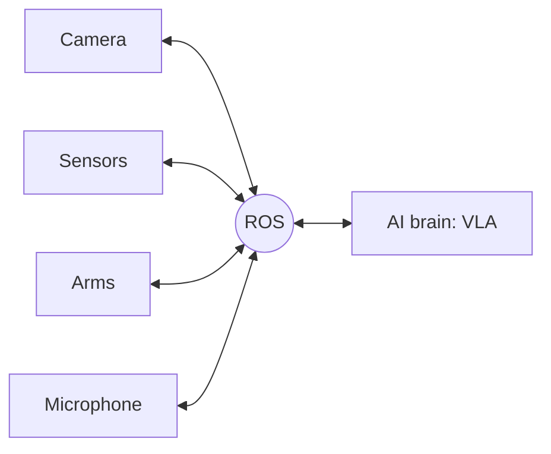

# 6. Vision, Language and Action (VLM, VLA, ROS)

[← Back to contents](../README.md)

> Builds on [chapter 3 (Text and LLMs)](03-text-and-llms.md) and [chapter 4 (Images)](04-images.md).

---

## The family at a glance

| Name | What it does |
|---|---|
| **NLP** | Understands human language |
| **LLM** | Understands and generates language using a trained model |
| **VLM** | Understands **images and text**, and generates text responses |
| **VLA** | Connects **vision, language and physical actions** |
| **ROS** | Connects and coordinates **robot software and hardware** |

---

## VLM (Vision Language Model)

A VLM is an AI model that can **understand visual information and connect it with human language**. It **sees and understands**.

If you give it an image and ask a question, it analyses (reads) the image and answers in our language.

**Where are VLMs used?**
1. Self-driving cars
2. Robotics and automation
3. Healthcare

A VLM is a **multimodal AI system**: it can process and respond to both **images (vision)** and **text (language)**.

### LLM vs VLM

| | Input | Output |
|---|---|---|
| **LLM** | Text | Text |
| **VLM** | Image + text | Text |

### How does a VLM read an image?

Compare this with [how an LLM reads text](03-text-and-llms.md#1-how-does-an-llm-read-text):

| Text (LLM) | Image (VLM) |
|---|---|
| Split text into **tokens** | Split image into **patches** |
| Tokens → **embeddings** | Patches → **image embeddings** (vision encoder) |
| Transformer processes embeddings | Projector connects image embeddings to the LLM, which processes them with the text |

Both end up as **embeddings (numbers)** going into a Transformer.

---

## VLA (Vision Language Action)

A VLA helps **AI-powered robots understand their surroundings, follow instructions and perform physical actions**.

> **Sees → Understands → Acts**
>
> Vision + Language + Action

**Example:** you tell a robot "Pick up the red bottle." The VLA:
1. Sees the bottle using a camera
2. Understands the instruction
3. Determines the required movement
4. Generates the action, and the robot picks it up

### VLM vs VLA

| VLM | VLA |
|---|---|
| Vision Language **Model** | Vision Language **Action** |
| Understands images and language | Connects vision and language **to action** |
| Describes and answers questions | Helps control **physical actions** |
| Image question answering | Robotic manipulation |
| Show it a red bottle → "I can see a red bottle on the table" | Sees the red bottle, understands "pick it", generates actions and **picks it up** |
| Only says what it sees, takes no action | **Sees, understands and acts** |
| **VLM = sees and understands** | **VLA = sees, understands and acts** |

---

## ROS (Robot Operating System)

ROS is a **robotics software framework** that provides **tools and communication mechanisms to build and control robots**.

Imagine you're building a robot. It has:
- Camera
- Sensors
- Arms
- Microphone

All of these need to **communicate with each other**. ROS helps **connect, communicate between and coordinate** these components.

**In my project:** none of these are used yet. They're next steps for robotics.

---

## Remember

- VLM = image + text in, text out. It **sees and understands**.
- VLM path: image → patches → vision encoder → image embeddings → projector → LLM → answer.
- VLA = VLM + **action**. It **sees, understands and acts**.
- ROS = the "nervous system" connecting a robot's parts.
