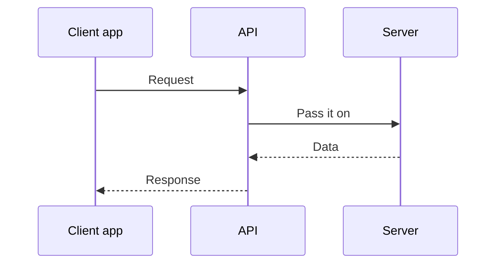
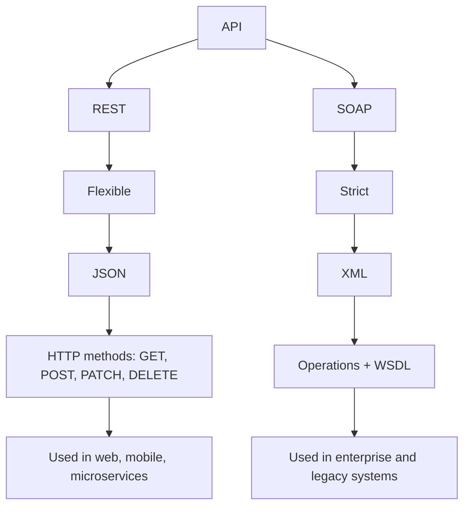

# 7. APIs

[← Back to contents](../README.md)

---

## What is an API?

**API** stands for **Application Programming Interface**. It's a **medium (contract) that lets two software systems communicate**.

You **send a request → to the API → and get a response**.

---

## Types of APIs

1. **REST** (Representational State Transfer): uses HTTP
2. **SOAP** (Simple Object Access Protocol): uses XML
3. **GraphQL**
4. **WebSocket**
5. **Webhooks**

---

## 1. REST API

A REST API is a medium between two software systems to communicate **over HTTP**.

- Simple and flexible
- Follows REST principles and usually communicates over HTTP
- Usually sends data as **JSON**

### REST methods

| Method | Does |
|---|---|
| **GET** | Get (read) data |
| **POST** | Create data |
| **PUT** | Update data |
| **DELETE** | Delete data |

(There's also **PATCH**, for updating part of the data.)

---

## 2. SOAP API

**SOAP** (Simple Object Access Protocol) is **structured and strict**.

- SOAP is a protocol applications use to communicate with each other over a network.
- It uses **formatted XML messages**.
- Unlike REST's GET/POST/PUT/DELETE, SOAP uses **"operations" (functions)**, described in a **WSDL** file.

---

## REST vs SOAP

| | REST | SOAP |
|---|---|---|
| Style | Flexible | Strict |
| Data format | JSON | XML |
| How you call it | HTTP methods (GET / POST / PUT / PATCH / DELETE) | Operations + WSDL |
| Used in | Web, mobile, microservices | Enterprise and legacy systems |

---

## In my project

My Telugu voice assistant **is** a REST API, built with **FastAPI** in Python. Some of its endpoints:

| Method | Endpoint | Does |
|---|---|---|
| GET | `/assistant` | Opens the voice assistant web page |
| GET | `/healthz` | Checks the server is alive |
| POST | `/tts` | Text → Telugu speech |
| POST | `/converse` | Your voice + chat history → answer as text and audio |
| POST | `/converse_text_stream` | Your text → answer, streamed back step by step |

- Try it: [API docs](https://telugu-voice-app.gentletree-f4002f64.southindia.azurecontainerapps.io/docs)
- Code: [`voice-assistant/api.py`](https://github.com/SEVT-Logistics-Private-Limited/tiny-llm-jetson/blob/main/voice-assistant/api.py)

---

## Remember

- API = a way for two systems to talk: request → response.
- REST = flexible, JSON, HTTP methods. Used for web, mobile and microservices.
- SOAP = strict, XML, operations + WSDL. Used for enterprise and legacy systems.
- Others: GraphQL, WebSocket, Webhooks.
