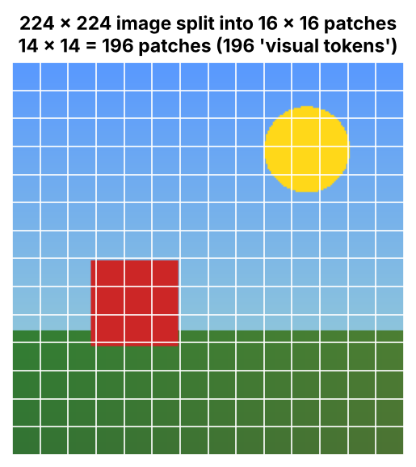

# 10. VLM (Vision Language Model)

> A VLM is an AI model that can understand visual information and connect it with human language. It sees and understands.

## Introduction

An LLM only works with text. A VLM adds **eyes**: you can show it an image and ask questions about it.

## What is it?

A **VLM (Vision Language Model)** is an AI model that can **understand visual information and connect it with human language**. It **sees and understands**.

If you give it an image and ask a question, it analyses (reads) the image and gives the answer in our language.

A VLM is a **multimodal AI system**: it can process and respond to both **images (vision)** and **text (language)**.

| | Input | Output |
|---|---|---|
| LLM | Text | Text |
| VLM | Image + text | Text |

## Why is it needed?

Many real-world questions are visual: "What's in this photo?" or "Is this road clear?". A VLM can answer them.

## How does it work?

### How does a VLM read an image?

1. **Image input**
2. **Image processing:** resize the image, normalise the pixel values, prepare it for the model
3. **Divide into patches:** the image is divided into smaller pieces
4. **Vision encoder:** a neural network (often a Vision Transformer) analyses the patches
5. **Image embeddings:** convert the visual information into numbers the model understands
6. **Language model:** uses the image embeddings to answer the question



## Flow diagram

```text
Image input
    ↓
Image processing (resize, normalise, prepare)
    ↓
Divide into patches
    ↓
Vision encoder
    ↓
Image embeddings
    ↓
Language model
    ↓
Answer
```

Short version:

```text
Image → Vision encoder → Projector / connector → Multimodal LLM → Answer
```

## Real-world use cases

1. Self-driving cars
2. Robotics and automation
3. Healthcare

## In our project

**Not used yet.** Our project works with voice and text only, so it doesn't process images yet.

The LLM we use (Gemini) can also accept images, so adding photo questions later would mean sending the image along with the question.

---

**Previous:** [← NLP](09-nlp.md) · [Home](../README.md) · **Next:** [VLA →](11-vla.md)
