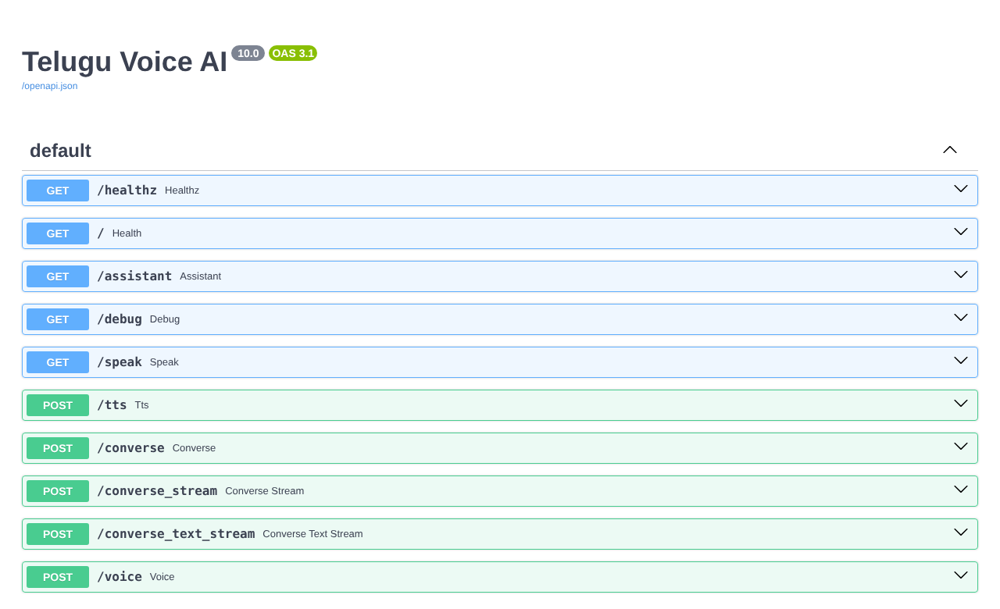

# 16. FastAPI

> FastAPI is a Python framework for building REST APIs quickly.

## Introduction

Once you understand what an [API](15-api.md) is, the next question is how to build one. In Python, a popular choice is **FastAPI**. It's what my voice assistant is built with.

## What is it?

**FastAPI** is a **Python web framework for building APIs**. You write normal Python functions, and FastAPI turns them into API endpoints that other apps can call over HTTP.

## Why is it needed?

- **Fast to build:** a few lines of Python give you a working API
- **Automatic documentation:** every FastAPI app gets an interactive docs page at `/docs`
- **Input checking:** it checks that requests contain the right data before your code runs
- Popular for serving **AI models**

## How does it work?

1. You write a Python function.
2. You attach it to a URL and an HTTP method (GET, POST, …).
3. FastAPI receives the request, checks the data, runs your function, and sends the response back (usually as JSON).

## Flow diagram

```text
Client sends request (e.g. POST /tts)
            ↓
         FastAPI
            ↓
   Checks the request data
            ↓
   Runs your Python function
            ↓
  Sends the response (JSON)
            ↓
     Client gets the answer
```

## Real-world use cases

- Serving AI and machine learning models as APIs
- Back ends for web and mobile apps
- Microservices

**In my project:** the Telugu voice assistant is a FastAPI app ([`voice-assistant/api.py`](https://github.com/SEVT-Logistics-Private-Limited/tiny-llm-jetson/blob/main/voice-assistant/api.py)). Some of its endpoints:

| Method | Endpoint | What it does |
|---|---|---|
| GET | `/healthz` | Checks the server is running |
| GET | `/assistant` | Opens the voice assistant web page |
| POST | `/tts` | Text → Telugu speech |
| POST | `/converse` | Your voice → answer as text and audio |
| POST | `/converse_text_stream` | Your text → answer, sent back step by step |

FastAPI automatically created this docs page for it ([live `/docs`](https://telugu-voice-app.gentletree-f4002f64.southindia.azurecontainerapps.io/docs)):



## Key takeaways

- FastAPI is a Python framework for building APIs.
- Python function + URL + method = an API endpoint.
- It gives you automatic docs at `/docs`.

---

**Previous:** [← API](15-api.md) · [Home](../README.md) · **Next:** [ML →](17-ml.md)
