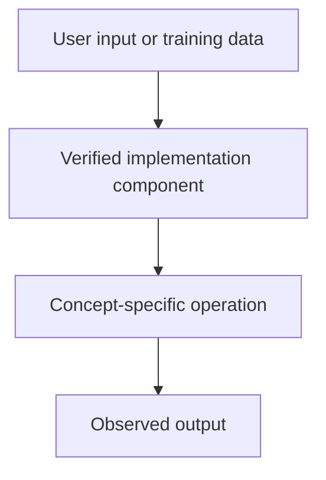

# Telugu Voice Assistant — Prompting, Context Construction and Decoding Controls

## Linked concept
[TXT-230 — Prompting, Context Construction and Decoding Controls](../../concepts/text/230-prompting-context-and-decoding-controls.md)

## Problem
TODO: supply the actual problem or engineering requirement. Do not infer missing context.

## Architecture
The inspected telugu_voice_api.py constructs a Telugu system instruction, creates role-tagged conversation messages and passes system instructions and contents to the Google Gemini SDK. This verifies prompt/context assembly in that API path. The user's exact contribution remains TODO.

## My exact contribution
TODO: supply your personal design, code, configuration, testing and debugging contributions, separate from team work.

## Stack
Confirmed in inspected API file: Python, FastAPI and Google GenAI SDK. TODO: supply versions and exact runtime.

## Decisions & tradeoffs
TODO: supply decisions, alternatives considered and personal rationale.

## Results/metrics
TODO: supply measured outcomes, method, sample size, environment, units and date. If none, state none.

## What failed
TODO: supply failures, root causes and debugging evidence.

## What I'd change
TODO: supply improvements and rationale.

## Evidence links
- [Source file](https://github.com/SEVT-Logistics-Private-Limited/tiny-llm-jetson/blob/main/telugu_voice_api.py)

## Link back
[Return to TXT-230 — Prompting, Context Construction and Decoding Controls](../../concepts/text/230-prompting-context-and-decoding-controls.md)