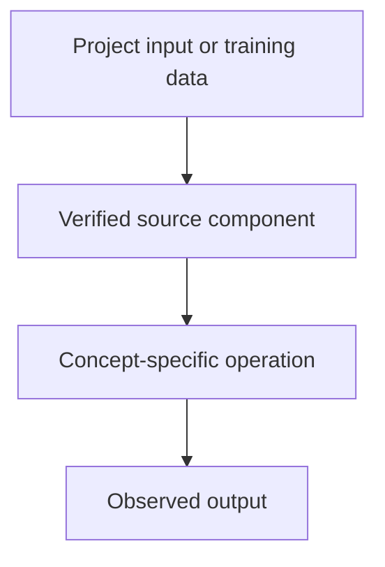

# Telugu Voice Assistant — Retrieval-Augmented Generation (RAG) Fundamentals

## Linked concept
[TXT-280 — Retrieval-Augmented Generation (RAG) Fundamentals](../../concepts/text/280-rag-fundamentals.md)

## Problem
TODO: supply the real project requirement or engineering problem. Do not infer missing context.

## Architecture
The Tiny LLM repository README states that the Telugu voice assistant provides RAG answers grounded in vehicle manuals. The inspected telugu_voice_api.py does not reveal the document parsing, index, retriever or retrieval call. Implementation details and exact personal contribution therefore remain unverified. TODO: supply the RAG source files, architecture and tests.

## My exact contribution
TODO: supply what you personally designed, coded, configured, tested, debugged or operated. Separate your work from team work.

## Stack
Project README describes voice-assistant/RAG use cases; implementation stack and retrieval components require verification. TODO: supply exact stack and files.

## Decisions & tradeoffs
TODO: supply decisions, alternatives, rationale and tradeoffs.

## Results/metrics
TODO: supply measured outcomes, method, sample size, environment, units and date. If none, state none.

## What failed
TODO: supply failures, limitations and root causes. Do not invent.

## What I'd change
TODO: supply concrete improvements and why.

## Evidence links
- [Project reference](https://github.com/SEVT-Logistics-Private-Limited/tiny-llm-jetson#readme)
- Test commands and reproducible outputs: TODO: supply.

## Link back
[Return to TXT-280 — Retrieval-Augmented Generation (RAG) Fundamentals](../../concepts/text/280-rag-fundamentals.md)