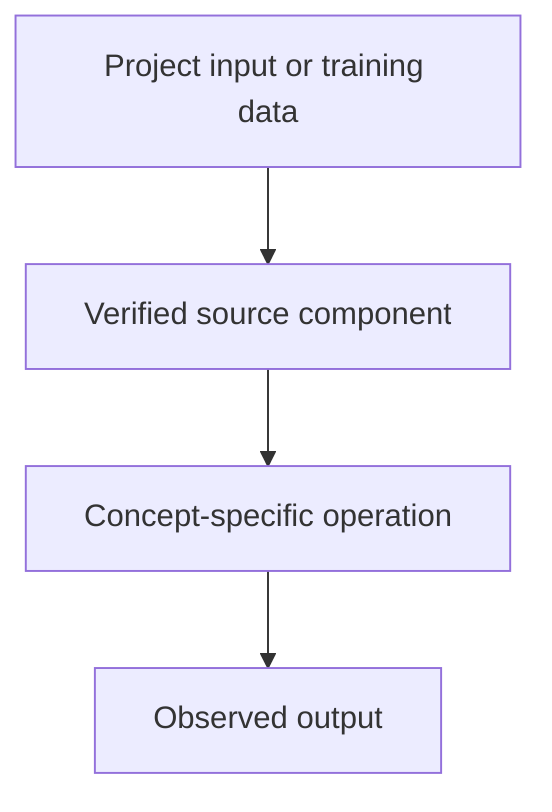

# Tiny GPT — Jetson + Colab — LLM Evaluation, Hallucinations and Grounding

## Linked concept
[TXT-270 — LLM Evaluation, Hallucinations and Grounding](../../concepts/text/270-llm-evaluation-hallucinations-and-grounding.md)

## Problem
TODO: supply the real project requirement or engineering problem. Do not infer missing context.

## Architecture
The repository includes test_tiny_llm.py, which loads a saved checkpoint and generates text from seed strings; model cards also record training loss and sample outputs. This supports basic checkpoint/generation testing, not a comprehensive benchmark or human-evaluated LLM quality study. TODO: supply your own evaluation protocol and outcomes.

## My exact contribution
TODO: supply what you personally designed, coded, configured, tested, debugged or operated. Separate your work from team work.

## Stack
Confirmed in inspected source: Python and PyTorch. TODO: supply exact versions, runtime and hardware.

## Decisions & tradeoffs
TODO: supply decisions, alternatives, rationale and tradeoffs.

## Results/metrics
TODO: supply measured outcomes, method, sample size, environment, units and date. If none, state none.

## What failed
TODO: supply failures, limitations and root causes. Do not invent.

## What I'd change
TODO: supply concrete improvements and why.

## Evidence links
- [Project reference](https://github.com/SEVT-Logistics-Private-Limited/tiny-llm-jetson/blob/main/test_tiny_llm.py)
- Test commands and reproducible outputs: TODO: supply.

## Link back
[Return to TXT-270 — LLM Evaluation, Hallucinations and Grounding](../../concepts/text/270-llm-evaluation-hallucinations-and-grounding.md)