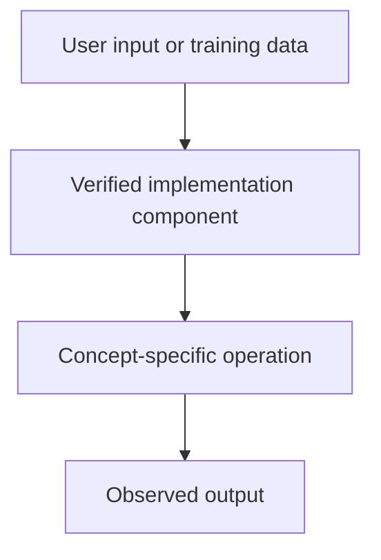

# Tiny GPT — Jetson + Colab — LLM Pretraining and Inference

## Linked concept
[TXT-220 — LLM Pretraining and Inference](../../concepts/text/220-llm-pretraining-and-inference.md)

## Problem
TODO: supply the actual problem or engineering requirement. Do not infer missing context.

## Architecture
The inspected tiny_llm.py constructs a GPT-style character model from scratch, trains it with cross-entropy loss and AdamW, saves a checkpoint and includes autoregressive generation. The reported run uses a repeated short English corpus and is an educational experiment, not evidence of general-purpose web-scale LLM pretraining.

## My exact contribution
TODO: supply your personal design, code, configuration, testing and debugging contributions, separate from team work.

## Stack
Confirmed in inspected source: Python and PyTorch. TODO: supply versions and exact runtime.

## Decisions & tradeoffs
TODO: supply decisions, alternatives considered and personal rationale.

## Results/metrics
TODO: supply measured outcomes, method, sample size, environment, units and date. If none, state none.

## What failed
TODO: supply failures, root causes and debugging evidence.

## What I'd change
TODO: supply improvements and rationale.

## Evidence links
- [Source file](https://github.com/SEVT-Logistics-Private-Limited/tiny-llm-jetson/blob/main/tiny_llm.py)

## Link back
[Return to TXT-220 — LLM Pretraining and Inference](../../concepts/text/220-llm-pretraining-and-inference.md)