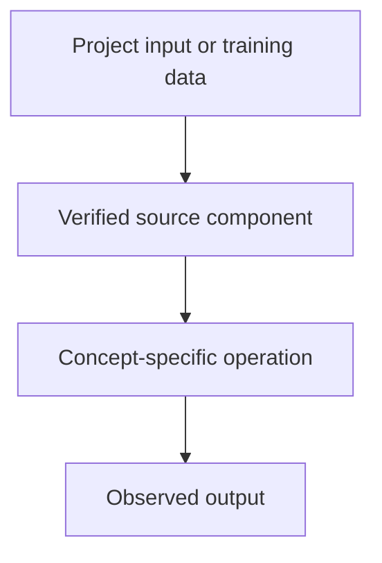

# Tiny GPT — Jetson + Colab — Quantization, Pruning and Knowledge Distillation

## Linked concept
[TXT-260 — Quantization, Pruning and Knowledge Distillation](../../concepts/text/260-quantization-pruning-distillation.md)

## Problem
TODO: supply the real project requirement or engineering problem. Do not infer missing context.

## Architecture
The Tiny LLM repository includes a compression directory and README documenting planned 4-bit and ternary compression workflows. This is evidence that compression is explored/documented in the project, not proof that a compressed model was successfully deployed or that the reported quality is independently reproduced. TODO: supply the exact run, code, outputs and your contribution.

## My exact contribution
TODO: supply what you personally designed, coded, configured, tested, debugged or operated. Separate your work from team work.

## Stack
Confirmed in inspected source: Python and PyTorch. TODO: supply exact versions, runtime and hardware.

## Decisions & tradeoffs
TODO: supply decisions, alternatives, rationale and tradeoffs.

## Results/metrics
TODO: supply measured outcomes, method, sample size, environment, units and date. If none, state none.

## What failed
TODO: supply failures, limitations and root causes. Do not invent.

## What I'd change
TODO: supply concrete improvements and why.

## Evidence links
- [Project reference](https://github.com/SEVT-Logistics-Private-Limited/tiny-llm-jetson/tree/main/compression)
- Test commands and reproducible outputs: TODO: supply.

## Link back
[Return to TXT-260 — Quantization, Pruning and Knowledge Distillation](../../concepts/text/260-quantization-pruning-distillation.md)